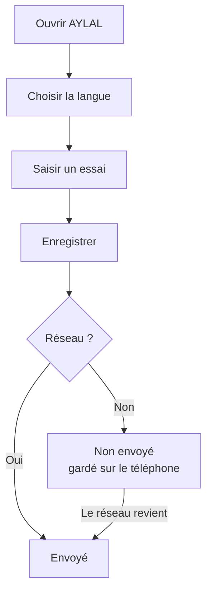

# أيلال: دليل الفلاح (الأساسيات)

> **ما يعمل اليوم**: الشاشة الرئيسية، اختيار اللغة، زر «استمع»، شريط «غير متصل»، وشاشة «تجربة جديدة».
> **ما يأتي لاحقا**: إنشاء حسابك ومزرعتك (بدونه لا يحفظ التطبيق العمومي أي تجربة)، خريطة قطعك والعرض التجريبي (في نسخ الاختبار فقط)، تنبيه «الهاتف شبه ممتلئ»، شاشة حل التعارض، وزر «إعادة المحاولة» الذي لا يعمل بعد. يفتح أيلال دائما بالفرنسية: اختيار اللغة لا يُحفظ بعد.

## 1. فائدة التطبيق
يفتح أيلال بلغتك: الدارجة أو العربية أو الفرنسية. تسجل تجاربك حتى بدون شبكة (ريزو). يرسل الهاتف كل شيء عندما تعود الشبكة.

## 2. ما تحتاجه قبل البدء
- هاتف أندرويد فيه أيلال.
- لا شيء آخر. الشبكة ليست ضرورية.

**جاهز الآن**: الشاشة الرئيسية، اللغات الثلاث، شاشة «تجربة جديدة».

**غير جاهز بعد**: خريطة قطعك، الحساب، أدوات المزرعة الحقيقية. انظر الإطار في الأعلى.

## 3. خطوة بخطوة
1. افتح أيلال. تظهر شاشة «مرحبا بك في أيلال».
2. يفتح أيلال بالفرنسية. لتغيير اللغة اختر لغتك: «الدارجة (عربي)» أو «الدارجة (لاتيني)» أو «العربية» أو «الفرنسية».
3. اضغط «استمع» لتسمع العنوان.
4. اضغط «تسجيل تجربة».
5. املأ «العنوان» و«ملاحظة» و«الكمية».
6. اضغط «حفظ».
7. انظر إلى العلامة على تجربتك. «لم يرسل بعد» تعني: محفوظة في الهاتف.
8. انتظر عودة الشبكة. تصبح العلامة «تم الإرسال». لا تفعل شيئا.

## 4. المسار بالصورة

## 5. أسئلة متكررة
**ما كاينش ريزو. واش نخسر المعلومات؟**
لا. تبقى في الهاتف. يظهر شريط: «غير متصل: بياناتك محفوظة على الهاتف».

**واش خاصني نضغط باش نصيفط؟**
لا. الإرسال يتم وحده عند عودة الشبكة.

**واش نقدر نبدل اللغة؟**
نعم، في أي وقت، بأزرار اللغة في الشاشة الرئيسية. حاليا يفتح أيلال دائما بالفرنسية، حتى لو كانت لغة هاتفك غير ذلك.

**هاتفان عدلا نفس التجربة. ماذا يحدث؟**
لا يضيع شيء بصمت. ترى «تعارض يجب مراجعته».

**واش معلوماتي محمية؟**
نعم. هي مشفرة في الهاتف وأثناء الإرسال.

## 6. إذا لم ينجح الأمر
- **بدون شبكة**: واصل العمل. سيُرسل كل شيء لاحقا.
- **«حدثت مشكلة»**: اقرأ «تحقق من اتصالك ثم أعد المحاولة». زر «إعادة المحاولة» لا يعمل بعد.
- **«لا توجد بيانات حاليا»**: هذا عادي الآن. زر «إضافة تجربة» لا يعمل بعد، استعمل «تسجيل تجربة».
- **«تعارض يجب مراجعته»**: تظهر العلامة، لكن شاشة اختيار النسخة الصحيحة تأتي لاحقا. لا يضيع شيء.
- **الهاتف شبه ممتلئ**: التنبيه على الشاشة يأتي لاحقا. اترك مكانا فارغا.
- **ضاع الهاتف قبل الإرسال**: تبقى «لم يرسل بعد» ظاهرة ما دام الخادم لم يستلم شيئا.
