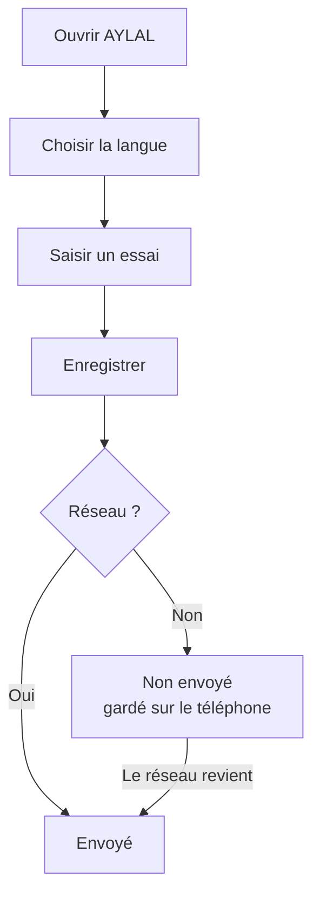

# أيلال: دليل الفلاح (الأساسيات)

## 1. فائدة التطبيق
يفتح أيلال بلغتك: الدارجة أو العربية أو الفرنسية. تسجل تجاربك حتى بدون شبكة (ريزو). يرسل الهاتف كل شيء عندما تعود الشبكة.

## 2. ما تحتاجه قبل البدء
- هاتف أندرويد فيه أيلال.
- لا شيء آخر. الشبكة ليست ضرورية.

**جاهز الآن**: الشاشة الرئيسية، اللغات الثلاث، تسجيل تجربة، الإرسال التلقائي.

**غير جاهز بعد**: خريطة قطعك (الصفحة موجودة لكنها فارغة). أدوات المزرعة الحقيقية تأتي لاحقا.

## 3. خطوة بخطوة
1. افتح أيلال. تظهر شاشة «مرحبا بك في أيلال».
2. اختر لغتك: «الدارجة (عربي)» أو «الدارجة (لاتيني)» أو «العربية» أو «الفرنسية».
3. اضغط «استمع» لتسمع النص.
4. اضغط «تسجيل تجربة».
5. املأ «العنوان» و«ملاحظة» و«الكمية».
6. اضغط «حفظ».
7. انظر إلى العلامة على تجربتك. «لم يرسل بعد» تعني: محفوظة في الهاتف.
8. انتظر عودة الشبكة. تصبح العلامة «تم الإرسال». لا تفعل شيئا.

## 4. المسار بالصورة

## 5. أسئلة متكررة
**ما كاينش ريزو. واش نخسر المعلومات؟**
لا. تبقى في الهاتف. يظهر شريط: «غير متصل: بياناتك محفوظة على الهاتف».

**واش خاصني نضغط باش نصيفط؟**
لا. الإرسال يتم وحده عند عودة الشبكة.

**واش نقدر نبدل اللغة؟**
نعم، في أي وقت. إذا كانت لغة هاتفك غير ذلك، يفتح أيلال بالفرنسية.

**هاتفان عدلا نفس التجربة. ماذا يحدث؟**
لا يضيع شيء بصمت. ترى «تعارض يجب مراجعته».

**واش معلوماتي محمية؟**
نعم. هي مشفرة في الهاتف وأثناء الإرسال.

## 6. إذا لم ينجح الأمر
- **بدون شبكة**: واصل العمل. سيُرسل كل شيء لاحقا.
- **«حدثت مشكلة»**: اقرأ «تحقق من اتصالك ثم أعد المحاولة». اضغط «إعادة المحاولة».
- **«لا توجد بيانات حاليا»**: اضغط «إضافة تجربة».
- **«تعارض يجب مراجعته»**: افتح التجربة واختر النسخة الصحيحة.
- **الهاتف شبه ممتلئ**: ينبهك أيلال قبل ضياع أي تسجيل. فرّغ مكانا.
- **ضاع الهاتف قبل الإرسال**: تبقى «لم يرسل بعد» ظاهرة ما دام الخادم لم يستلم شيئا.
