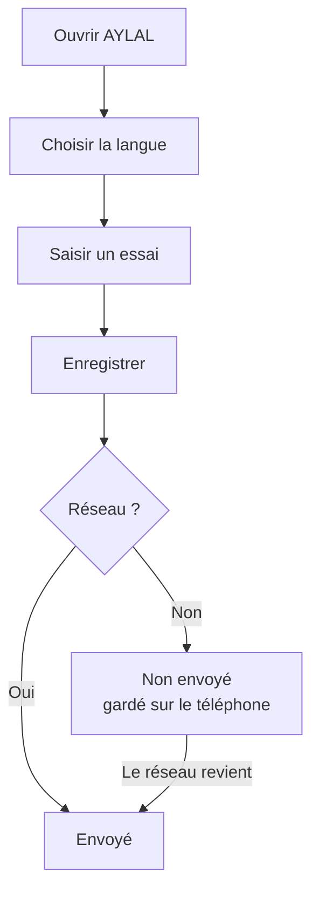

# AYLAL : guide de l'agriculteur (fondations)

## 1. À quoi ça sert
AYLAL s'ouvre dans votre langue : darija, arabe ou français. Vous notez vos essais, même sans réseau. Le téléphone envoie tout quand le réseau revient.

## 2. Ce qu'il faut avant de commencer
- Un téléphone Android avec AYLAL installée.
- Rien d'autre. Le réseau n'est pas obligatoire.

**Déjà prêt** : l'écran d'accueil, les 3 langues, la saisie d'un essai, l'envoi automatique.

**Pas encore prêt** : la carte de vos parcelles (la page existe, mais elle est vide). Les vrais outils de la ferme arrivent plus tard.

## 3. Pas à pas
1. Ouvrez AYLAL. L'écran « Bienvenue sur AYLAL » s'affiche.
2. Choisissez votre langue : « Darija (arabe) », « Darija (latin) », « Arabe » ou « Français ».
3. Appuyez sur « Écouter » pour entendre le texte lu.
4. Appuyez sur « Saisir un essai ».
5. Remplissez « Titre », « Note » et « Quantité ».
6. Appuyez sur « Enregistrer ».
7. Regardez l'étiquette sur votre essai. « Non envoyé » veut dire : gardé sur le téléphone.
8. Attendez le réseau. L'étiquette devient « Envoyé ». Vous ne faites rien.

## 4. Parcours en image

## 5. Questions fréquentes
**Je n'ai pas de réseau. Je perds mes données ?**
Non. Elles restent sur le téléphone. Un bandeau le dit : « Hors ligne : vos données sont enregistrées sur le téléphone ».

**Je dois appuyer pour envoyer ?**
Non. L'envoi se fait seul au retour du réseau.

**Je peux changer de langue plus tard ?**
Oui, à tout moment. Si votre téléphone parle une autre langue, AYLAL s'ouvre en français.

**Deux téléphones changent le même essai. Que se passe-t-il ?**
Rien n'est perdu en silence. Vous voyez « Conflit à vérifier ».

**Mes données sont-elles protégées ?**
Oui. Elles sont chiffrées sur le téléphone et pendant l'envoi.

## 6. Si ça ne marche pas
- **Hors ligne** : continuez à travailler. Tout sera envoyé plus tard.
- **« Un problème est survenu »** : lisez « Vérifiez votre connexion puis réessayez ». Appuyez sur « Réessayer ».
- **« Aucune donnée pour le moment »** : appuyez sur « Ajouter un essai ».
- **« Conflit à vérifier »** : ouvrez l'essai et choisissez la bonne version.
- **Téléphone presque plein** : AYLAL vous prévient avant de perdre une saisie. Libérez de la place.
- **Téléphone perdu avant l'envoi** : « Non envoyé » reste affiché tant que le serveur n'a rien reçu.
