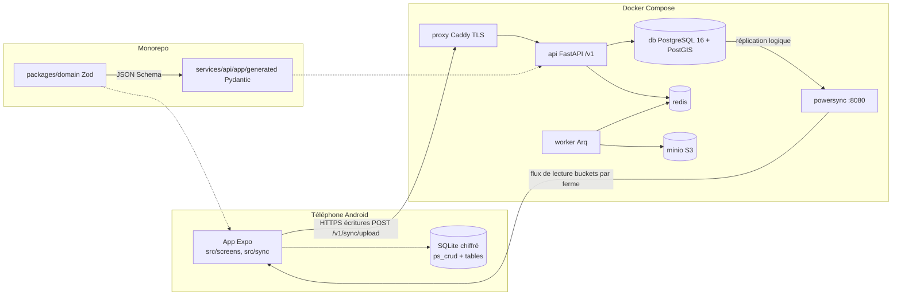
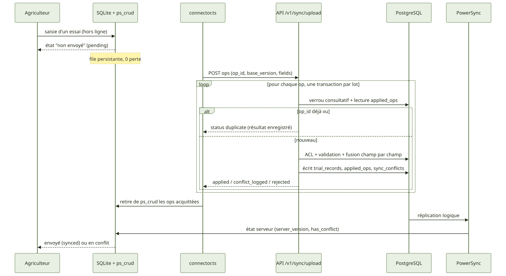
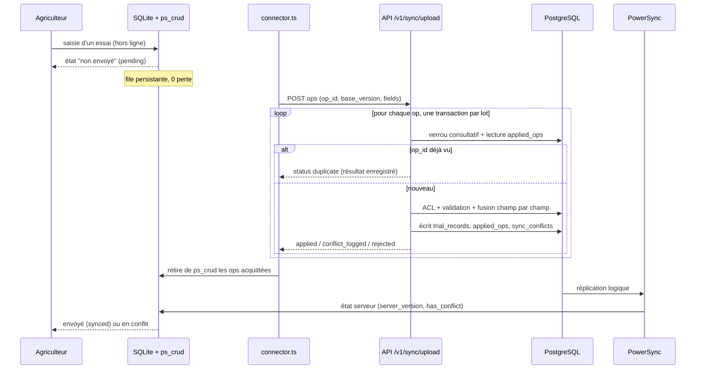
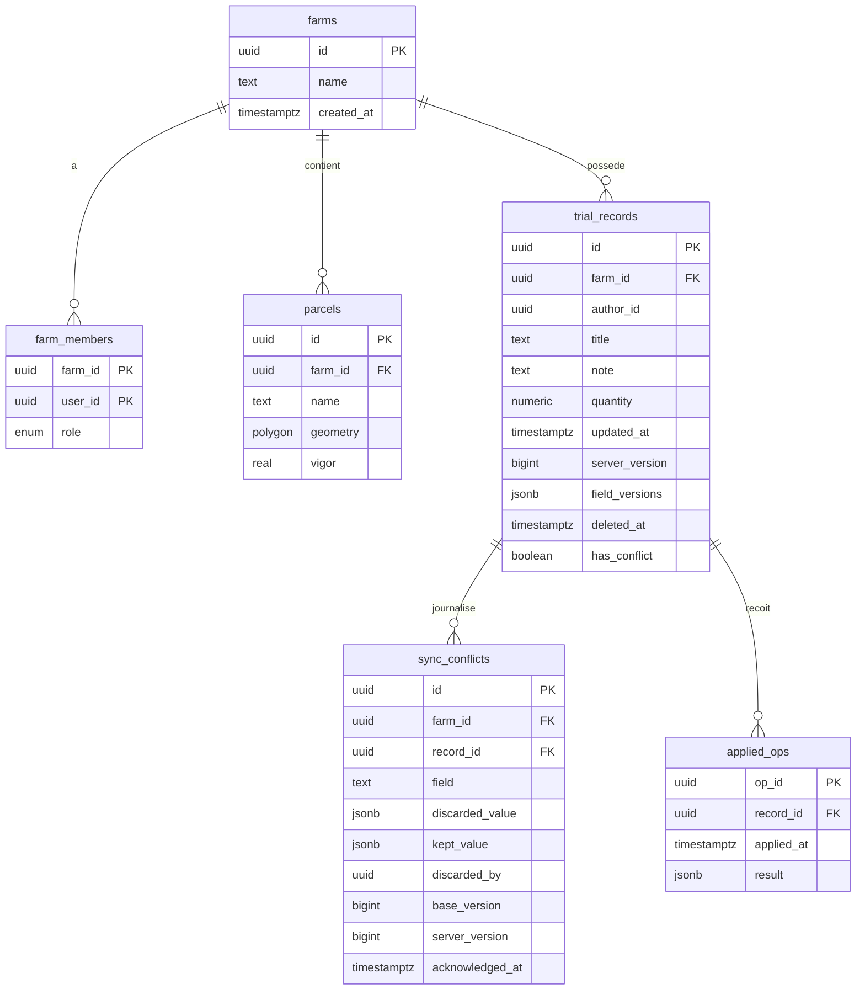
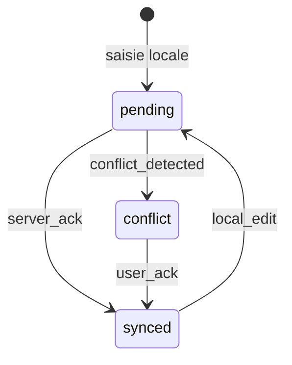

# 001-foundations — Document ingénieur

> Fonctionnalité : F0 — Fondations techniques · Branche : `001-foundations` · Date : 2026-11-07

## 1. Résumé

**Objectif** : socle exécutable d'AYLAL : monorepo pnpm, plateforme Docker Compose, porte de qualité `make check`, validation partagée Zod → Pydantic, synchronisation hors ligne sans perte avec résolution de conflits côté serveur, design system, rendu Mermaid, prototype mesurable.

**Livré** : API FastAPI (`/v1/health`, `/v1/auth/dev-token`, `/v1/sync/upload`, `/v1/sync/conflicts/{id}/acknowledge`), migration Alembic `0001_initial`, config PowerSync, `packages/domain` (schémas, validation, `conflict.ts`), `packages/i18n` (ary, ary-Latn, ar, fr), `packages/ui`, logique mobile testée (accueil, saisie d'essai, carte, synchro, perf) sous `apps/mobile/src`, worker Arq, squelettes web et desktop.

**Non livré / non vérifié** (voir §11) : taille d'APK non mesurée, parcours e2e Maestro non exécutés (pas de KVM), tâches T110 et T111 reportées.

## 2. Architecture

Les écritures ne passent pas par PowerSync : le connecteur mobile envoie `ps_crud` vers l'API (`infra/powersync/sync-rules.yaml`). PowerSync ne fait que la réplication en lecture, par bucket de ferme.

## 3. Flux principaux

Fichiers : `apps/mobile/src/sync/connector.ts` (envoi), `services/api/app/routers/sync.py` (lot), `services/api/app/sync/apply.py` (application d'une opération).

## 4. Modèle de données

Source : schémas Zod (`packages/domain/src/schemas/`), JSON Schema dans `packages/domain/schema/`, Pydantic généré dans `services/api/app/generated/`, SQLAlchemy dans `services/api/app/db/models.py`, migration `services/api/alembic/versions/0001_initial.py`. Hors diagramme : `app_settings` (SQLite local seul : `locale`, `theme`, `telemetry_enabled`, `install_id`). Détail des champs : `specs/001-foundations/data-model.md`.

## 5. États

L'état de synchronisation est calculé, pas stocké (`deriveSyncState` dans `apps/mobile/src/sync/syncState.ts`) : `conflict` si `has_conflict`, sinon `pending` si une opération est dans `ps_crud` ou `server_version` inconnu, sinon `synced`. Toute transition hors table lève une erreur (`nextSyncState`).

## 6. API

Préfixe `/v1` (`services/api/app/main.py`). Contrat : `specs/001-foundations/contracts/openapi.yaml`, vérifié par `tests/contract/test_openapi_sync.py`. Authentification : JWT HS256 maison (`app/auth/tokens.py`), en-tête `Authorization: Bearer`.

| Endpoint | Rôle | Réponses |
| --- | --- | --- |
| `GET /health` | état de `db` et `redis`, sans authentification | 200 `{status:"ok", checks}` ; 503 `{status:"degraded"}` |
| `POST /auth/dev-token` `{user_id}` | jeton d'essai | 200 `{token, expires_at}` ; 404 si `AYLAL_ENABLE_DEV_TOKEN` ≠ 1 ou env hors `dev`/`test` |
| `POST /sync/upload` `{ops[≤500]}` | application idempotente d'un lot | 200 `{results[]}` ; 401 sans jeton valide ; 422 schéma invalide |
| `POST /sync/conflicts/{id}/acknowledge` | acquitte un conflit | 204 ; 401 ; 404 (inconnu ou autre ferme, indistinguables) ; 403 (rôle `viewer`) |

Opération : `op_id`, `table` (= `trial_records`), `kind` (`put`/`patch`/`delete`), `record_id`, `farm_id?`, `base_version ≥ 0`, `fields`, `device_clock?` (informatif).

Résultat par opération : `status` ∈ `applied`, `conflict_logged`, `duplicate`, `rejected`. Un refus est un résultat HTTP 200 avec `error.code` ∈ `forbidden`, `validation` (+ `field`), `not_found` (décision R3, `decisions.md`). Un lot = une transaction : une coupure ne laisse jamais de demi-lot.

## 7. Règles métier et où elles sont codées

| Règle | Emplacement |
| --- | --- |
| `title` 1..120 après trim, `quantity` 0..1 000 000, `note` ≤ 2000, `vigor` 0..1, polygone valide | Zod : `packages/domain/src/schemas/`, `validation/index.ts` ; Python : `app/generated/` + `app/domain/validation.py` |
| Même verdict TS/Python | vecteurs `packages/domain/vectors/*.json` rejoués des deux côtés ; `check_fresh.py` détecte un Pydantic périmé |
| Conflit champ par champ : un champ est contesté si `field_versions[champ] > base_version` ; l'opération arrivée en dernier gagne, la valeur écartée est journalisée | `packages/domain/src/conflict.ts` et réplique `services/api/app/domain/conflict.py` |
| L'horloge de l'appareil et `updated_at` ne tranchent jamais | idem (`device_clock` ignoré) |
| Idempotence par `op_id` (`applied_ops`), verrou `pg_advisory_xact_lock` par enregistrement | `app/sync/apply.py` |
| ACL : rôle `owner`/`editor` pour écrire ; rôle lu en base, pas dans le jeton | `app/auth/access.py` (`WRITE_ROLES`, `farm_role`) |
| Isolation des fermes en lecture | `infra/powersync/sync-rules.yaml` (bucket `farm_data`) |
| Acquittement : `has_conflict` repasse à faux quand plus aucun conflit ouvert | `routers/sync.py` |
| Suppression logique | `deleted_at` dans `apply.py` |

## 8. Hors ligne et synchronisation

- Saisie locale dans SQLite (SQLCipher prévu, clé gérée par `src/sync/encryptionKey.ts`) ; chaque modification ajoute atomiquement une entrée `ps_crud`, retirée seulement après acquittement.
- Rejouer un lot est sans effet (`duplicate`) : l'envoi peut être relancé après toute coupure.
- Conflit : aucune perte silencieuse, `sync_conflicts` conserve la valeur écartée ; l'état « en conflit » est répliqué vers les membres de la ferme jusqu'à acquittement.
- Alerte de stockage faible : `src/sync/storageWarning.ts`.
- Cible : 30 jours hors ligne, ≥ 1 000 enregistrements, 0 perte et 0 doublon (`test_offline_30_days.py`, simulation côté serveur).

## 9. Tests

Test first : RED, GREEN, REFACTOR en commits séparés. Traçabilité AC → tests : `specs/001-foundations/traceability.md`.

| Niveau | Outil | Emplacement |
| --- | --- | --- |
| API | pytest | `services/api/tests/{unit,integration,contract,e2e}` |
| Domaine, i18n, ui | Vitest | `packages/*/tests` |
| Mobile (modèles de vue, logique pure, `.test.ts` en node) | Jest | `apps/mobile/src/**/__tests__` |
| Visuel | Playwright + Storybook, 3 thèmes x 2 sens | `packages/ui/visual` |
| Plateforme, rapports | shell | `tests/platform`, `tests/report`, `tests/diagrams` |
| Bout en bout mobile | Maestro | `apps/mobile/maestro/*.yaml` |

Couverture mesurée (`decisions.md`) : domaine 93,8 %, API 88,55 % (seuil 80 %, bloquant). La couverture JS ne couvre que `@aylal/domain`.

Commandes : `make test`, `make test-api`, `make test-domain`, `make test-mobile`, `make test-visual`, `make coverage`, `make e2e`, `make check`.

## 10. Exploitation Docker

Services (`docker-compose.yml`) : `db` (postgis 16-3.4, `wal_level=logical`), `redis`, `minio` + `minio-init`, `powersync` (:8080), `api` (:8000), `worker`, `proxy` (Caddy, TLS interne) ; profil `test` : `api-test`, `js-test` ; profil `visual` : `storybook`, `visual` ; profil `e2e`. Chaque service a un healthcheck.

Variables (valeurs par défaut de développement dans `docker-compose.yml`) : `POSTGRES_PASSWORD`, `AYLAL_DATABASE_URL`, `AYLAL_REDIS_URL`, `AYLAL_ENV` (défaut `dev`), `AYLAL_JWT_SECRET` (fourni par `.env`, non codé en dur), `AYLAL_ENABLE_DEV_TOKEN` (0 par défaut ; `make` l'active pour test, coverage, e2e-api, check), `MINIO_ROOT_USER`/`MINIO_ROOT_PASSWORD`.

Commandes : `make up` (attend l'état sain), `make down`, `make logs`, `make build`, `make diagrams` (rend `docs/**/diagrams/*.mmd` en SVG + PNG).

## 11. Décisions et dettes techniques

Décisions (`specs/001-foundations/decisions.md`) : refus d'accès à l'envoi = résultat par opération, pas HTTP 403 ; tests mobiles en `.test.ts` sur modèles de vue ; correction de portabilité de `tests/diagrams/test_render.sh` (`LC_ALL=C grep -a`), sans changer d'assertion ; `noUncheckedIndexedAccess` désactivé pour `i18n` et `mobile` ; `mypy` ignore le code généré.

Limites et dettes, sans contournement :
- **APK non mesuré** : `apps/mobile` n'est pas encore un projet Expo/React Native complet (ni `expo` ni `react-native` dans `package.json`, pas de projet natif ni de script `build:android:release`). L'image `aylal-android-build` n'a pas d'Android SDK, et l'hôte aarch64 n'a pas de build-tools Linux arm64. `make apk-size` affiche « NON MESURE » et échoue (code 1) ; le budget de 40 Mo n'est donc pas vérifié.
- **E2E non exécutés** : pas de KVM sur macOS, l'émulateur Android est impossible ; les parcours Maestro (AC2.1, AC2.4, AC3.1, AC3.2) ne sont pas exécutés (`E2E_SKIP=1`). L'e2e API tourne. Exécution prévue en CI Linux/KVM.
- **T110 et T111 reportées** : pas d'Android 2 Go de référence ; la mesure de démarrage < 3 s et de la carte < 2 s sur appareil reste à faire. Prérequis : expo/react-native épinglés, `expo prebuild`, SDK Android épinglé (linux/amd64), script `build:android:release`.
- La synchro de bout en bout sur un vrai téléphone (SQLCipher, PowerSync natif) n'est pas démontrée ; seules la logique et l'API sont testées.
