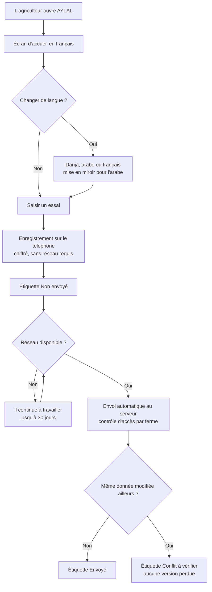
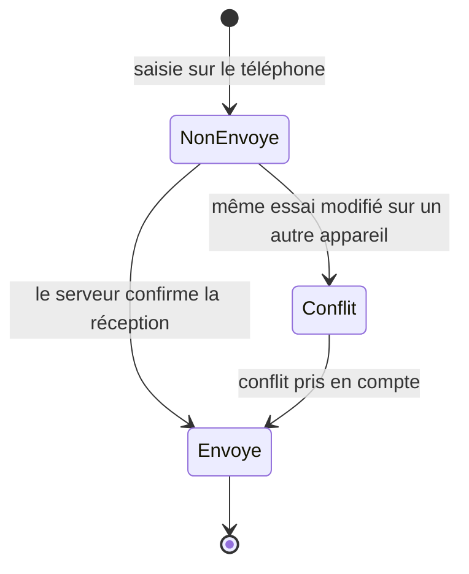

# AYLAL : document métier, fondations (F0)

Public : responsable produit, agronome, partenaire (coopérative, financeur). Sources : CPS sections 15 et 16, `specs/001-foundations/spec.md`, `decisions.md`, `.status`.

## 1. Objectif et valeur pour l'agriculteur
F0 ne contient aucun outil agricole. Elle pose les garanties sur lesquelles tout le reste repose : l'app marche sans réseau, parle darija, arabe et français, et ne perd aucune saisie. Elle fixe aussi la taille et la vitesse visées sur un téléphone Android d'entrée de gamme.

## 2. Acteurs et rôles
| Qui | Ce qu'il peut faire | Ce qu'il ne voit pas |
|---|---|---|
| Agriculteur | Changer de langue, écouter l'accueil, saisir un essai, voir s'il est envoyé | Les données d'une autre ferme ; le compte et la ferme réels (arrivent avec F1) |
| Équipe produit et design | Consulter le catalogue de composants (3 thèmes, 2 sens de lecture) | Les données des utilisateurs |
| Équipe technique | Lancer la plateforme et les tests, produire les diagrammes et le rapport de mesures | Non défini dans la spec |
| Compte d'essai de F0 | Valider le contrôle d'accès par ferme et par rôle | Non défini dans la spec (un compte d'essai remplace l'authentification, livrée en F1) |

## 3. Glossaire métier
| Terme | Sens dans l'app |
|---|---|
| Ferme | Propriétaire des données et du contrôle d'accès ; regroupe parcelles et membres |
| Parcelle | Zone cultivée avec contour ; en F0 elle sert seulement à la carte de démonstration |
| Essai | Donnée simple de validation (titre, note, quantité), sans valeur agricole |
| Non envoyé / Envoyé | Étiquette : gardé sur le téléphone / reçu par le serveur |
| Conflit à vérifier | Même essai modifié sur deux appareils ; aucune version n'est perdue en silence |
| Hors ligne | Pas de réseau ; l'app continue de fonctionner |
| Thème plein soleil | Couleurs à fort contraste pour lire dehors |
| Seuil | Valeur mesurable à tenir (démarrage, taille, trafic) |

## 4. Processus métier

Cycle de vie d'un essai :

## 5. Règles métier
- RM-1 : toute saisie et toute consultation de données déjà chargées fonctionnent sans réseau pendant au moins 30 jours (CPS 15, FR-012).
- RM-2 : l'envoi est automatique au retour du réseau, sans perte ni doublon (FR-013).
- RM-3 : ce qui n'est pas encore envoyé est toujours signalé ; l'état reste affiché tant que le serveur n'a rien reçu, même après perte du téléphone (FR-014, cas limite).
- RM-4 : un conflit est résolu par une règle documentée et déterministe, sans perte silencieuse ; il ne dépend pas de l'horloge du téléphone (FR-015, cas limite).
- RM-5 : une règle de validation (par exemple titre de 1 à 120 caractères) est définie une seule fois et donne le même résultat sur le téléphone et sur le serveur (FR-016).
- RM-6 : données chiffrées sur le téléphone et pendant l'envoi (FR-017).
- RM-7 : le serveur n'ouvre à un utilisateur que les données de sa ferme, selon son rôle (FR-018).
- RM-8 : aucune dépendance obligatoire hors du Maroc pour les données des utilisateurs (FR-019, CPS 15). Le choix de l'hébergeur reste à faire.
- RM-9 : la télémétrie est anonyme et désactivable (FR-020).
- RM-10 : langues darija (arabe et latin), arabe standard en miroir complet, français ; aucun texte en dur ; repli sur le français (FR-007, FR-008).
- RM-11 : chaque écran a quatre états : chargement, vide, erreur, hors ligne ; jamais d'écran blanc (FR-009).
- RM-12 : boutons d'au moins 48 dp ; transitions de 200 à 300 ms, réduites si l'utilisateur le demande (FR-010, FR-024).
- RM-13 : l'app installée pèse moins de 40 Mo et consomme moins de 5 Mo de données mobiles par jour (SC-003, SC-006).
- RM-14 : saisie et envoi d'un essai sans perte, 1 000 enregistrements après 30 jours simulés hors ligne (SC-005).

## 6. Critères d'acceptation
| Critère | Priorité | État |
|---|---|---|
| Récit 1 : plateforme et tests lancés par Docker | P1 | Couvert par des tests |
| Récit 2 : accueil en 3 langues, RTL, 4 états, zones 48 dp | P1 | Couvert par des tests (modèles de vue et analyse des sources) ; rendu sur appareil vérifié en E2E seulement dans les builds de test |
| Récit 3 : saisie hors ligne, envoi sans perte, conflit, règle commune, chiffrement | P1 | Couvert par des tests ; synchronisation réelle vérifiée sur émulateur |
| Récit 4 : catalogue, 3 thèmes, RTL, régression visuelle, animations réduites | P1 | Couvert par des tests (73 captures de référence, selon decisions.md) |
| Récit 5 : `make diagrams` | P2 | Couvert par des tests |
| Récit 6 : mesures sur Android 2 Go | P2 | Partiel : mesures provisoires sur émulateur (démarrage, carte, fluidité) ; taille de l'app mesurée une fois (38,3 Mo) ; trafic non mesuré ; appareil réel non testé |

## 7. Ce qui est livré et ce qui ne l'est pas
**Serveur et domaine** : livrés. Plateforme complète sous Docker, synchronisation, contrôle d'accès par ferme et rôle, règles de validation partagées. Couverture mesurée : domaine 93,8 %, API 88,55 % (seuil 80 %).

**Écrans mobiles** : livrés en version socle. Accueil (langues, écoute, bandeau hors ligne, états vide, chargement, erreur), saisie d'un essai avec étiquette d'envoi. Réserves honnêtes :
- l'enregistrement d'un essai n'a lieu que dans les builds de test, qui utilisent une ferme du jeu d'essai ; sans compte (F1), la version publique ne garde rien ;
- carte de 50 parcelles et démo animée : accessibles seulement dans les builds de test ; la carte lit un jeu local, pas encore la table réelle ni un fond de carte ;
- la langue n'est pas mémorisée et l'app s'ouvre toujours en français ;
- l'alerte « stockage presque plein » existe en règle mais n'est pas affichée ; pas d'écran pour régler un conflit ; les boutons « Réessayer » et « Ajouter un essai » n'agissent pas ;
- un build de production distinct reste à définir.

**Données de référence** : non concernées en F0.

**Dérogations (`.status`, `decisions.md`)** : fusion avec « apk-size NON MESURE », dérogation accordée par l'utilisateur ; l'APK a ensuite été mesuré à 38,3 Mo pour 40 Mo, marge faible ; mesures de performance provisoires sur émulateur, mesures sur Android 2 Go réel reportées aux tests terrain ; relecture des textes par un locuteur natif de la darija planifiée ; maquettes et test avec 5 agriculteurs hors F0.

## 8. Indicateurs de réussite
| Indicateur | Seuil (CPS 15, spec) | Mesure disponible |
|---|---|---|
| Démarrage | < 3 s | 35 ms sur émulateur (provisoire, ne compte pas le lancement du processus) |
| Affichage depuis le cache local | < 2 s | 4 ms sur émulateur (provisoire) |
| Fluidité des animations | 60 images/s | 60,3 sur émulateur (provisoire) |
| Taille de l'app | < 40 Mo | 38,3 Mo (marge faible) |
| Données mobiles par jour | < 5 Mo | non mesuré |
| Perte de données après 30 jours hors ligne | 0 | cible, testée en simulation |
| Couverture des tests du code métier | ≥ 80 % | 93,8 % domaine, 88,55 % API |

## 9. Hors périmètre
iOS ; contenu de web et desktop (squelettes) ; compte par téléphone et code à usage unique (F1) ; modèles vocaux darija hébergés au Maroc (F7) ; choix de l'hébergeur ; maquettes haute fidélité et test avec 5 agriculteurs ; fonctions agricoles (parcelles réelles, irrigation).

## 10. Risques et questions ouvertes
- Marge de 1,7 Mo sous la limite de 40 Mo : chaque fonctionnalité peut la dépasser.
- Performances jamais mesurées sur un vrai Android 2 Go : le respect des seuils sur le terrain n'est pas prouvé.
- Hébergeur au Maroc non choisi : l'exigence légale (loi 09-08) n'est pas encore vérifiable de bout en bout.
- La version publique n'a ni compte ni production distincte du build de test : à décider avant toute distribution.
- Textes en darija provisoires, pas encore relus par un locuteur natif.
- Règle de résolution des conflits : le détail de la règle choisie pour l'agriculteur est dans le document ingénieur ; la décision métier de ce qui se passe quand deux versions diffèrent n'est pas validée par un agronome (non défini dans la spec).
