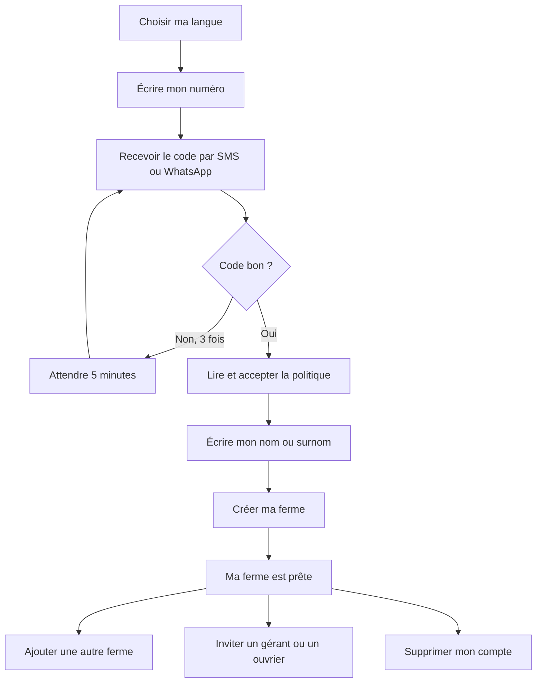

# أيلال: إنشاء حسابي ومزرعتي

> **قريباً: غير متوفر بعد.**
> شاشات التطبيق ليست جاهزة بعد.
> التصاميم ما زالت تنتظر الموافقة.
> هذا الدليل يشرح ما هو **مُخطَّط له**. لا تبحث عن هذه الأزرار الآن، فهي غير موجودة بعد.
> سنضيف الأسماء الدقيقة للأزرار عند اعتماد الشاشات.

## 1. فيمَ يفيد هذا؟

تنشئ حسابك برقم هاتفك، بدون كلمة سر وبدون بريد إلكتروني.
ثم تنشئ مزرعتك في أقل من دقيقتين.

## 2. ما تحتاجه قبل البداية

- هاتف برقم مغربي (06... أو 07...).
- شبكة (الإنترنت) لاستقبال الرمز. بعد ذلك يعمل التطبيق بدون شبكة.
- اسم أو لقب. لا شيء آخر إجباري.
- اسم مزرعتك ومكانها (الجماعة أو الدوار).

## 3. خطوة بخطوة (مُخطَّط له)

1. افتح أيلال.
2. اختر لغتك: الدارجة أو العربية أو الفرنسية. صوت يقرأ لك الخيارات.
3. اكتب رقم هاتفك.
4. اختر استقبال الرمز برسالة قصيرة (SMS) أو عبر واتساب.
5. اكتب الرمز الذي وصلك.
6. اقرأ سياسة البيانات. يمكنك الاستماع إليها.
7. وافق أو ارفض. إذا رفضت، لا يُنشأ الحساب.
8. اكتب اسمك أو لقبك.
9. اكتب اسم مزرعتك.
10. اختر المكان: بموقعك الحالي أو على الخريطة.
11. اكتب المساحة تقريباً. يمكنك تركها فارغة.
12. أكّد. تم إنشاء مزرعتك وأنت مالكها.

### أكثر من مزرعة

1. أضف مزرعة أخرى.
2. اختر المزرعة التي تريد رؤيتها.
3. يعرض التطبيق بيانات تلك المزرعة فقط.

### دعوة مسيّر أو عامل

1. افتح فريق المزرعة.
2. اكتب رقم الشخص.
3. اختر دوره.
4. **المسيّر (المسؤول)** يرى كل شيء ويعدّل كل شيء. لكنه لا يحذف المزرعة.
5. **العامل (الخدّام)** يرى فقط القطع المسندة إليه. ولا يرى أي مبلغ مالي.
6. أرسل الدعوة. ينضم الشخص إلى المزرعة عندما يسجّل بهذا الرقم.
7. يمكنك تغيير دوره أو سحب صلاحيته. يسري ذلك عند المزامنة التالية له.

### حذف حسابي

1. افتح ملفك الشخصي.
2. اختر حذف الحساب.
3. اقرأ ما سيُمحى. إذا كان معك أشخاص يعملون في المزرعة، يظهر تنبيه.
4. أكّد. سيتم تسجيل خروجك.
5. تُمحى بياناتك في أجل أقصاه 30 يوماً.

## 4. المسار بالصورة

## 5. أسئلة متكررة

**هل أحتاج كلمة سر؟**
لا. يكفي الرمز الذي يصلك.

**أخطأت في الرمز ثلاث مرات. ماذا أفعل؟**
انتظر 5 دقائق. ثم اطلب رمزاً جديداً.

**هل أبقى متصلاً؟**
نعم، حتى تخرج بنفسك. رمز من 4 أرقام على الهاتف ممكن، لكنه غير إجباري.

**غيّرت هاتفي. هل أفقد كل شيء؟**
لا. ادخل بنفس الرقم. ما لم يكن قد أُرسل بعد قد يغيب، والتطبيق ينبهك.

**هل هو مدفوع؟**
لا. هو مجاني.

## 6. إذا لم يعمل

- **لا شبكة في البداية**: يلزم إنترنت لاستقبال الرمز. أعد المحاولة لاحقاً. ما كتبته يبقى.
- **لم يصل الرمز**: اطلب رمزاً جديداً بالوسيلة الأخرى (SMS أو واتساب).
- **الرقم مرفوض**: تأكد منه. الأرقام المغربية فقط تعمل.
- **الموقع غير موجود**: اختر على الخريطة، أو من قائمة الجهة والإقليم والجماعة.
- **لا شبكة عند إنشاء المزرعة**: تبقى المزرعة في هاتفك، وتُعلَّم «في انتظار الإرسال».
- **نسيت الرمز ذا 4 أرقام**: ادخل برقمك ورمز جديد. لا يضيع شيء.
