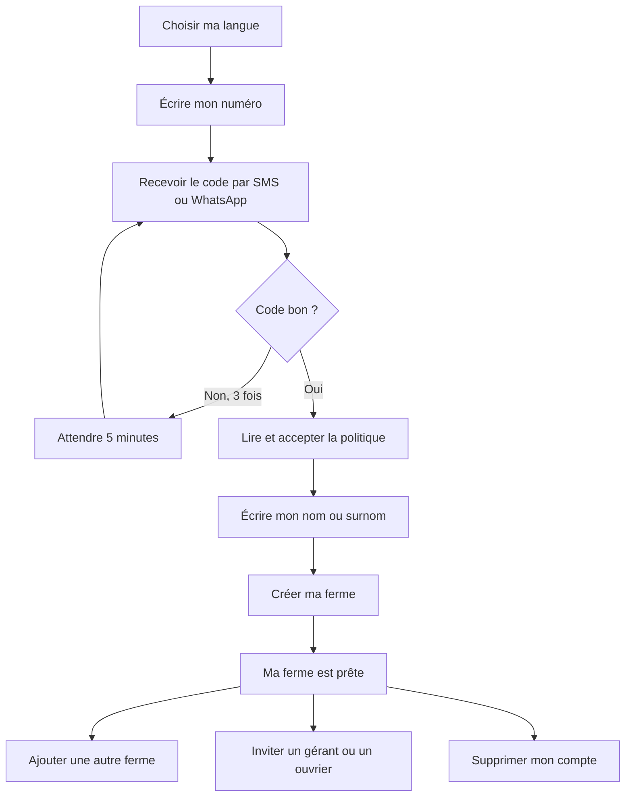

# AYLAL : créer mon compte et ma ferme

> **À venir : pas encore utilisable.**
> Les écrans de l'application (langue, numéro, code, politique, ferme, équipe, suppression) ne sont pas encore livrés.
> Les maquettes attendent encore leur validation.
> **Disponible aujourd'hui** : le fonctionnement derrière l'écran. Le code par SMS ou WhatsApp, la session, la ferme, les rôles et la suppression du compte sont prêts côté serveur.
> **Pas encore disponible** : tous les boutons et écrans décrits ci-dessous. L'export de vos données n'est pas encore fourni.
> Ce guide dit ce qui est **prévu**. Ne cherchez pas ces boutons : ils n'existent pas encore.
> Les noms exacts des boutons seront ajoutés quand les écrans seront validés.

## 1. À quoi ça sert

Vous créez votre compte avec votre téléphone, sans mot de passe ni e-mail.
Puis vous créez votre ferme, en moins de 2 minutes.

## 2. Ce qu'il faut avant de commencer

- Un téléphone avec un numéro marocain (06... ou 07...).
- Du réseau, pour recevoir le code. Après, ça marche aussi sans réseau.
- Un nom ou un surnom. Rien d'autre n'est obligatoire.
- Le nom de votre ferme et son emplacement (commune ou douar).

## 3. Pas à pas (prévu)

1. Ouvrez AYLAL.
2. Choisissez votre langue : darija, arabe ou français. Une voix lit les choix.
3. Écrivez votre numéro de téléphone.
4. Choisissez de recevoir le code par SMS ou par WhatsApp.
5. Écrivez le code reçu.
6. Lisez la politique de données. Vous pouvez l'écouter.
7. Acceptez, ou refusez. Si vous refusez, le compte n'est pas terminé. Seul votre numéro est gardé, puis effacé au bout de 24 heures.
8. Écrivez votre nom ou votre surnom.
9. Écrivez le nom de votre ferme.
10. Choisissez l'emplacement : par votre position, ou sur la carte.
11. Écrivez la surface, à peu près. Vous pouvez laisser vide.
12. Validez. Votre ferme est créée. Vous en êtes le propriétaire.

### Avoir plusieurs fermes

1. Ajoutez une autre ferme.
2. Choisissez la ferme que vous voulez voir.
3. L'application montre seulement les données de cette ferme.

### Inviter un gérant ou un ouvrier

1. Ouvrez l'équipe de la ferme.
2. Écrivez le numéro de la personne.
3. Choisissez son rôle.
4. Le **gérant** voit tout et peut tout changer. Il ne peut pas supprimer la ferme.
5. L'**ouvrier** voit seulement ses parcelles. Il ne voit aucun argent.
6. Envoyez l'invitation. La personne rejoint la ferme quand elle s'inscrit.
7. Vous pouvez changer son rôle ou lui retirer l'accès. Cela prend effet à sa prochaine synchronisation.

### Supprimer mon compte

1. Ouvrez votre profil.
2. Choisissez la suppression du compte.
3. Lisez ce qui sera effacé. Si des gens travaillent avec vous, un avertissement s'affiche.
4. Confirmez. Vous êtes déconnecté.
5. Vos données sont effacées en 30 jours au plus.

## 4. Parcours en image

## 5. Questions fréquentes

**Faut-il un mot de passe ?**
Non. Le code reçu suffit.

**Je me suis trompé de code trois fois. Que faire ?**
Attendez 5 minutes. Puis demandez un nouveau code.

**Je reste connecté ?**
Oui, jusqu'à ce que vous vous déconnectiez. Un code à 4 chiffres sur le téléphone est possible, mais pas obligatoire.

**Je change de téléphone. Je perds tout ?**
Non. Connectez-vous avec le même numéro. Ce qui n'était pas encore envoyé peut manquer : l'application vous prévient.

**Est-ce payant ?**
Non. C'est gratuit.

## 6. Si ça ne marche pas

- **Pas de réseau au début** : il faut du réseau pour recevoir le code. Réessayez plus tard. Votre saisie reste.
- **Code jamais reçu** : attendez une minute, puis demandez un nouveau code, par l'autre moyen (SMS ou WhatsApp).
- **Numéro refusé** : vérifiez-le. Seuls les numéros marocains marchent.
- **Position introuvable** : choisissez sur la carte, ou dans la liste région, province, commune.
- **Pas de réseau pour la ferme** : la ferme est gardée sur le téléphone. Elle est marquée « en attente d'envoi ».
- **Code à 4 chiffres oublié** : reconnectez-vous avec votre numéro et un nouveau code. Rien n'est perdu.
