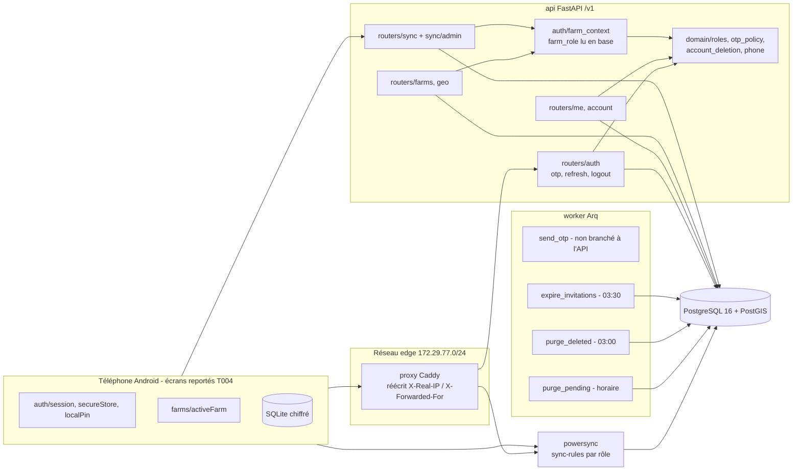
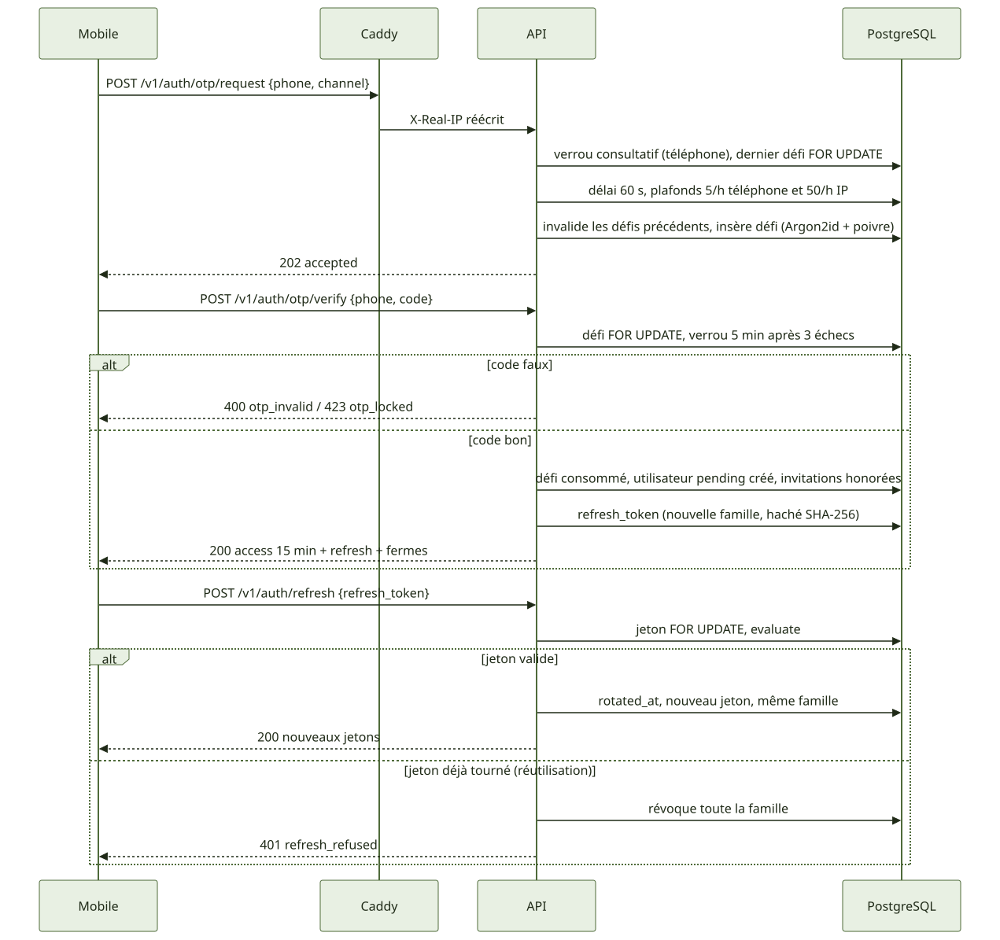
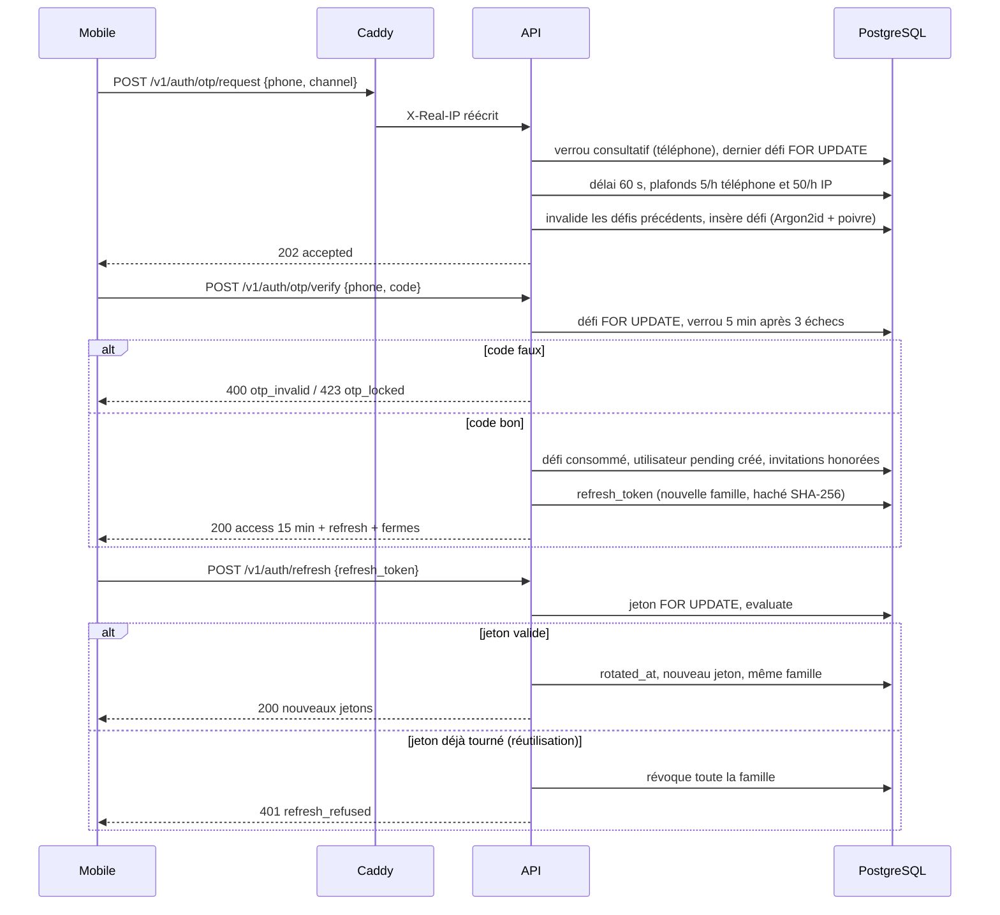
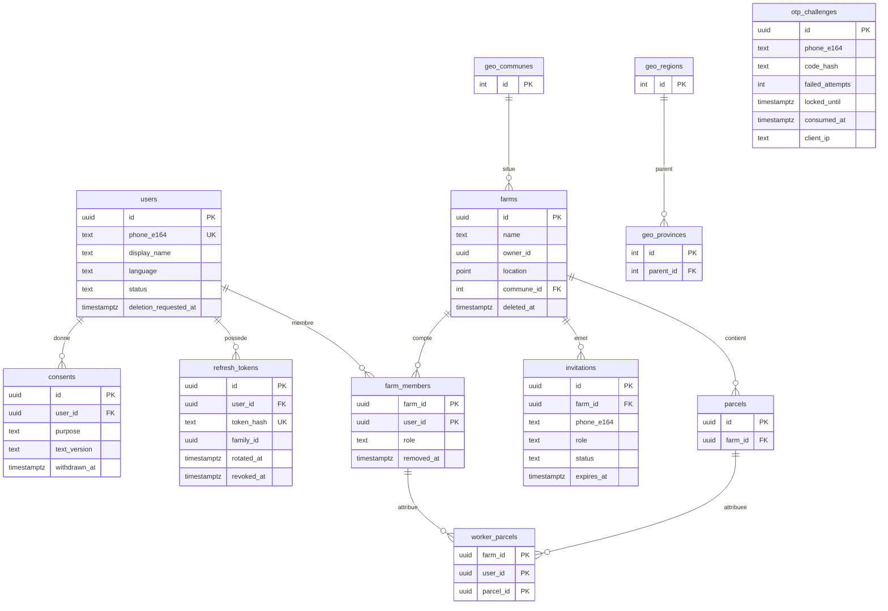
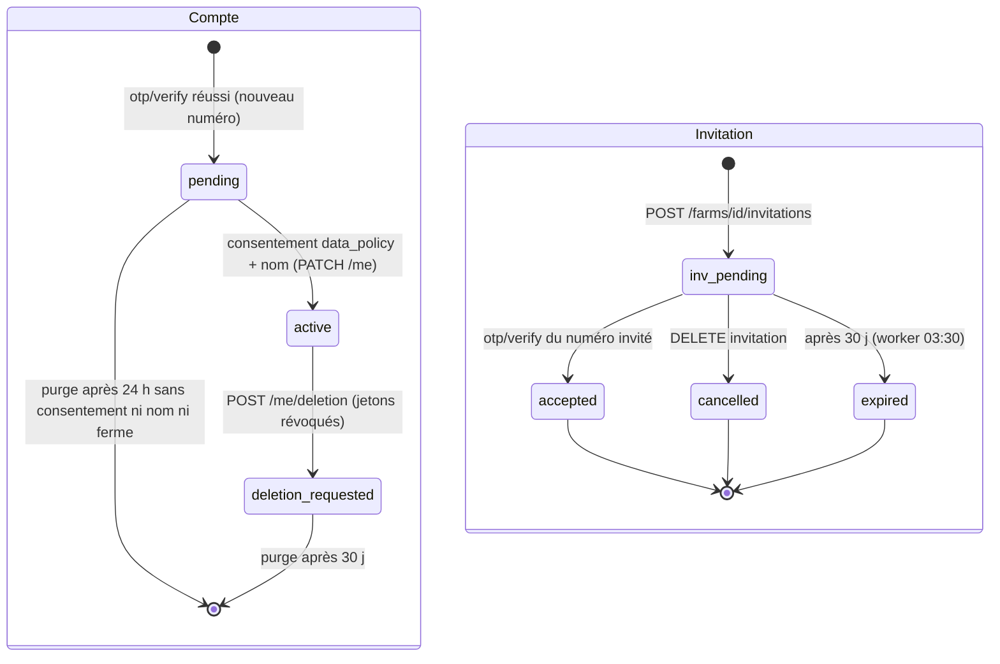

# 002-account-onboarding-farm — Document ingénieur

> Fonctionnalité : F1 — Compte, onboarding et ferme · Branche : `002-account-onboarding-farm` · Date : 2026-11-07

## 1. Résumé

**Objectif** : inscription par numéro marocain + code à usage unique (OTP), session à jeton d'accès court et jeton de rafraîchissement rotatif, consentements versionnés, profil minimal, fermes multiples avec rôles (propriétaire, gestionnaire, ouvrier), invitations, référentiel géographique, export et suppression de compte.

**Livré (API, worker, domaine)** : routes `/v1/auth`, `/v1/me`, `/v1/farms`, `/v1/geo` ; migrations `0002_account_farm` et `0003_otp_client_ip` ; règles miroirs TS/Python (`packages/domain/src/{phone,otp-policy,roles,account-deletion,consent,farm,onboarding}.ts`, `services/api/app/domain/`) ; contrôle d'écriture de synchro par rôle (`app/sync/admin.py`) ; règles PowerSync par rôle (`infra/powersync/sync-rules.yaml`) ; tâches worker `send_otp`, `purge_pending`, `purge_deleted`, `expire_invitations` ; logique mobile hors écran (`apps/mobile/src/{auth,farms}`).

**Non livré / non vérifié** (détail §11) :
- Les **écrans mobiles** E1 à E13 et les parcours Maestro ne sont pas écrits : la porte design T004 (validation humaine des maquettes) n'est pas levée.
- `apk-size` non mesuré ; e2e Maestro non exécutés (seuls les e2e de service pytest existent).
- `SqlAccountRepo` et l'export asynchrone sont partiels ; les `trial_records` d'un compte purgé sont conservés (anonymisation à décider).
- Aucun adaptateur d'envoi réel : l'API n'utilise que `ConsoleSender` ; WhatsApp reste désactivé (fournisseur hors Maroc) ; référentiel géo de 12 entrées.

## 2. Architecture

Points structurants : aucun nouveau service Docker (le worker existant porte les tâches, `geo` est un module de l'API) ; Caddy est le seul chemin réseau vers l'API (port API publié sur `127.0.0.1` seulement) ; le rôle est lu en base à chaque requête, jamais dans le jeton.

## 3. Flux principaux

Autres flux : `PATCH /v1/me` (profil, exige un consentement `data_policy` actif) ; `POST /v1/me/deletion` (statut `deletion_requested`, tous les jetons révoqués, accès refusé aussitôt car `current_user` relit le statut) ; invitation honorée à `otp/verify` pour un nouveau compte comme pour un compte existant.

## 4. Modèle de données

Écarts au `data-model.md` (decisions.md) : `farms.owner_id` et `farms.location` nullables en base (imposés par l'API et la synchro) ; pas de FK vers `users` pour `farm_members.user_id`, `farms.owner_id`, `invitations.invited_by` (la synchro peut créer une ferme avant la ligne `users`) ; `parcels` porte `UNIQUE (farm_id, id)` pour la FK composite de `worker_parcels`. Rôles F0 migrés : `editor` vers `manager`, `viewer` vers `worker`. Pas de champ financier dans F1. `otp_challenges` n'a pas de relation avec `users` (clé : téléphone).

## 5. États

`users.status` : `pending`, `active`, `deletion_requested`, puis suppression physique. `invitations.status` : `pending` vers `accepted`, `cancelled` ou `expired`.

## 6. API

Préfixe `/v1`. Contrat : `specs/002-account-onboarding-farm/contracts/openapi.yaml`. Les erreurs métier portent `detail` en objet `{"code": ...}` ; certaines erreurs de ferme restent des chaînes (`forbidden`, `not_found`, `already_member`, `invitation_pending`, `phone_invalid` côté invitation).

| Route | Rôle requis | Succès | Erreurs |
| --- | --- | --- | --- |
| `POST /auth/otp/request` `{phone, channel}` | public | 202 | 422 `phone_invalid` ; 429 `otp_rate_limited` + `Retry-After` |
| `POST /auth/otp/verify` `{phone, code}` | public | 200 `access_token`, `refresh_token`, `expires_at`, `user`, `farms` | 400 `otp_invalid` (`attempts_left`) ; 410 `otp_expired` ; 423 `otp_locked` (`retry_after`) |
| `POST /auth/refresh` `{refresh_token}` | jeton de rafraîchissement | 200 (même forme) | 401 `refresh_refused` (inconnu, révoqué, réutilisé) |
| `POST /auth/logout` | Bearer | 204 (famille de cet appareil) | 401 |
| `GET/PATCH /me` | Bearer | 200 | 403 `consent_required` ; 422 champ inconnu, `language_invalid`, `display_name_invalid` |
| `POST/GET /me/consents`, `DELETE /me/consents/{purpose}` | Bearer | 201 / 200 / 204 | 422 sans version |
| `POST /me/deletion` `{confirm: true}` | Bearer | 202 `deletion_requested_at`, `deletion_deadline` (+30 j) | 422 sans confirmation |
| `GET /me/deletion/impact` | Bearer | 200 `owned_farms` (propriétaire avec autres membres) | 401 |
| `POST /me/export` | Bearer | 202 `export_id` (génération non faite, §11) | 401 |
| `GET/POST /farms`, `GET/PATCH /farms/{id}` | membre ; PATCH owner/manager | 200/201 | 404 non-membre ; 403 ouvrier |
| `GET /farms/{id}/members`, `PATCH`/`DELETE .../members/{uid}` | lecture membre ; écriture owner | 200/204 | 403, 404, 409, 422 |
| `PUT /farms/{id}/members/{uid}/parcels` `{parcel_ids}` | owner/manager, cible ouvrier | 200 | 403, 404, 422 |
| `GET/POST /farms/{id}/invitations`, `DELETE .../{inv}` | owner | 201 (200 si renouvelée) / 204 | 409 `already_member`, `invitation_pending` ; 422 ; 404 |
| `GET /geo/regions`, `/provinces`, `/communes`, `/locate` | Bearer | 200 | voir `routers/geo.py` |
| `POST /sync/upload` | membre, contrôle par opération | 200 | 403 (lot entier), 404, 422 |

`/v1/auth/dev-token` n'existe qu'en dev/test (404 sinon).

## 7. Règles métier et où elles sont codées

| Règle | Code |
| --- | --- |
| Numéro marocain mobile `+212[67]xxxxxxxx` (formes locale, `+212`, `00212`) | `packages/domain/src/phone.ts`, `app/domain/phone.py` |
| 3 échecs : verrou 5 min ; expiration du code 5 min | `otp_policy.py` / `otp-policy.ts` ; `OTP_TTL` dans `routers/auth.py` |
| Matrice de droits owner/manager/worker | `app/domain/roles.py`, `roles.ts` ; vecteurs partagés testés par `test_f1_shared_vectors.py` |
| Owner jamais invitable ni retirable ; parcelles attribuées aux ouvriers seulement | `INVITABLE_ROLES`, `can_remove_member`, `can_assign_parcels_to` |
| Invitation : usage unique, 30 j, honorée à la vérification OTP | `_honor_invitations` (`routers/auth.py`), `INVITATION_TTL` (`routers/farms.py`) |
| Suppression : délai 30 j, avertissement si propriétaire avec autres membres | `account_deletion.py` ; `routers/account.py` |
| Rotation et réutilisation des jetons | `app/auth/sessions.py` (`evaluate`, `rotate`) |
| Un seul propriétaire par ferme | index unique partiel (migration 0002) |

### Modèle de sécurité

- **Rôles lus en base** : `farm_role` joint `Farm` (`deleted_at IS NULL`) et `FarmMember` (`removed_at IS NULL`) à chaque requête ; un retrait est effectif immédiatement côté API.
- **404 inter-ferme** : `farm_context` répond le même 404 pour ferme inexistante, supprimée, ou non-membre (membre retiré compris) ; 403 seulement pour un membre au rôle insuffisant (`require(action)`). Les objets enfants sont chargés avec `farm_id` dans le WHERE.
- **Synchro** : `sync/admin.authorize` applique la même matrice avant toute écriture d'un lot sur `farms`, `farm_members`, `worker_parcels`, `invitations` ; un ouvrier reçoit 403 pour tout le lot. Seule exception : création de sa propre ferme (`farm_id == record_id`, ferme inconnue).
- **Durcissement OTP** : code à 6 chiffres haché Argon2id + poivre `AYLAL_OTP_PEPPER` ; verrou consultatif par téléphone (`pg_advisory_xact_lock`) et `FOR UPDATE` sur le défi (compteur atomique) ; verrou vérifié avant toute comparaison ; un nouvel envoi invalide les défis précédents et hérite des échecs de la dernière heure ; renvoi 60 s, plafond 5/h par téléphone et 50/h par IP ; pendant un verrou, réponse identique (202, rien envoyé).
- **Proxys de confiance** : `client_ip` ne lit `X-Real-IP`/`X-Forwarded-For` que si le pair socket est dans `AYLAL_TRUSTED_PROXIES` (défaut compose `172.29.77.2/32` : Caddy sur le réseau `edge` dédié) ; Caddy écrase ces en-têtes ; vide = en-têtes ignorés (fail closed) ; un saut non analysable donne `None` (pas de seau IP partagé) ; si tous les sauts sont de confiance, repli sur le pair.
- **Secrets** : `get_settings()` (appelé au démarrage) refuse hors dev/test un `AYLAL_JWT_SECRET` ou `AYLAL_OTP_PEPPER` de moins de 32 caractères ou connu ; `AYLAL_ENABLE_TEST_OTP=1` (code fixe `000000`) est refusé hors dev/test.
- **Jetons** : accès 15 min ; rafraîchissement de 32 octets aléatoires stocké en SHA-256, rotation à chaque usage ; réutilisation d'un jeton tourné = révocation de la famille ; `logout` ne révoque que la famille de l'appareil.

## 8. Hors ligne et synchronisation

- Seule la vérification OTP initiale exige le réseau. Côté mobile : `secureStore` (préfixe `aylal_`), `session`, `localPin` (code local vérifié sur l'appareil), `activeFarm` (ferme active, `pending_upload`/`synced`).
- Les fermes créées hors ligne reçoivent un UUID client et passent par `/v1/sync/upload` ; PowerSync filtre en lecture par rôle : seau du personnel (owner/manager, `removed_at IS NULL`) et seau `farm_worker` limité à `worker_parcels`, sans `SELECT *` sur `farms`, `farm_members`, `invitations`, `users` ni table financière.
- Limite connue : `authorize` s'exécute avant le lot ; un lot qui crée une ferme puis y écrit une opération d'administration (invitation en file) reçoit 404 en bloc ; à scinder côté client.
- Retrait d'un membre : effectif en synchro à la prochaine émission de jeton PowerSync.
- Les écrans (états chargement, vide, erreur, hors ligne) n'étant pas écrits, ces 4 états ne sont pas vérifiés pour F1.

## 9. Tests

Stratégie : test first (RED/GREEN/REFACTOR), pyramide contrôlée par `make test-pyramid`.
- Unitaires (`services/api/tests/unit`) : OTP, sessions, rôles, suppression, géo, vecteurs partagés TS/Python.
- Intégration et contrat (`tests/integration`, `tests/contract`) sur PostgreSQL réel : OTP (atomicité, limites), isolation inter-ferme, ferme supprimée, écriture de synchro par rôle, invitations, consentements, suppression/export, migration 0002, proxys de confiance, gating test-OTP.
- Worker : `services/workers/tests` (ports factices ; `test_sql_account_repo.py` saute si la base est injoignable).
- E2E de service (`tests/e2e`, pile Docker, `AYLAL_ENABLE_TEST_OTP=1`) : inscription, consentement/profil, onboarding, équipe, suppression, IP derrière proxy, hors ligne.
- Domaine TS (Vitest) et mobile (Jest) : `activeFarm`, `session`, `secureStore`, `localPin`. Aucun test d'écran.
- Couverture : seuil 80 % configuré (`make coverage`) ; **non remesurée pour ce document**.

Lancer : `make test` (api + domaine + mobile), `make test-api`, `make test-domain`, `make test-mobile`, `make coverage`, `make e2e-api` (service). `make e2e` inclut Maestro, **non exécuté**.

## 10. Exploitation Docker

Services (`docker-compose.yml`) : `db` (PostgreSQL 16 + PostGIS), `redis`, `minio`, `powersync`, `migrate` (`alembic upgrade head`), `api`, `worker`, `proxy` (Caddy), plus `api-test` et `js-test` pour les tests. Réseaux : `default` et `edge` (adresses statiques `172.29.77.2` Caddy, `172.29.77.3` API).

| Variable | Rôle |
| --- | --- |
| `AYLAL_ENV` | `dev`, `test` ou prod (défaut compose : `dev`) |
| `AYLAL_JWT_SECRET`, `AYLAL_OTP_PEPPER` | obligatoires hors dev/test, 32 caractères min. |
| `AYLAL_ENABLE_TEST_OTP` | code fixe de test, dev/test uniquement |
| `AYLAL_ENABLE_DEV_TOKEN` | route `dev-token`, dev/test |
| `AYLAL_TRUSTED_PROXIES` | CIDR des proxys de confiance (défaut `172.29.77.2/32`) |
| `AYLAL_SMS_GATEWAY_URL`, `AYLAL_SMS_GATEWAY_KEY` | passerelle SMS (lues par la config, aucun adaptateur livré ne les utilise) |
| `AYLAL_DATABASE_URL`, `AYLAL_REDIS_URL` | connexions |

Commandes : `make up`, `make down`, `make logs`, `make diagrams`. Tâches planifiées (Arq) : `purge_pending` chaque heure, `purge_deleted` à 03:00, `expire_invitations` à 03:30.

## 11. Décisions et dettes techniques

- **Écrans mobiles reportés** : T027, T034, T036, T041, T042 (Maestro), T049, T050 (Maestro), T055, T056 (Maestro), T060, T061, T067, T068 (Maestro), bloqués par la porte design T004 non levée. Les critères d'acceptation visuels ne sont pas couverts.
- **apk-size non mesuré** ; **e2e Maestro non exécutés**.
- **Envoi du code** : l'API appelle `ConsoleSender` (journalise sans le code) ; la tâche `send_otp` (canal choisi puis repli, numéros marocains seulement) existe mais n'est branchée ni à l'API ni à un fournisseur. **WhatsApp désactivé** (WhatsApp Business dépend de Meta, hors Maroc, constitution XIII) ; le drapeau `AYLAL_OTP_WHATSAPP_ENABLED` prévu par `research.md` n'existe pas dans le code.
- **`SqlAccountRepo` partiel** : purge des comptes en attente et supprimés via asyncpg, test d'intégration conditionné à la base. **Export asynchrone partiel** : `build_export` est prêt, mais `POST /me/export` ne renvoie qu'un `export_id`, sans génération ni livraison.
- **`trial_records` d'un compte purgé conservés** (pas de FK) ; anonymisation à décider.
- **Référentiel géo de 12 régions/provinces/communes** à boîtes englobantes approximatives ; import officiel HCP/ANCFCC à faire (R5).
- Choix : `farm_members.user_id` sans FK ; invitation réservée au propriétaire (matrice `member.invite`) ; `current_user` ouvre sa propre session pour lire le statut ; contradiction F0/F1 sur les rôles résolue en migrant les valeurs dans les tests F0 (decisions.md).
- Choix de l'opérateur de passerelle SMS marocain ouvert (R3), isolé par le port `OtpSender`.
