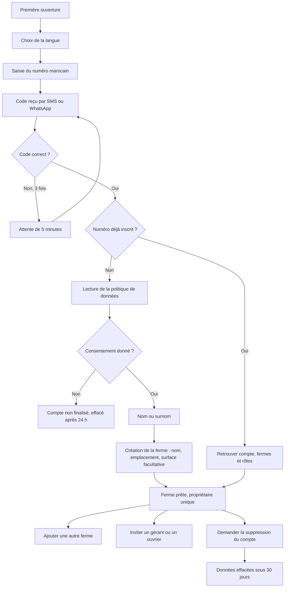
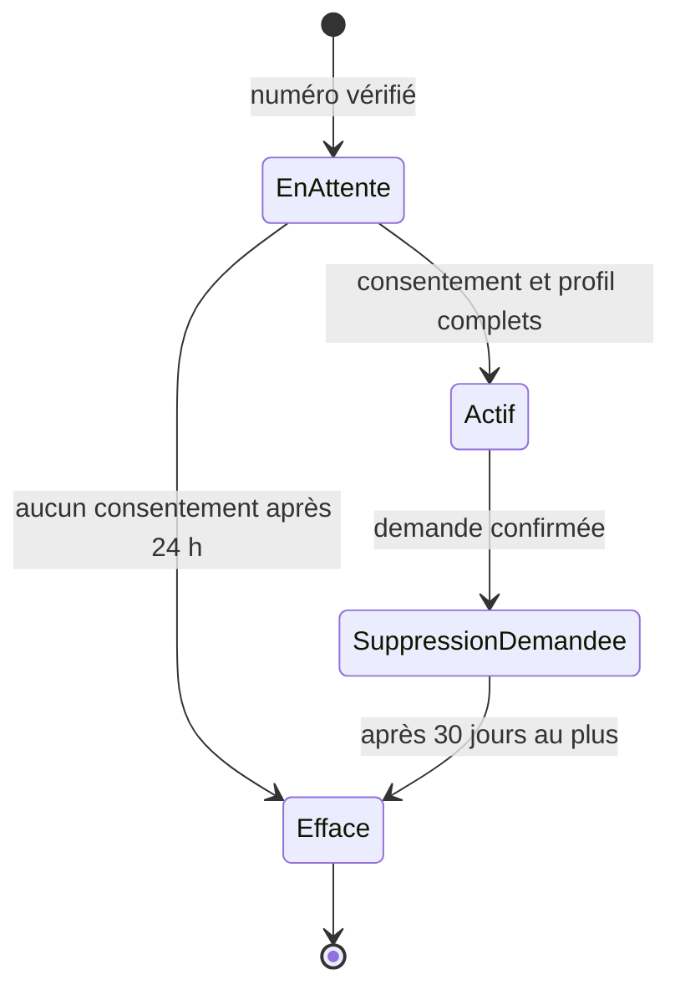

# F1 — Compte, onboarding et ferme : document métier

> **État réel** : le fonctionnement côté serveur et les règles métier sont livrés et testés. Les écrans de l'application mobile ne sont pas livrés (maquettes non validées). Voir la section 7.

## 1. Objectif et valeur pour l'agriculteur

L'agriculteur crée son compte avec son seul numéro de téléphone, sans mot de passe ni e-mail. Il choisit sa langue, donne son accord sur l'usage de ses données, puis crée sa ferme. La cible du CPS est de 2 minutes pour tout le parcours, et la ferme est la porte d'entrée de toutes les autres fonctions.

## 2. Acteurs et rôles

| Acteur | Ce qu'il peut faire | Ce qu'il ne voit pas |
| --- | --- | --- |
| Propriétaire (un seul par ferme) | Tout voir et modifier, inviter, changer les rôles, retirer un membre, attribuer des parcelles, supprimer la ferme et son compte | Rien de caché dans sa ferme |
| Gérant | Tout voir et tout modifier dans la ferme, attribuer des parcelles | Ne peut pas supprimer la ferme ni changer le propriétaire |
| Ouvrier | Enregistrer des opérations sur ses parcelles attribuées | Les autres parcelles, tout montant financier, la gestion de l'équipe |
| Personne non membre | Rien | La ferme n'existe pas pour elle (réponse identique à une ferme inexistante) |
| Équipe AYLAL | Fournir la politique de données et le référentiel géographique | Non défini dans la spec |

## 3. Glossaire métier

| Terme | Sens dans l'app |
| --- | --- |
| Compte | Un numéro de téléphone marocain vérifié = un compte |
| Code à usage unique | Code reçu par SMS ou WhatsApp pour prouver le numéro |
| Code d'accès local | Code à 4 chiffres facultatif, gardé sur le téléphone seulement |
| Consentement | Accord explicite à la politique de données, daté et versionné, révocable |
| Profil minimal | Nom ou surnom, et langue. Rien d'autre n'est obligatoire |
| Ferme | Exploitation avec nom, emplacement, commune et surface approximative facultative |
| Commune | Unité administrative déduite de la position ou choisie dans la liste région, province, commune |
| Ferme active | La ferme dont l'écran affiche les données |
| Invitation | Proposition envoyée à un numéro, avec un rôle ; expire au bout de 30 jours |
| En attente d'envoi | Donnée créée hors ligne, pas encore transmise |

## 4. Processus métier

Cycle de vie du compte :

## 5. Règles métier

| N° | Règle | Source |
| --- | --- | --- |
| RM-1 | Un compte = un numéro marocain vérifié. Pas d'e-mail, pas de mot de passe | CPS 6 ; FR-001, FR-002 |
| RM-2 | Le code est envoyé par SMS ou WhatsApp, au choix, avec repli sur l'autre canal si l'un échoue | spec, session 2026-11-07 |
| RM-3 | Après 3 codes erronés, attente de 5 minutes, imposée par le serveur | CPS 6 ; FR-003 |
| RM-4 | Délai minimal entre deux envois de code et plafonds horaires par téléphone et par adresse réseau (valeurs fixées par les tests) | decisions.md (constats de sécurité) |
| RM-5 | La session reste ouverte jusqu'à déconnexion volontaire ; le code local à 4 chiffres est facultatif | FR-004, FR-005 |
| RM-6 | Sans consentement explicite, le compte n'est pas finalisé ; il est purgé après 24 h | FR-010 ; decisions.md |
| RM-7 | Le profil minimal se limite au nom ou surnom et à la langue | FR-011 |
| RM-8 | Le consentement est révocable à tout moment | FR-012 |
| RM-9 | Une ferme exige un nom et un emplacement ; la surface est facultative | FR-013 |
| RM-10 | Une ferme a un propriétaire unique, non retirable ; le transfert n'est pas dans F1 | FR-014 ; hypothèses |
| RM-11 | Un utilisateur peut avoir plusieurs fermes et choisir la ferme active | FR-016 |
| RM-12 | L'accès par ferme et par rôle est contrôlé côté serveur, indépendamment de l'écran ; le rôle est relu à chaque requête | FR-021 ; decisions.md |
| RM-13 | Le gérant voit tout mais ne supprime pas la ferme et ne change pas le propriétaire | FR-019 |
| RM-14 | L'ouvrier ne voit que ses parcelles attribuées et aucun montant | FR-020 |
| RM-15 | Seuls propriétaire et gérant attribuent des parcelles ; jamais l'ouvrier | FR-022 |
| RM-16 | Une invitation est honorée à l'inscription du numéro ; elle expire après 30 jours | FR-023 ; hypothèses |
| RM-17 | Rôle modifié ou accès retiré : effet à la prochaine synchronisation du membre | FR-022 |
| RM-18 | Suppression du compte : données personnelles effacées sous 30 jours ; le propriétaire est averti pour les membres de sa ferme | FR-025 |
| RM-19 | Le fonctionnement hors ligne est total, sauf la vérification du numéro ; rien n'est perdu | FR-028 |
| RM-20 | Gratuit, sans fonction payante | FR-030 |

## 6. Critères d'acceptation

| Critère | Priorité | État |
| --- | --- | --- |
| R1 Inscription par numéro et code, compte créé | P1 | Serveur couvert par tests ; écrans non livrés |
| R1 Trois codes erronés, attente de 5 min | P1 | Couvert par tests (serveur) |
| R1 Retour d'un inscrit sans doublon | P1 | Couvert par tests (serveur) |
| R1 Session persistante | P1 | Partiel : logique mobile testée, aucun écran |
| R1 Code local 4 chiffres facultatif | P1 | Partiel : logique mobile testée, aucun écran |
| R2 Choix de langue avec voix, RTL | P1 | Partiel : options de langue et RTL testés ; écran non livré |
| R2 Langue enregistrée dans le profil | P1 | Couvert par tests (serveur) |
| R3 Consentement et profil minimal | P1 | Serveur couvert ; écrans non livrés |
| R4 Création de ferme, commune déduite | P1 | Serveur couvert ; écran non livré |
| R4 Ferme créée hors ligne, « en attente d'envoi » | P1 | Partiel : synchronisation testée ; indicateur à l'écran non livré |
| R4 Parcours complet en moins de 2 min | P1 | Partiel : parcours serveur testé ; mesure sur téléphone non faite |
| R8 Suppression du compte sous 30 jours | P1 | Serveur couvert ; écran non livré |
| R5 Plusieurs fermes, ferme active | P2 | Serveur et logique mobile couverts ; écran non livré |
| R6 Équipe : invitation, rôles, ouvrier restreint | P2 | Serveur couvert ; écrans non livrés |
| R7 Changer de téléphone | P3 | Partiel : restauration serveur ; avertissement sur données non envoyées non livré |

## 7. Ce qui est livré et ce qui ne l'est pas

**Livré**
- Serveur : code à usage unique, sessions, consentements, profil, fermes, membres, invitations, suppression de compte, contrôle d'accès par ferme et par rôle.
- Règles métier partagées (numéro marocain, rôles, politique de code, ferme, consentement).
- Données de référence : un échantillon de 12 régions, 12 provinces et 12 communes avec zones approximatives. L'import officiel complet reste à faire (source à valider).
- Mobile : stockage sécurisé de la session, code local, ferme active (sans écran).
- Tâches de fond : envoi du code, purge des comptes non finalisés et des comptes supprimés, expiration des invitations.

**Non livré ou reporté**
- Tous les écrans mobiles de F1 (E1 à E13) : la porte design (maquettes validées) n'est pas levée ; dérogation de l'utilisateur, fonctionnalité fusionnée sans écrans.
- Les tests de bout en bout sur téléphone (Maestro) correspondants.
- L'export des données personnelles : la demande est acceptée, mais la génération et la livraison du fichier restent à faire.
- Textes d'interface : les fichiers de textes de F1 sont vides.
- Anonymisation des données d'essais d'un utilisateur supprimé : à décider.
- Limite connue : une invitation créée hors ligne dans le même lot qu'une nouvelle ferme est refusée tant que le lot n'est pas scindé.
- Les finalisations de la tâche de couverture, du visuel et de la vérification complète (T071 à T074) sont notées ouvertes dans les tâches.

## 8. Indicateurs de réussite

- Parcours complet en moins de 2 minutes (90 % des essais de recette) : SC-001.
- 80 % des inscrits créent une parcelle en moins de 10 minutes après l'inscription : CPS section 1 ; SC-002.
- 4 agriculteurs sur 5 réussissent sans aide au test du prototype : SC-003.
- 0 cas d'ouvrier voyant une parcelle non attribuée ou un montant : SC-005.
- 100 % des tentatives refusées 5 minutes après 3 codes erronés : SC-006.
- 100 % des comptes supprimés dans les 30 jours : SC-007.
- Aucune donnée créée hors ligne perdue : SC-008.
- 40 % d'utilisateurs actifs par mois parmi les inscrits : CPS section 1.

## 9. Hors périmètre

- Connexion par e-mail ou réseaux sociaux.
- Vérification d'identité (CIN) et titres fonciers.
- Parcelles et cultures (F2).
- Partage avec conseillers, coopératives, capteurs (F9).
- Dépenses, stocks, montants (F8).
- Transfert de propriété d'une ferme.
- Amazighe (phase 3).

## 10. Risques et questions ouvertes pour le métier

- Les écrans sont absents : aucun agriculteur ne peut encore s'inscrire. À planifier avec la validation des maquettes.
- Texte de la politique de données : à fournir par AYLAL et à valider juridiquement (loi 09-08, déclaration CNDP). Non défini dans la spec.
- Fournisseur d'envoi SMS et WhatsApp, coût et délais : non défini dans la spec.
- Référentiel géographique officiel (HCP, ANCFCC) : source à valider ; seul un échantillon est chargé.
- Tutoiement ou vouvoiement en darija : à fixer par un locuteur natif.
- Export des données : délai de livraison et format non définis.
- Sort des données d'essais d'un utilisateur supprimé : décision à prendre.
- Durée de 30 jours de validité d'une invitation : valeur par défaut prudente, le CPS est muet.
