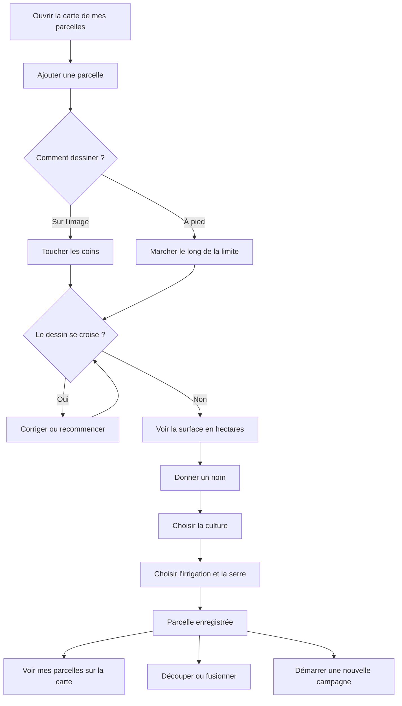

# أيلال: قطعي الفلاحية وزراعاتي

> **ما يعمل اليوم وما سيأتي.**
> **موجود الآن**: شاشة «قطعي» موجودة، وتظهر فيها رسالة «لا توجد قطع مسجلة» حين تكون القائمة فارغة. وخلف الشاشة، يعرف التطبيق مسبقاً حساب المساحة، ورفض الرسم الذي يتقاطع، وحفظ القطعة المحذوفة 90 يوماً، وتدبير المواسم والأجزاء والدمج، وتحديد ما يراه العامل.
> **قادم**: الخريطة الحقيقية، والرسم على الصورة أو مشياً، وبطاقة القطعة والاستمارة، وقائمة الزراعات بالصور، والتقسيم والدمج والمواسم. هذه الشاشات تنتظر بعدُ اعتماد التصاميم. أما صور الزراعات والصورة الفضائية فليست جاهزة بعد. واستيراد ملف من تقني غير مبرمج حالياً.
> الخطوات أدناه تشرح ما هو **مُخطَّط له**. لا تبحث عن هذه الأزرار الآن، فهي غير موجودة بعد. وستُضاف أسماؤها الدقيقة مع الشاشات.

## 1. فيمَ يفيد هذا؟

تصف مزرعتك قطعةً قطعة: أين هي، وماذا يُزرع فيها، وكيف تُسقى.
وكل ما بقي في التطبيق ينطلق من هنا.

## 2. ما تحتاجه قبل البداية

- حساب ومزرعة موجودان من قبل.
- هاتف مع تشغيل الموقع (GPS)، للرسم بالمشي.
- شبكة (الإنترنت) لرؤية صورة القمر الصناعي. المناطق التي رأيتها من قبل تبقى ظاهرة بدون شبكة.
- لا شيء آخر. اسم الصنف ونوع التربة اختياريان.

## 3. خطوة بخطوة (مُخطَّط له)

### رسم قطعتي (البلاصة / الفدان)

1. افتح خريطة قطعك.
2. أضف قطعة.
3. اختر طريقة الرسم: على الصورة، أو بالمشي.
4. على الصورة: المس زوايا قطعتك واحدة بعد الأخرى.
5. بالمشي: امش على حدّ القطعة والهاتف في يدك. يُظهر التطبيق دقة الموقع.
6. إذا كانت الإشارة ضعيفة، أعد الرسم أو صحّحه.
7. أكّد الحدود.
8. إذا تقاطع الرسم مع نفسه، يصحّحه التطبيق أو يطلب منك الإعادة. ويُريك المكان.
9. انظر إلى المساحة المحسوبة بالهكتار، برقمين بعد الفاصلة.
10. إذا كنت تعرف مساحة أخرى، اكتبها. تُحفظ المساحتان معاً.

### الاسم والزراعة والسقي والبيت المغطى

1. اكتب اسم القطعة.
2. اختر الزراعة من القائمة المصورة: الزيتون، الحمضيات، القمح الصلب، القمح اللين، الشعير، الطماطم (المطيشة)، البطاطس، البصل، الفواكه الحمراء، الأفوكادو، نخيل التمر، اللوز، العنب (الدالية)، الشمندر، الفصة (الجتّ)، الذرة العلفية.
3. زراعتك ليست في القائمة؟ أضف زراعة حرّة. تبقى خاصة بمزرعتك. والنصائح المرتبطة بالقائمة لا تعمل معها.
4. اكتب الصنف إن كنت تعرفه. وإلا فتجاوز هذه الخطوة.
5. للأشجار: اكتب سنة الغرس. للزراعة الموسمية: اكتب تاريخ البذر.
6. اختر طريقة السقي: بعلي (بدون سقي)، بالغمر، بالرشّ، بالتنقيط، أو المحور الدوّار.
7. قل هل القطعة تحت بيت مغطى (سِرّ / بيت بلاستيكي).
8. احفظ. بدون شبكة، يُحفظ في الهاتف ويُرسل لاحقاً.

يُقدَّر طور الزراعة تلقائياً. يمكنك تصحيحه، ويُحفظ تصحيحك.

### رؤية كل قطعي على الخريطة

1. افتح الخريطة.
2. ترى كل قطعك بالألوان: أخضر أو برتقالي أو أحمر.
3. اللون الرمادي يعني أن الحالة لم تُحسب بعد.
4. المس قطعة لتفتح بطاقتها.

### التقسيم أو الدمج

1. **التقسيم**: افتح القطعة، ثم قسّمها إلى أجزاء أو إلى قطاعات سقي. لكل جزء مساحته.
2. **الدمج**: اختر قطعتين من المزرعة نفسها. تصبحان قطعة واحدة بالمساحة الكلية.
3. لا يضيع سجل المواسم.

### بدء موسم جديد

1. افتح بطاقة القطعة.
2. ابدأ موسماً جديداً واختر الزراعة الجديدة.
3. يُغلق الموسم السابق. ويمكنك قراءته من جديد.
4. زراعتان مختلطتان (الزيتون والحبوب): أضف موسماً للثانية. يبقى الاثنان نشطين.
5. موسمان لنفس الزراعة في الوقت نفسه: يرفض التطبيق ويشرح السبب.

### حذف قطعة

1. احذف القطعة. تُحفظ جانباً 90 يوماً.
2. خلال هذه الأيام الـ90 يمكنك استرجاعها.
3. بعد ذلك تُمحى نهائياً.

### ماذا يرى العامل

- العامل يرى فقط القطع التي أُعطيت له.
- لا يستطيع إنشاء قطعة ولا تغييرها ولا حذفها. المالك والمسيّرون فقط يستطيعون.
- إذا حُذفت قطعة، لا يرى العامل منها شيئاً بعد ذلك.

## 4. المسار بالصورة

## 5. أسئلة شائعة

**قطعتان تتلامسان. هل هذا خطير؟**
لا. ينبّهك التطبيق ويمكنك التأكيد.

**قطعتي صغيرة أو تحت بيت مغطى.**
يقول لك التطبيق إن صورة القمر الصناعي ستكون أقل موثوقية.

**هل أستطيع الرسم بدون شبكة؟**
نعم. تُحفظ القطعة في الهاتف ثم تُرسل عند عودة الشبكة.

**لا أعرف الصنف.**
تجاوز هذه الخطوة. ليست إجبارية.

**هل هو مدفوع؟**
لا. هو مجاني.

## 6. إذا لم يشتغل

- **لا توجد شبكة**: ارسم رغم ذلك. تُوضع علامة «في انتظار الإرسال». لا يضيع شيء.
- **صورة القمر الصناعي غير ظاهرة**: تظهر فقط المناطق التي رأيتها من قبل. ارسم بالمشي.
- **إشارة GPS ضعيفة**: انتظر، أو أعد الدوران حول القطعة.
- **الرسم مرفوض**: يلزم ثلاث زوايا على الأقل، ومساحة أكبر من الصفر.
- **القطعة نفسها تغيّرت على هاتفين**: لا يضيع شيء. يرتّب التطبيق الأمر وحده.
- **رسالة خطأ**: اضغط «إعادة المحاولة».
