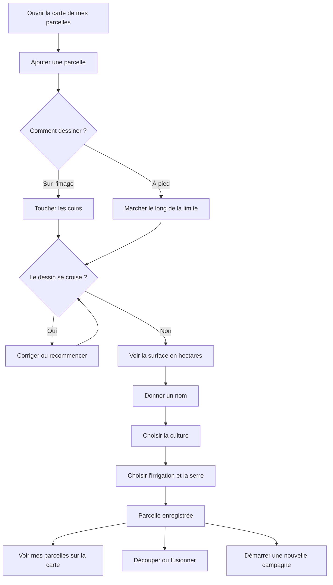

# AYLAL : mes parcelles et mes cultures

> **À venir : pas encore utilisable.**
> Les écrans de l'application ne sont pas encore prêts.
> Les maquettes attendent encore leur validation.
> Ce guide dit ce qui est **prévu**. Ne cherchez pas ces boutons : ils n'existent pas encore.
> Les noms exacts des boutons seront ajoutés quand les écrans seront validés.

## 1. À quoi ça sert

Vous décrivez votre ferme parcelle par parcelle : où elle est, ce qui y pousse, comment elle est arrosée.
Tout le reste de l'application part de là.

## 2. Ce qu'il faut avant de commencer

- Avoir déjà un compte et une ferme.
- Un téléphone avec le GPS allumé, pour dessiner à pied.
- Du réseau pour voir l'image satellite. Les zones déjà vues restent visibles sans réseau.
- Rien d'autre. Le nom de la variété et le type de sol sont facultatifs.

## 3. Pas à pas (prévu)

### Dessiner ma parcelle

1. Ouvrez la carte de vos parcelles.
2. Ajoutez une parcelle.
3. Choisissez comment dessiner : sur l'image, ou à pied.
4. Sur l'image : touchez les coins de votre parcelle, l'un après l'autre.
5. À pied : marchez le long de la limite, téléphone en main. L'application montre la précision du GPS.
6. Si le signal est faible, reprenez ou corrigez le tracé.
7. Validez le contour.
8. Si le dessin se croise, l'application le corrige ou vous demande de recommencer. Elle vous montre où.
9. Regardez la surface calculée, en hectares, avec deux chiffres après la virgule.
10. Si vous connaissez une autre surface, écrivez-la. Les deux surfaces sont gardées.

### Nom, culture, irrigation, serre

1. Écrivez le nom de la parcelle.
2. Choisissez la culture dans la liste avec photos : olivier, agrumes, blé dur, blé tendre, orge, tomate, pomme de terre, oignon, fruits rouges, avocatier, palmier dattier, amandier, vigne, betterave, luzerne, maïs fourrager.
3. Votre culture n'y est pas ? Ajoutez une culture libre. Elle reste privée à votre ferme. Les conseils qui dépendent de la liste ne marchent pas pour elle.
4. Écrivez la variété si vous la connaissez. Sinon, passez.
5. Arbres : écrivez l'année de plantation. Culture de saison : écrivez la date de semis.
6. Choisissez l'irrigation : pluvial, gravitaire, aspersion, goutte-à-goutte ou pivot.
7. Dites si la parcelle est sous serre.
8. Enregistrez. Sans réseau, c'est gardé sur le téléphone et envoyé plus tard.

Le stade de la culture est estimé tout seul. Vous pouvez le corriger. Votre correction est gardée.

### Voir toutes mes parcelles sur la carte

1. Ouvrez la carte.
2. Toutes vos parcelles y sont, en couleur : vert, orange ou rouge.
3. Une couleur grise veut dire que l'état n'est pas encore calculé.
4. Touchez une parcelle pour ouvrir sa fiche.

### Découper ou fusionner

1. **Découper** : ouvrez la parcelle, puis découpez-la en blocs ou en secteurs d'irrigation. Chaque bloc a sa surface.
2. **Fusionner** : choisissez deux parcelles de la même ferme. Elles deviennent une seule, avec la surface totale.
3. L'historique des campagnes n'est pas perdu.

### Démarrer une nouvelle campagne

1. Ouvrez la fiche de la parcelle.
2. Démarrez une campagne et choisissez la nouvelle culture.
3. La campagne d'avant est fermée. Vous pouvez la relire.
4. Deux cultures mélangées (olivier et céréales) : ajoutez une campagne pour la seconde. Les deux restent actives.
5. Deux campagnes de la même culture en même temps : l'application refuse et explique.

### Supprimer une parcelle

1. Supprimez la parcelle. Elle est mise de côté pendant 90 jours.
2. Pendant ces 90 jours, vous pouvez la reprendre.
3. Après, elle est effacée pour toujours.

### Ce que voit un ouvrier

- L'ouvrier voit seulement les parcelles qu'on lui a données.
- Il ne peut pas créer, changer ni supprimer une parcelle. Seuls le propriétaire et les gérants le peuvent.
- Si une parcelle est supprimée, l'ouvrier ne voit plus rien d'elle.

## 4. Parcours en image

## 5. Questions fréquentes

**Deux parcelles se touchent. C'est grave ?**
Non. L'application vous prévient. Vous pouvez confirmer.

**Ma parcelle est petite ou sous serre.**
L'application vous dit que l'image satellite sera peu fiable.

**Puis-je dessiner sans réseau ?**
Oui. La parcelle est gardée sur le téléphone, puis envoyée au retour du réseau.

**Je ne connais pas la variété.**
Passez cette étape. Ce n'est pas obligatoire.

**Est-ce payant ?**
Non. C'est gratuit.

## 6. Si ça ne marche pas

- **Pas de réseau** : dessinez quand même. C'est marqué « à envoyer ». Rien n'est perdu.
- **Image satellite absente** : seules les zones déjà vues s'affichent. Dessinez à pied.
- **Signal GPS faible** : attendez, ou reprenez le tour de la parcelle.
- **Dessin refusé** : il faut au moins trois coins, et une surface plus grande que zéro.
- **Même parcelle changée sur deux téléphones** : rien n'est perdu. L'application arrange tout seule.
- **Message d'erreur** : appuyez sur « Réessayer ».
