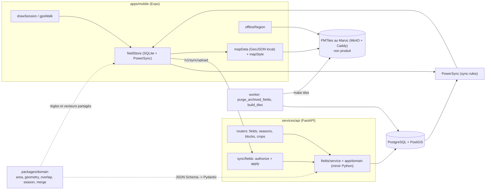
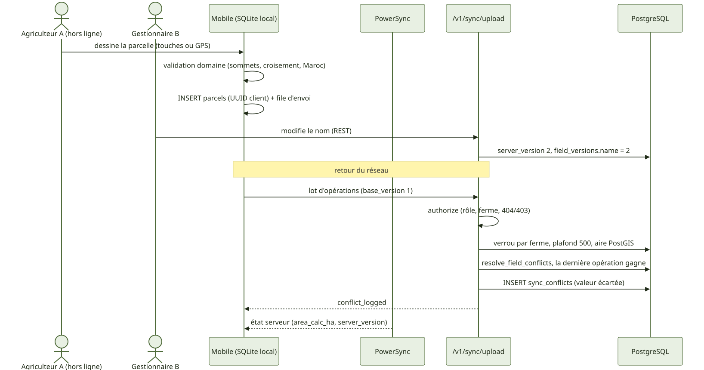
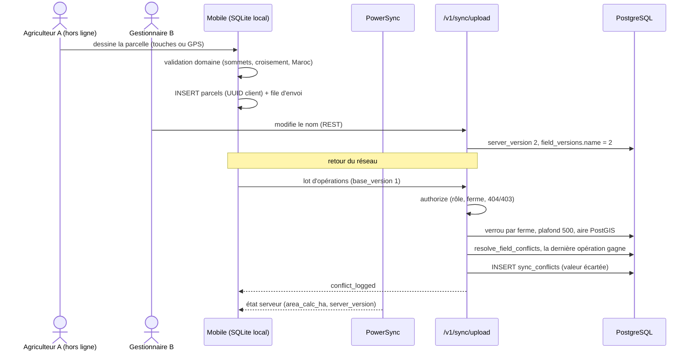
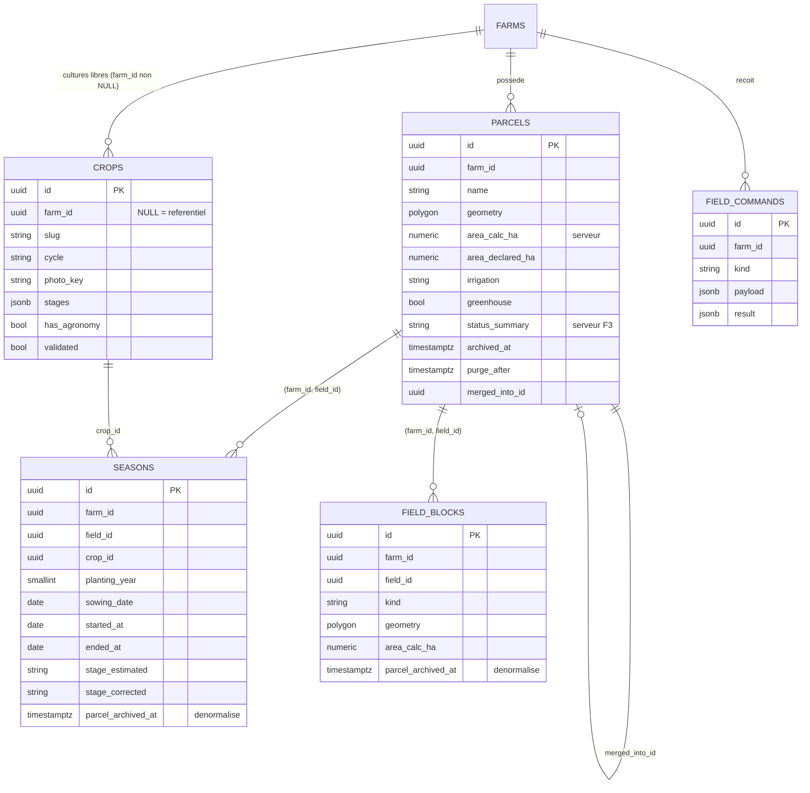
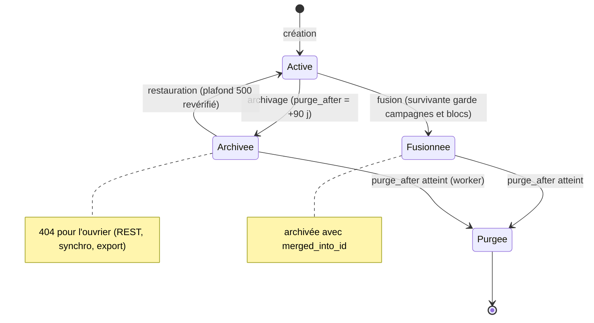

# 003-fields-crops — Document ingénieur

> Fonctionnalité : F2 — Parcelles et cultures · Branche : `003-fields-crops` · Date : 2026-11-07

## 1. Résumé

**Objectif** : transformer `parcels` (F0) en parcelle complète (géométrie, aire calculée et déclarée, irrigation, serre, archivage 90 j), ajouter le référentiel de 16 cultures et les cultures libres, les campagnes (une active par parcelle et par culture), les blocs/secteurs et la fusion hors ligne.

**Livré** : migrations `0004_fields_crops` et `0005_crops_reference_data` ; routes `fields`, `seasons`, `blocks`, `crops` ; règles miroirs TS/Python avec vecteurs partagés ; synchro (`app/sync/fields.py`) ; règles PowerSync ; export et purge étendus ; tâches worker `purge_archived_fields` et `build_tiles` ; logique mobile hors écran (`apps/mobile/src/fields`: dessin, marche GPS, données de carte, région hors ligne, store).

**Non livré / non vérifié (honnêtement)** :
- **Écrans mobiles reportés** (F2-E1 à E8, composants `CropTile`, `PrecisionMeter`, `MapLegend`, `DrawToolbar`) : porte design T004 non levée.
- **Photos de cultures non générées** (`apps/mobile/assets/crops/<slug>.webp`) ; `crops.photo_key` pointe déjà dessus.
- **`morocco.pmtiles` non produit** : `make tiles` existe, mais `AYLAL_TILES_SOURCE` (source vectorielle marocaine) et `AYLAL_TILES_BASE_URL` (hébergement au Maroc, https) sont à fournir.
- **`parcels.vigor` (F0) non retiré** (T071) : le helper de tests `_f2.py` l'insère.
- **Mesures de recette non faites** (SC-001 à SC-004) ; **e2e Maestro non exécutés** (`E2E_SKIP=1`), build R8 non validé sur émulateur.
- Aire côté client : formule sphérique de Chamberlain-Duquette (rayon authalique) ; le serveur fait foi (PostGIS `geography`) ; écart attendu jusqu'à 0,5 % (tolérance des vecteurs).
- Emprise du Maroc : boîte codée en dur (`MOROCCO_EXTENT` lon -17,2..-0,9, lat 20,7..36,0), pas le contour HCP ; le contrôle porte sur le centroïde.
- Dérogation de budget APK : 52 Mo (§10).

## 2. Architecture

Faits : la carte lit uniquement `parcels` en local (`FIELDS_LOCAL_SQL`, sans jointure) ; le style de carte ne référence que `AYLAL_TILES_BASE_URL` (test d'allowlist `test_f2_no_foreign_tiles.py`) ; l'import KML/Shapefile est analysé sur l'appareil, jamais téléversé.

## 3. Flux principaux

Fusion : commande `field_commands` (`kind=merge`) rejouée au retour du réseau, idempotente via `applied_ops(op_id)`. La survivante reçoit blocs, `worker_parcels` et campagnes (par culture, la plus ancienne active est gardée, l'autre clôturée) ; les fusionnées sont archivées avec `merged_into_id`. Découper crée des blocs, jamais de parcelle.

## 4. Modèle de données

- Clés étrangères composites `(farm_id, field_id)` : aucune référence inter-ferme.
- Exception documentée : `crops.farm_id` sans FK vers `farms` (un `TRUNCATE farms CASCADE` détruirait le référentiel) ; `seasons.crop_id` référence `crops(id)`, l'appartenance (référentiel ou culture de la ferme) est contrôlée par l'API.
- Index unique partiel `(field_id, crop_id) WHERE ended_at IS NULL` ; `CHECK NOT (planting_year AND sowing_date)`.
- `parcel_archived_at` (seasons, field_blocks) : copie de `parcels.archived_at`, posée par le serveur dans la même transaction (voir §7, PowerSync).
- `field_commands` : insertion seule, `result` = `ok` ou `error.code`.

## 5. États

Campagne : active (`ended_at` NULL) puis clôturée, jamais supprimée (disparaît avec la purge de sa parcelle). Commande : en attente, puis appliquée ou refusée. Le worker `purge_archived_fields` supprime les parcelles dont `purge_after <= now` (cascade sur les enfants, `merged_into_id` remis à NULL).

## 6. API

Préfixe `/v1`. Contrat : `specs/003-fields-crops/contracts/openapi.yaml`.

| Route | Méthodes | Rôles |
| --- | --- | --- |
| `/farms/{farm_id}/fields` | GET, POST | lecture : tous (ouvrier : attribuées) ; écriture : owner/manager |
| `/farms/{farm_id}/fields/archived` | GET | owner/manager |
| `/farms/{farm_id}/fields/merge` | POST | owner/manager |
| `/farms/{farm_id}/fields/{field_id}` | GET, PATCH, DELETE (archive, 204) | idem |
| `/farms/{farm_id}/fields/{field_id}/restore` | POST | owner/manager |
| `/farms/{farm_id}/fields/{field_id}/seasons[/{season_id}]` | GET, POST, GET, PATCH | écriture : owner/manager |
| `/farms/{farm_id}/fields/{field_id}/blocks[/{block_id}]` | GET, POST, PATCH, DELETE | écriture : owner/manager |
| `/crops`, `/farms/{farm_id}/crops` | GET ; POST (culture libre) | POST : owner/manager |
| `/sync/upload` | POST | mêmes contrôles que REST |

Entrée de parcelle : `name` (1-80), `geometry` (GeoJSON Polygon), `irrigation`, `greenhouse`, `area_declared_ha`, `source`. Les champs serveur (`farm_id`, `area_calc_ha`, `status_summary`, `created_by`, `archived_at`) sont ignorés ou rejetés. Les décimaux sont sérialisés en nombres JSON.

Erreurs : `detail = {code, field?}`.

| HTTP | Codes |
| --- | --- |
| 404 | non-membre, ferme supprimée, objet d'une autre ferme, parcelle archivée/purgée, ouvrier sur parcelle non attribuée |
| 403 | rôle insuffisant (dont ouvrier sur parcelle attribuée), écriture sur référentiel |
| 409 | `season_already_active` |
| 422 | `geometry_invalid`, `geometry_self_intersecting` (`crossings[]`), `geometry_too_complex`, `outside_morocco`, `area_too_large` (> 5 000 ha), `field_limit_reached` (500), `season_date_mismatch`, `block_outside_field`, `block_overlap`, `merge_not_contiguous`, `crop_not_found` |

Synchro : un résultat par opération (`ok`, `conflict_logged`, ou rejet `not_found`, `forbidden`, `conflict`, `validation`).

## 7. Règles métier et où elles sont codées

| Règle | TS (`packages/domain/src`) | Python |
| --- | --- | --- |
| 3 à 500 sommets, polygone simple, centroïde dans l'emprise | `geometry.ts` | `domain/geometry.py`, `domain/field_limits.py`, PostGIS `ST_IsValid`/`ST_IsSimple` (`fields/service.py`) |
| Aire (client Chamberlain-Duquette ; serveur `ST_Area(geography)`) | `area.ts` | `fields/service.py` |
| Chevauchement (avertissement, non bloquant) | `overlap.ts` | `fields/service.py` (`ST_Intersects`) |
| Champs parcelle, irrigation (5 modes), serre | `field.ts` | `domain/field_rules.py` |
| Campagne : dates, rotation, une active par culture, stade | `season.ts`, `phenology.ts` | `domain/season_rules.py` |
| Blocs : contenance et non-chevauchement (tolérance 1 %) | `block.ts` | `fields/service.py` |
| Fusion | `merge.ts` | `fields/service.py` |
| Conflits champ par champ (dernier arrivé gagne, perte tracée) | `conflict.ts` | `domain/conflict.py`, `sync/fields.py` |
| Matrice des rôles | `roles.ts` | `domain/roles.py`, `auth/farm_context.py` |

### Modèle de sécurité

- **404 inter-ferme** : tout objet est chargé avec `farm_id` dans le WHERE ; non-membre, membre retiré, ferme supprimée = 404 identique à « inexistant ». FK composites en base.
- **403 par rôle** : création, modification, découpe, fusion, archivage, restauration, import, campagnes, cultures libres = owner/manager. Ouvrier : 404 sur parcelle non attribuée, 403 sur parcelle attribuée.
- **Parcelle archivée masquée à l'ouvrier** en REST, en synchro et dans l'export ; ses campagnes et blocs aussi. Seuls `/fields/archived` et `/restore` la voient (owner/manager, avant purge).
- **Plafonds** : 3 à 500 sommets, aire <= 5 000 ha, 500 parcelles actives par ferme. Verrou consultatif par ferme (`pg_advisory_xact_lock`, `_lock_farm_fields`) pris à la création et à la restauration pour fermer la course entre `count` et `INSERT` (REST et synchro) et le contournement par restauration.
- **Synchro** : `authorize` applique rôle, appartenance et visibilité à chaque opération avant écriture ; un lot refusé n'écrit rien pour l'ouvrier. Les fermes créées plus tôt dans le lot sont prises en compte.
- **Règles PowerSync sans jointure** (le service refuse jointures, sous-requêtes et `IN (...)`) : l'ouvrier est borné par le paramètre `worker_parcels.parcel_id` ; les enfants filtrent sur la colonne dénormalisée `parcel_archived_at IS NULL`. Le référentiel de 16 cultures n'est pas un seau (règle sans paramètre rejetée) : lu par `GET /v1/crops` et embarqué.
- **Données** : géométries hébergées au Maroc, aucun serveur de cartes tiers (test d'allowlist), aucune clé de fournisseur de cartes.

## 8. Hors ligne et synchronisation

- Création, modification, découpe, fusion, archivage, restauration écrivent en local (SQLite + PowerSync) avec UUID générés côté client ; envoi par `/v1/sync/upload`, idempotent par `op_id`.
- Le serveur revalide tout (géométrie, Maroc, plafonds) et recalcule `area_calc_ha` ; la valeur serveur revient par PowerSync.
- Conflits : par champ, la dernière opération reçue gagne ; la valeur écartée est inscrite dans `sync_conflicts` (`conflict_logged`). `stage_corrected` n'est jamais écrasé par la réestimation.
- Une écriture sous une parcelle archivée est refusée (404) : la synchro ne peut pas restaurer.
- Tuiles : `offlineRegion.ts` télécharge une zone depuis `AYLAL_TILES_BASE_URL` ; sans `morocco.pmtiles` publié, il n'y a pas de fond de carte (non vérifié sur appareil).

## 9. Tests

- **Stratégie** : test first (RED puis GREEN). Unitaire : Vitest (domaine, vecteurs partagés `f2_*.json`), Jest (`apps/mobile/src/fields/__tests__`), pytest unitaire ; intégration : pytest sur PostgreSQL réel (`tests/integration/test_f2_*.py`, dont isolation inter-ferme, matrice de rôles, synchro, quota, plafond de géométrie, hors Maroc, export/purge, ouvrier et parcelle archivée) ; contrat (`openapi.yaml`, règles PowerSync) ; e2e de service (`tests/e2e`, `tests/platform/test_f2_sync_rules_valid.sh`).
- **Absents** : tests d'écran, Storybook, Maestro (`field_draw_*`, `crop_season`, `field_map`, `split_merge`, `seasons`) bloqués par T004 ; mesures SC-001 à SC-004.
- **Lancer** (Docker) : `make test`, `make test-api`, `make test-domain`, `make test-mobile`, `make test-worker` (reconstruire l'image worker avant : `docker compose build worker`), `make coverage` (seuil 80 %), `make sync-rules`. Le chiffre de couverture n'est pas rapporté ici (non relevé pour ce document).

## 10. Exploitation Docker

- Aucun service nouveau : API, PostgreSQL + PostGIS, PowerSync, MinIO, Redis, worker existants. Migration : `0004_fields_crops` (réversible), `0005_crops_reference_data` (seed des 16 cultures).
- Variables : `AYLAL_TILES_BASE_URL` (vide par défaut ; `require_tiles_base_url` refuse hors dev/test si absente, appelée au démarrage des routes carte), `AYLAL_TILES_SOURCE` (pour `make tiles`), `AYLAL_DATABASE_URL` (worker). Aucun secret nouveau.
- Commandes : `make up`, `make tiles` (image `infra/docker/tiles.Dockerfile`, tippecanoe, `infra/tiles/build.sh`), `make apk`, `make apk-size`, `make check`.
- **Dérogation de budget APK (CPS §15)** : la limite passe de 40 à 52 Mo pour la branche `003-fields-crops` uniquement, via `specs/003-fields-crops/apk-budget.env` (`APK_LIMIT_MB=52`, `APK_BUDGET_REASON`, `DECISION_REF`). `scripts/in-container/apk-size.sh` lit `specs/<branche>/apk-budget.env` et refuse la dérogation si : valeur non numérique, <= 40 ou > 60 Mo, raison ou référence absentes, fichier de décision introuvable ou sans section « Dérogation » (`decisions.md`). La limite n'est pas modifiable par variable d'environnement. Mesure : 49,9 Mo (49 921 377 o, arm64-v8a, R8 actif), contre 38,3 Mo en F1 ; `libmaplibre.so` = 10,85 Mo. Leviers écartés : retirer la carte, compresser les `.so` (déplace la taille vers l'installation, ~64 Mo installés), exclure `libgifimage`/`libnative-filters` (gain 1,2 %, risque non vérifiable) ; gain total des autres leviers 0,6 à 0,9 Mo. Réexamen : allègement de MapLibre ou AAB ; taille installée à mesurer sur appareil réel.

## 11. Décisions et dettes techniques

Décisions (voir `specs/003-fields-crops/decisions.md`) :
- `get_settings()` ne refuse pas l'absence de `AYLAL_TILES_BASE_URL` (tests F1 non modifiables) ; contrôle dans `require_tiles_base_url`. À confirmer à la revue.
- Colonnes dénormalisées pour PowerSync ; pas de seau pour le référentiel des cultures ; `crops.farm_id` sans FK.
- Export : gestionnaire = tout, ouvrier = ses parcelles seulement, sans cultures libres.

Dettes :
- Écrans, composants UI, photos, tuiles, maquettes (porte T004) ; validation agronomique des stades (`validated=false`).
- Retrait de `parcels.vigor` et de ses lecteurs F0 (carte, seed).
- Mesures de recette et Maestro non exécutés ; passage Maestro à faire avant fusion (build R8).
- Emprise du Maroc en boîte ; aire client approchée (0,5 %).
- Taille installée de l'APK non mesurée sur appareil.
