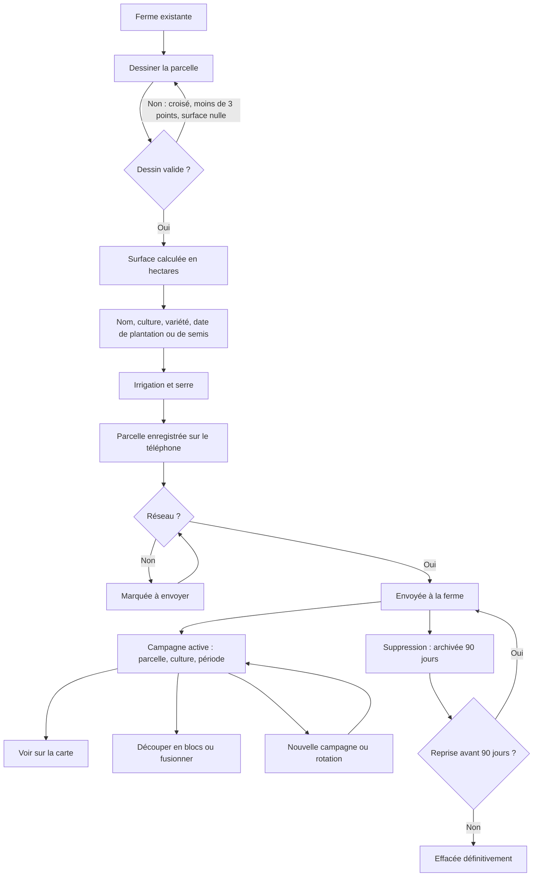
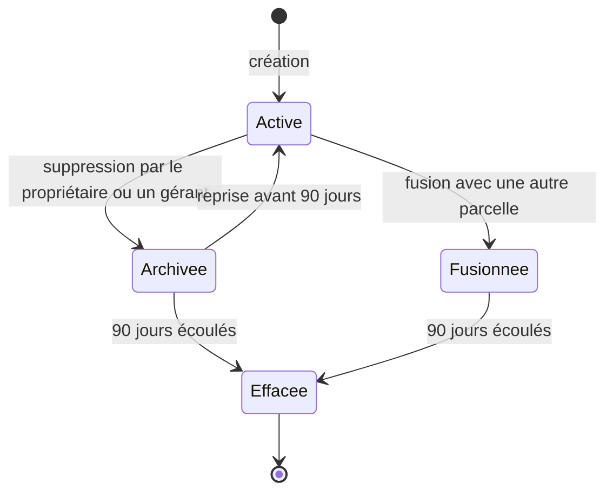

# F2 Parcelles et cultures : document métier

Section CPS 7. Public : responsable produit, agronome, partenaire (coopérative, financeur).

## 1. Objectif et valeur pour l'agriculteur

L'agriculteur décrit sa ferme parcelle par parcelle : où elle est, ce qui y pousse, comment elle est irriguée. C'est la base de toutes les autres fonctions (météo, irrigation, journal, assistant). Tout se fait sans réseau et rien n'est perdu au retour de la connexion.

## 2. Acteurs et rôles

| Qui | Ce qu'il peut faire | Ce qu'il ne voit pas |
| --- | --- | --- |
| Propriétaire | Créer, modifier, découper, fusionner, supprimer et reprendre des parcelles ; gérer cultures libres et campagnes (spec FR-020) | Les fermes des autres agriculteurs |
| Gérant | Mêmes droits que le propriétaire sur les parcelles (FR-020) | Les fermes des autres agriculteurs |
| Ouvrier invité | Consulter les parcelles qui lui sont attribuées | Les autres parcelles ; aucune donnée d'une parcelle supprimée (FR-020). Ne peut ni créer, ni modifier, ni supprimer |
| Technicien | Non défini dans la spec ; il intervient seulement comme source d'un fichier à importer (récit 7, non livré) | Non défini dans la spec |

## 3. Glossaire métier

| Terme | Sens dans l'app |
| --- | --- |
| Parcelle | Un terrain dessiné sur la carte, avec son nom, sa surface, son irrigation, sa serre |
| Surface calculée / déclarée | La première vient du dessin, la seconde est saisie par l'agriculteur ; les deux sont gardées |
| Culture du référentiel | L'une des 16 cultures de lancement (olivier, agrumes, blé dur, blé tendre, orge, tomate, pomme de terre, oignon, fruits rouges, avocatier, palmier dattier, amandier, vigne, betterave, luzerne, maïs fourrager) |
| Culture libre | Culture ajoutée par l'agriculteur, privée à sa ferme |
| Variété | Précision facultative sur la culture |
| Campagne | Une parcelle, une culture, une période |
| Rotation | Nouvelle campagne d'une autre culture, qui clôt la précédente |
| Cultures associées | Deux cultures actives ensemble sur la même parcelle (olivier et céréales) |
| Stade | Étape de la culture, estimée automatiquement et corrigeable |
| Bloc ou secteur | Sous-partie d'une parcelle, avec sa surface (secteur d'irrigation) |
| Fusion | Deux parcelles de la même ferme deviennent une seule |
| Archivée | Parcelle supprimée, reprenable pendant 90 jours |
| Mode d'irrigation | Pluvial, gravitaire, aspersion, goutte-à-goutte ou pivot |

## 4. Processus métier

Cycle de vie d'une parcelle :

Une campagne est active, puis clôturée ; elle n'est jamais supprimée seule.

## 5. Règles métier

- **RM-1** : la surface est calculée à partir du dessin ; la surface déclarée est conservée à côté (CPS 7, FR-002, FR-003).
- **RM-2** : un dessin qui se croise est corrigé ou refusé avec explication ; moins de trois points ou surface nulle : refusé (FR-004, cas limites).
- **RM-3** : une parcelle qui en chevauche une autre de la ferme déclenche un avertissement, pas un refus (cas limites).
- **RM-4** : une campagne associe une parcelle, une culture et une période (CPS 7, FR-012).
- **RM-5** : au plus une campagne active par culture et par parcelle ; plusieurs cultures différentes peuvent être actives ensemble (CPS 7, FR-013).
- **RM-6** : une nouvelle campagne d'une autre culture clôt la précédente, qui reste consultable (FR-015).
- **RM-7** : le stade est estimé (date de plantation, cumul de température) et l'agriculteur peut le corriger ; sa correction est gardée (FR-014).
- **RM-8** : arbres : année de plantation ; cultures de saison : date de semis ; variété facultative (FR-009).
- **RM-9** : irrigation parmi cinq modes, et indication « sous serre » (FR-010).
- **RM-10** : une parcelle supprimée est archivée 90 jours, reprenable, puis effacée (CPS 7, FR-018).
- **RM-11** : l'ouvrier ne voit que ses parcelles ; la gestion est réservée au propriétaire et aux gérants (FR-020).
- **RM-12** : tout fonctionne sans réseau et se synchronise sans perte ; en cas de modification de la même parcelle sur deux téléphones, rien n'est perdu et le conflit se règle sans intervention (FR-005, cas limites).
- **RM-13** : les données appartiennent à l'agriculteur, sont incluses dans son export et supprimées avec son compte (FR-021, loi 09-08).
- **RM-14** : une parcelle de moins de 0,3 ha ou sous serre est signalée peu adaptée à l'imagerie, utilisé par F3 (cas limites).
- **RM-15** : plafond de 500 parcelles par ferme et de 5 000 ha par parcelle (decisions.md, plan ; valeurs absentes de la spec).

## 6. Critères d'acceptation

Priorité P1 sauf mention. « Couvert » = testé côté serveur et domaine ; aucun écran n'est livré, donc aucun parcours bout en bout côté téléphone.

| Critère | Priorité | État |
| --- | --- | --- |
| Dessin GPS hors réseau, puis synchronisation (CPS) | P1 | Partiel : règles et synchronisation couvertes par des tests, écran de dessin non livré |
| Surface en hectares, deux décimales (CPS) | P1 | Partiel : calcul couvert, affichage non livré |
| Dessin qui se croise corrigé ou refusé, avec explication visuelle (CPS) | P1 | Partiel : détection couverte, explication visuelle non livrée |
| Dessin par touches sur l'image (R1-A4) | P1 | Non livré (écran) |
| Surface déclarée à côté de la calculée (R1-A5) | P1 | Partiel : conservée côté données, écran non livré |
| Liste illustrée des 16 cultures, culture libre, variété facultative, date selon le cycle, correction du stade (R2) | P1 | Partiel : données et règles couvertes, liste, photos et écrans non livrés |
| Irrigation et serre enregistrées et affichées (R3) | P1 | Partiel : enregistrées côté données, affichage non livré |
| Carte colorée, couleur neutre, ouverture de la fiche, hors ligne (R4) | P1 | Partiel : un écran « Mes parcelles » minimal ; carte réelle non livrée |
| Découper en blocs, fusionner (R5) | P2 | Partiel : serveur et domaine couverts, écrans non livrés |
| Nouvelle campagne, refus d'une double campagne, cultures associées (R6) | P2 | Partiel : serveur et domaine couverts, écran non livré |
| Import KML ou Shapefile (R7) | P3 | Non livré (aucune maquette) |

## 7. Ce qui est livré et ce qui ne l'est pas

Livré (serveur et domaine) : parcelles, calcul de surface, détection des croisements, campagnes, blocs, fusion, archivage 90 jours et purge, rôles, synchronisation hors ligne, export des données, référentiel des 16 cultures et cultures libres.

Livré (mobile) : un écran « Mes parcelles » minimal (titre, message de liste vide, nombre de parcelles) ; il n'affiche pas encore de vraie carte.

Non livré : tous les autres écrans (dessin, fiche et formulaire, liste des cultures, découpage et fusion, campagnes, parcelles archivées). Ils attendent la validation des maquettes (porte design T004 dans `.status`, « écrans reportés »). Import de fichier : non fait, pas de maquette.

Données de référence manquantes :
- photos des 16 cultures non produites, à fournir ;
- fond de carte hors ligne : l'outil de fabrication existe, mais aucune source de données marocaine ni hébergement n'ont été fournis, donc aucun fichier produit ;
- stades de culture : validation agronomique non faite.

Dérogations et réserves : taille de l'application 50,8 Mo avant optimisation, 49,9 Mo après, contre 40 Mo au CPS ; relèvement à 52 Mo recommandé, décision humaine requise. Mesures de recette (SC-001 à SC-004) et parcours Maestro non exécutés.

## 8. Indicateurs de réussite

Spec : première parcelle en moins de 3 minutes ; 100 % des parcelles créées hors réseau retrouvées après 30 jours hors ligne simulés ; surface à 1 % près ; carte de 50 parcelles en moins de 2 secondes ; 100 % des croisements détectés ; écrans vérifiés en trois langues et quatre états (SC-001 à SC-006). Aucun n'est mesuré à ce jour (écrans absents).

CPS : parcelle créée après inscription pour 80 % des inscrits en moins de 10 minutes ; surface suivie 100 000 ha à 12 mois (hypothèses à valider).

## 9. Hors périmètre

Cadastre et limites légales ; conception du réseau d'irrigation ; couleur d'état, imagerie et météo (F3) ; bilan hydrique (F4).

## 10. Risques et questions ouvertes pour le métier

- Aucun agriculteur ne peut encore utiliser la fonction sur téléphone : le risque principal est le calendrier des maquettes.
- Qui fournit les photos des cultures et la source des fonds de carte marocains, et où les héberger ?
- Valider avec un agronome les stades de culture.
- Budget de taille de l'application : relever à 52 Mo ou réduire la carte ?
- Plafonds de 500 parcelles et 5 000 ha : confirmer qu'ils conviennent aux grandes fermes d'export (non définis dans la spec).
- Rôle du technicien : non défini dans la spec.
