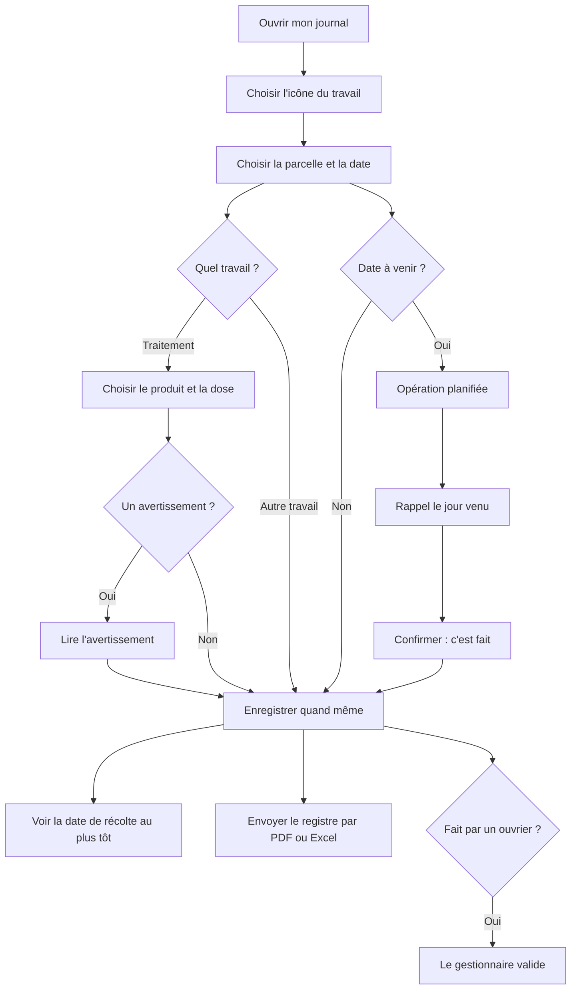

# أيلال: دفتر أشغالي

> **قريبًا: غير جاهز بعد.**
> شاشات التطبيق لم تجهز بعد.
> التصاميم ما زالت تنتظر الموافقة.
> هذا الدليل يشرح ما هو **مخطط له**. لا تبحث عن هذه الأزرار: لم تظهر بعد.
> أسماء الأزرار الدقيقة ستضاف عند اعتماد الشاشات.
> **الكلام للتسجيل** و**تصوير الملصق** لم يربطا بعد.
> **مدة حفظ السجل** (5 سنوات مقترحة) لم تؤكد بعد.

## 1. فيمَ يفيد

تسجل كل شغل في الضيعة في ثوانٍ: السقي، العلاج، السماد، الحصاد.
ويمكنك أيضًا إخراج سجل العلاجات (سجل المبيدات) عند المراقبة.

## 2. ما تحتاجه قبل البدء

- حساب وضيعة جاهزان.
- قطعك الأرضية (الفدادين) مرسومة.
- لا تحتاج إلى شبكة (الإنترنت) لتسجيل شغل.
- للكلام بدل الكتابة: ميكروفون يشتغل (مخطط).

## 3. خطوة بخطوة (مخطط)

### تسجيل شغل

1. افتح الدفتر.
2. المس أيقونة الشغل: علاج، سماد، سقي، حرث، زرع أو غرس، تقليم، إزالة الأعشاب، حصاد، آخر.
3. اختر القطعة.
4. اختر التاريخ.
5. سجّل. لا شيء آخر إجباري.
6. عدة قطع معًا؟ الكمية توزع حسب مساحة كل قطعة. ترى التوزيع.
7. يظهر الشغل في القائمة، من الأقدم إلى الأحدث، مع أيقونته.

### تسجيل علاج

1. اختر أيقونة العلاج.
2. ابحث عن المنتج باسمه.
3. أو صوّر الملصق (لم يربط بعد). تؤكد المنتج المقترح.
4. اكتب الجرعة.
5. يفحص التطبيق المنتج على هذه الزراعة: هل هو مسموح، هل الجرعة مسموحة، كم مرة عولجت.
6. ظهر تنبيه؟ اقرأه. يمكنك التسجيل رغم ذلك.
7. يبقى التنبيه مكتوبًا في سجلك.
8. نسيت المنتج أو الجرعة؟ يطلبهما التطبيق. لكنه لا يمنعك.
9. المنتج غير موجود؟ اكتب اسمه بنفسك. يوضع عليه «غير مفحوص».
10. الجرعة بوحدة أخرى؟ يعرض التطبيق التحويل قبل التأكيد.

### معرفة متى أحصد

1. افتح بطاقة القطعة.
2. انظر إلى أقرب تاريخ للحصاد.
3. عدة علاجات؟ الأجل الأطول هو المعتبر.
4. لا أجل جارٍ: يمكنك الحصاد حالًا.
5. صححت علاجًا أو حذفته؟ يتغير التاريخ تلقائيًا.

### برمجة شغل والتذكير به

1. سجل الشغل بتاريخ قادم.
2. يصير «مبرمجًا».
3. في اليوم المحدد يذكّرك الهاتف. حتى لو كنت بلا شبكة عند التسجيل.
4. تم الشغل؟ أكّد. يصير «منجزًا».
5. لم يتم في وقته؟ يبقى ظاهرًا كمتأخر. أجّله أو أنجزه أو ألغِه.

### الكلام للتسجيل (مخطط، لم يربط بعد)

1. اضغط على الميكروفون.
2. قل ما فعلت، بالدارجة أو العربية أو الفرنسية.
3. تمتلئ الاستمارة وحدها.
4. ما كان غير واضح يُشار إليه. تختار أنت.
5. راجع ثم أكّد. بلا تأكيد لا يسجل شيء.
6. إذا لم تُفهم الجملة، تفتح استمارة فارغة. استعمل الأيقونات.

### إخراج السجل للمراقبة

1. افتح سجل العلاجات.
2. اختر قطعة أو الضيعة كلها.
3. اختر التواريخ.
4. اختر PDF أو Excel.
5. كل سطر يحتوي: التاريخ، القطعة، الزراعة، المنتج، المادة الفعالة، الجرعة، المساحة، من عالج.
6. التنبيهات تظهر أيضًا في السطر.
7. أرسل الملف بالواتساب إلى التعاونية أو المصدّر أو المراقب.

### ما يفعله المسيّر

- الشغل الذي سجله عامل (خدّام) يصل إلى المسيّر «للمصادقة».
- المسيّر يصادق عليه أو يصححه.
- كل تصحيح يحفظ: من، متى، قبل، بعد.
- ما يسجله المالك أو المسيّر يصادق عليه فورًا.

### ما يراه العامل

- العامل يستطيع تسجيل شغل.
- لا يرى إلا ما يسمح به دوره.
- شغله يبقى «للمصادقة» حتى يوافق المسيّر.

## 4. المسار بالصورة

## 5. أسئلة متكررة

**هل يمنعني التطبيق من العلاج؟**
لا. هو ينبّه فقط. القرار لك.

**هل أسجل بلا شبكة؟**
نعم. يحفظ الشغل في الهاتف ثم يرسل عند عودة الشبكة.

**كم مدة حفظ السجل؟**
المقترح: 5 سنوات. لم يؤكد بعد.

**منتجي غير موجود في القائمة.**
اكتب اسمه. يسجل «غير مفحوص».

**هل السجل وثيقة رسمية؟**
لا. هو سجل تعرضه. وليس شهادة.

## 6. إذا لم يشتغل

- **بلا شبكة**: سجل رغم ذلك. يوضع عليه «للإرسال». لا شيء يضيع.
- **قائمة المنتجات قديمة**: بلا شبكة يظهر تاريخ آخر تحديث.
- **تصوير الملصق غير ممكن**: ابحث عن المنتج باسمه.
- **الكلام لا يشتغل**: استعمل الأيقونات.
- **التصدير غير ممكن**: أعد المحاولة أو انتظر عودة الشبكة.
- **نفس الشغل تغير في هاتفين**: لا شيء يضيع. تحفظ النسختان.
- **رسالة خطأ**: اضغط «إعادة المحاولة».
