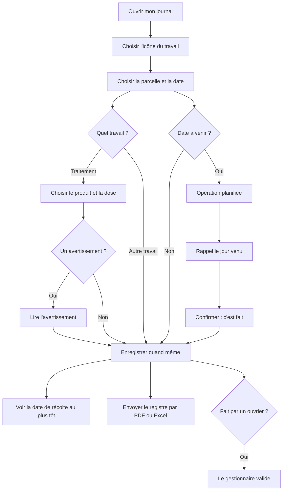

# AYLAL : mon journal des travaux

> **À venir : pas encore utilisable.**
> Les écrans de l'application ne sont pas encore prêts.
> Les maquettes attendent encore leur validation.
> Ce guide dit ce qui est **prévu**. Ne cherchez pas ces boutons : ils n'existent pas encore.
> Les noms exacts des boutons seront ajoutés quand les écrans seront validés.
> **Parler pour noter** et **photo de l'étiquette** ne sont pas encore branchés.
> **Combien de temps le registre est gardé** (5 ans prévus) reste à confirmer.

## 1. À quoi ça sert

Vous notez chaque travail de la ferme en quelques secondes : arrosage, traitement, engrais, récolte.
Vous pouvez aussi sortir votre registre de traitements pour un contrôle.

## 2. Ce qu'il faut avant de commencer

- Avoir déjà un compte et une ferme.
- Avoir déjà dessiné vos parcelles.
- Le réseau n'est pas nécessaire pour noter un travail.
- Pour parler à la place d'écrire : un micro qui marche (prévu).

## 3. Pas à pas (prévu)

### Noter un travail

1. Ouvrez le journal.
2. Touchez l'icône du travail : traitement, engrais, arrosage, travail du sol, semis ou plantation, taille, désherbage, récolte, autre.
3. Choisissez la parcelle.
4. Choisissez la date.
5. Enregistrez. Rien d'autre n'est obligatoire.
6. Plusieurs parcelles à la fois ? Une quantité est partagée selon la surface de chaque parcelle. Vous voyez le partage.
7. Le travail apparaît dans la liste, du plus ancien au plus récent, avec son icône.

### Noter un traitement

1. Choisissez l'icône du traitement.
2. Cherchez le produit par son nom.
3. Ou prenez en photo l'étiquette (pas encore branché). Vous confirmez le produit proposé.
4. Écrivez la dose.
5. L'application vérifie le produit sur cette culture : produit autorisé, dose permise, nombre de passages.
6. Un avertissement s'affiche ? Lisez-le. Vous pouvez enregistrer quand même.
7. L'avertissement reste écrit dans votre registre.
8. Produit ou dose oubliés ? L'application les demande. Elle ne vous bloque pas.
9. Produit introuvable ? Écrivez son nom vous-même. Il sera marqué « non contrôlé ».
10. Dose dans une autre unité ? L'application montre la conversion avant de valider.

### Voir quand je peux récolter

1. Ouvrez la fiche de la parcelle.
2. Regardez la date de récolte au plus tôt.
3. Plusieurs traitements ? C'est le délai le plus long qui compte.
4. Aucun délai en cours : la parcelle est récoltable tout de suite.
5. Vous corrigez ou supprimez un traitement : la date se met à jour.

### Planifier un travail et être rappelé

1. Notez le travail avec une date à venir.
2. Il devient « planifié ».
3. Le jour venu, le téléphone vous rappelle. Même si vous étiez sans réseau en le notant.
4. Le travail est fait ? Confirmez. Il passe à « fait ».
5. Pas fait à temps ? Il reste visible, en retard. Reportez-le, faites-le ou annulez-le.

### Parler pour noter (prévu, pas encore branché)

1. Appuyez sur le micro.
2. Dites ce que vous avez fait, en darija, en arabe ou en français.
3. Le formulaire se remplit seul.
4. Ce qui est incertain est signalé. Vous choisissez vous-même.
5. Vérifiez, puis confirmez. Sans confirmation, rien n'est noté.
6. Phrase non comprise : un formulaire vide s'ouvre. Utilisez les icônes.

### Sortir le registre pour un contrôle

1. Ouvrez le registre des traitements.
2. Choisissez une parcelle ou toute la ferme.
3. Choisissez les dates.
4. Choisissez PDF ou Excel.
5. Chaque ligne donne : date, parcelle, culture, produit, matière active, dose, surface, qui a traité.
6. Les avertissements sont aussi sur la ligne.
7. Envoyez le fichier par WhatsApp à la coopérative, à l'exportateur ou au contrôleur.

### Ce que fait le gestionnaire

- Un travail noté par un ouvrier arrive chez le gestionnaire « à valider ».
- Le gestionnaire le valide, ou le corrige.
- Chaque correction est gardée : qui, quand, avant, après.
- Ce que le propriétaire ou le gestionnaire note est validé tout de suite.

### Ce que voit un ouvrier

- L'ouvrier peut noter un travail.
- Il ne voit que ce que son rôle permet.
- Son travail reste « à valider » jusqu'au feu vert du gestionnaire.

## 4. Parcours en image

## 5. Questions fréquentes

**L'application peut-elle m'empêcher de traiter ?**
Non. Elle prévient seulement. C'est vous qui décidez.

**Puis-je noter sans réseau ?**
Oui. Le travail est gardé sur le téléphone, puis envoyé au retour du réseau.

**Combien de temps le registre est-il gardé ?**
Prévu : 5 ans. Ce n'est pas encore confirmé.

**Mon produit n'est pas dans la liste.**
Écrivez son nom. Il est noté « non contrôlé ».

**Le registre est-il un papier officiel ?**
Non. C'est un registre à montrer. Ce n'est pas une certification.

## 6. Si ça ne marche pas

- **Pas de réseau** : notez quand même. C'est marqué « à envoyer ». Rien n'est perdu.
- **Liste des produits ancienne** : sans réseau, la date de dernière mise à jour est affichée.
- **Photo d'étiquette impossible** : cherchez le produit par son nom.
- **Parler ne marche pas** : utilisez les icônes.
- **Export impossible** : réessayez, ou attendez le retour du réseau.
- **Même travail changé sur deux téléphones** : rien n'est perdu. Les deux versions sont gardées.
- **Message d'erreur** : appuyez sur « Réessayer ».
