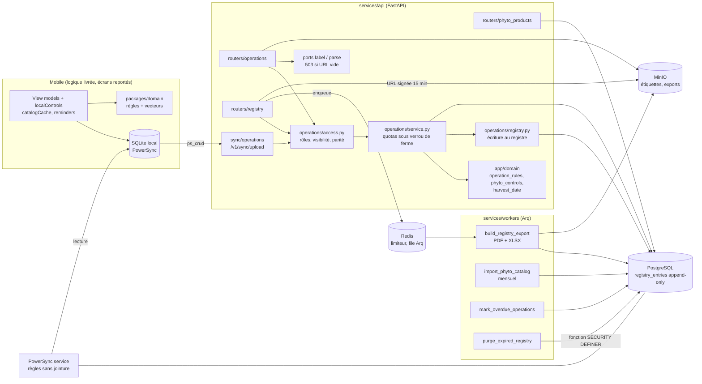
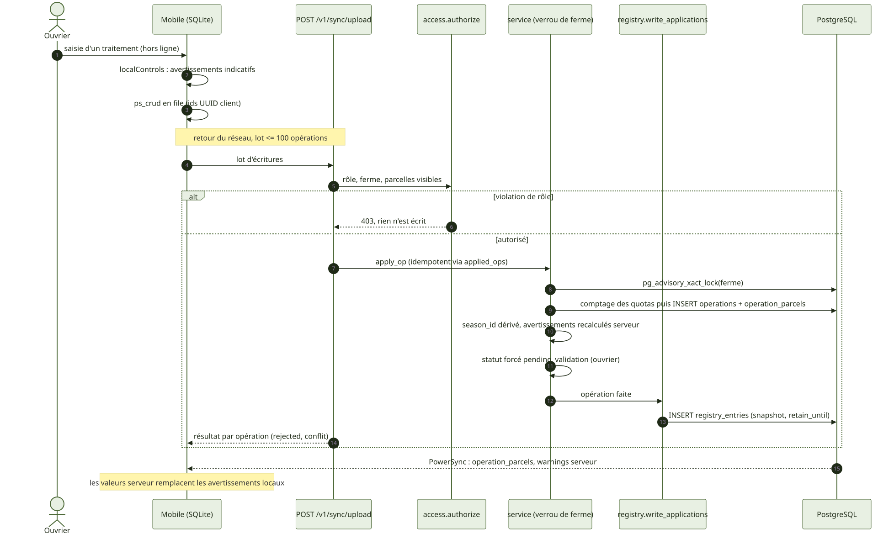
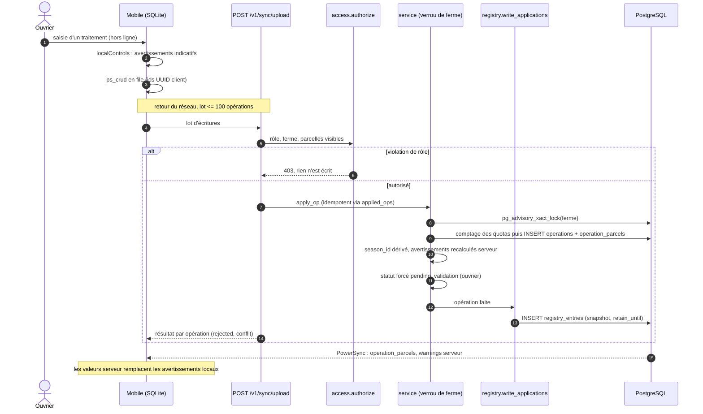
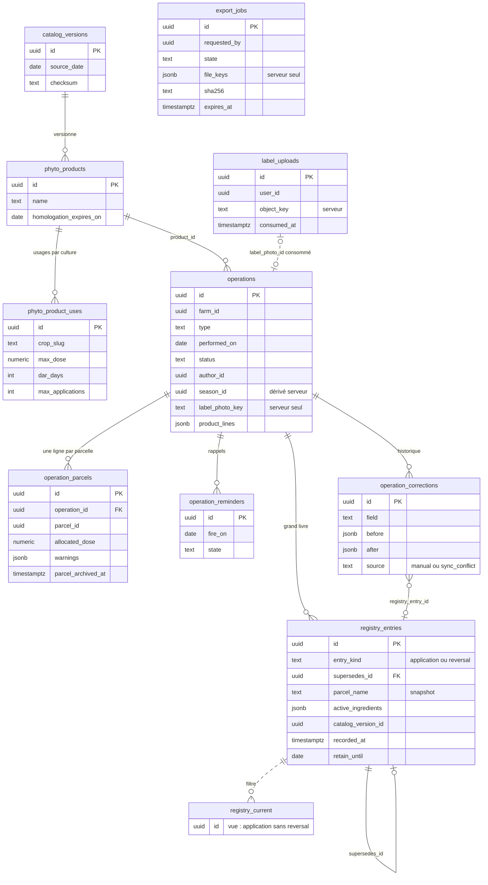
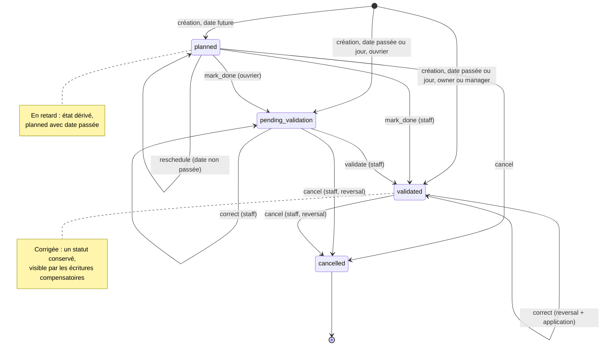

# F6 — Journal des opérations et registre phyto : document ingénieur

Branche `005-operations-journal`. Sources : `specs/005-operations-journal/{spec,plan,data-model,decisions}.md`, migrations `0006` à `0009`, code `services/api`, `services/workers`, `packages/domain`.

## 1. Résumé

**Objectif** : journal des 9 types d'opérations (multi-parcelles, hors ligne), catalogue phyto, contrôles phyto (avertissements, jamais bloquants), date de récolte au plus tôt (DAR), planification et rappels, registre phyto réglementaire append-only, export PDF/XLSX.

**Livré (backend, domaine, mobile non-écran)** : 10 tables et la vue `registry_current` (migration `0006`, durcie par `0007` à `0009`, vue `operations_done` en `0008`), routes REST, écriture par `/v1/sync/upload`, règles PowerSync, tâches worker, règles pures TS/Python avec vecteurs partagés, view models mobiles (`apps/mobile/src/operations`).

**Non livré, à ne pas présumer**

| Sujet | État |
| --- | --- |
| Écrans mobiles F6-E1 à E11, Maestro, Storybook | Reportés : porte design T004 (validation humaine) non donnée et fusion de `004-design-system` attendue. `apps/mobile/src/screens` ne contient aucun écran F6. |
| Reconnaissance d'étiquette (`AYLAL_VISION_URL`) | Non câblée : variable vide, `POST /operations/label` répond 503 `label_unavailable` (avec `label_photo_id`). |
| Dictée (`AYLAL_NLU_URL`) | Non câblée : `POST /operations/parse` répond 503 `parse_unavailable`. |
| Conservation du registre | 5 ans par défaut (`AYLAL_REGISTRY_RETENTION_YEARS`), **À CONFIRMER** : le CPS est muet (juriste, loi 09-08, CNDP, ONSSA). |
| Source du catalogue d'homologations | À fournir : `AYLAL_PHYTO_CATALOG_SOURCE` vide = aucun import. |
| Budget APK | Dérogation à 52 Mo pour cette branche (mesure 50 480 024 o ; défaut 40 Mo). |
| E2E Maestro (mobile) | Non exécutés : seuls les e2e API existent. |

## 2. Architecture

Points structurants : un seul module `operations/access.py` pour la visibilité et les droits, appelé par REST, synchro, export de compte, purge, export de registre et calcul DAR ; le registre n'est jamais écrit par une route dédiée, seulement par `service` via `registry.write_applications` et `reverse_current`.

## 3. Flux principaux

Flux REST équivalent : `POST /operations` suit le même chemin `service` (même verrou, mêmes contrôles). L'export : `POST /registry/exports` valide, met un job en file Arq, le worker rend PDF/XLSX dans MinIO, `GET /registry/exports/{job}` renvoie des URL signées.

## 4. Modèle de données

Tables : `catalog_versions`, `phyto_products`, `phyto_product_uses` (référentiel global sans `farm_id`) ; `operations`, `operation_parcels` (lecture dénormalisée synchronisée), `operation_reminders`, `registry_entries`, `operation_corrections`, `label_uploads`, `export_jobs` (par ferme). Clés étrangères composites `(farm_id, id)`. `operation_parcels.parcel_archived_at` est recopié par le trigger `parcels_copy_archived_at` (archivage, restauration, fusion). Ajouts par rapport à `data-model.md` : `operations.product_lines jsonb` (<= 5 lignes, une écriture de registre par parcelle et par ligne), `operation_corrections.server_version` (0008), vue `operations_done` (point de lecture F4/F8 : statuts `done`, `pending_validation`, `validated`).

## 5. États

Règle codée dans `app/domain/operation_rules.py` (`next_status`, `initial_status`, `is_overdue`), miroir de `packages/domain/src/operation.ts`, vecteur `f6_status_machine.json`. « En retard » = `planned` et `performed_on < aujourd'hui` : dérivé, jamais stocké. « Corrigée » n'est pas un statut : le statut est conservé et la correction se lit par `entry_kind = reversal` + nouvelle `application` (`corrected` dans le statut d'export). `cancel` d'une opération faite insère un `reversal` seul. Le worker `mark_overdue_operations` ne change que l'état des rappels (`scheduled` -> `fired`), jamais le statut.

## 6. API

Préfixe `/v1`. Contrat : `specs/005-operations-journal/contracts/openapi.yaml`.

| Méthode et chemin | Rôle requis | Notes |
| --- | --- | --- |
| `GET/POST /farms/{f}/operations` | lecture selon visibilité / création | pagination `limit` <= 200, curseur ; 201 |
| `POST .../operations/check` | création | calcule les avertissements sans écrire |
| `POST .../operations/parse` | création | 503 `parse_unavailable` par défaut ; 60/h/utilisateur |
| `POST .../operations/label` | création | multipart <= 3 Mo, JPEG/WebP par signature ; 503 `label_unavailable` par défaut ; 20/h |
| `GET/PATCH .../operations/{id}` | lecture / staff | PATCH = correction (reversal + application) |
| `POST .../operations/{id}/done`, `/cancel`, `/reschedule` | auteur ou staff | `reschedule` : 409 si non planifiée, 422 si date passée |
| `POST .../operations/{id}/validate` | owner, manager | 409 si pas `pending_validation` |
| `GET .../operations/{id}/corrections` | staff | `before`/`after` |
| `GET .../fields/{id}/earliest-harvest` | selon visibilité | `{date, harvestable_now, unknown_dar, limiting_product}` |
| `GET /phyto-products`, `GET /farms/{f}/phyto-products` | authentifié | seule la dernière version du catalogue |
| `GET /farms/{f}/registry` | owner, manager | vue courante, curseur |
| `POST /farms/{f}/registry/exports` | owner, manager | 202 ; 1 job actif, 10/h/ferme |
| `GET /farms/{f}/registry/exports/{job}` | demandeur du job | `downloads: {pdf?, xlsx?}`, URL signée <= 900 s, `Cache-Control: no-store` |

Erreurs : corps `{"code": ..., "field"?}`. Ferme inconnue, non-membre, membre retiré, ferme supprimée, objet hors ferme ou invisible : **404** `{"detail":"not_found"}` identique. 403 ouvrier sur action de gestion ; 413 `batch_too_large`, `payload_too_large`, `operations_quota_exceeded`, `planned_quota_exceeded` ; 422 `invalid_object_ref` (identique pour inconnu, autre ferme, autre utilisateur, consommé, forgé), `invalid_image`, `invalid_cursor` ; 429 `Retry-After` ; 410 `export_expired` ; 503 `export_unavailable` (mise en file échouée, job `failed`). Corps `extra=forbid` : `label_photo_key` ou `file_keys` fournis par un client sont refusés. Taille de corps vérifiée avant parsing (`body_limit.py`, 256 Ko).

## 7. Règles métier et où elles sont codées

| Règle | Code |
| --- | --- |
| Statuts, transitions, retard | `app/domain/operation_rules.py` / `operation.ts` |
| Avertissements `not_authorized_for_crop`, `dose_above_max`, `max_applications_reached`, `dar_unknown`, `free_product_unchecked` ; recalculés serveur, ceux du client ignorés ; contrôle par parcelle | `app/domain/phyto_controls.py` / `phyto-controls.ts` |
| Décompte d'applications : même produit, parcelle, `season_id` (NULL inclus), autres opérations de `registry_current` | `operations/service.py` |
| DAR et date de récolte au plus tôt (`max(performed_on + dar_days)`, `dar_days` NULL = date inconnue) | `app/domain/harvest_date.py` / `harvest-date.ts` |
| Plafonds (50 parcelles, 5 lignes produit, lot 100, note 500, produit libre/opérateur 80, 20 000 opérations/ferme/an, 500 planifiées, dose 0,001 à 100 000, date 2000-01-01 à +2 ans, export 10 000 lignes) | `app/domain/operation_limits.py` / `operation-limits.ts`, vecteur `f6_limits.json` |
| Visibilité et droits (ouvrier : ses opérations, parcelles attribuées non archivées ; un non-staff n'agit que si TOUTES les lignes lui sont visibles, sinon 404) | `operations/access.py`, `app/domain/roles.py` |
| `season_id` dérivé côté serveur de la parcelle et de la date, jamais lu du client | `operations/service.py` |
| Quotas sous verrou : `pg_advisory_xact_lock(hashtextextended(farm,0))`, comptage puis écriture dans la même transaction, REST et synchro | `operations/service.py` (même clé que `fields/service.py`) |
| Snapshot du registre (parcelle, culture, surface, produit, matière active, DAR, dose max, opérateur, avertissements, version du catalogue) | `operations/registry.py` |
| Conservation : `retain_until = max(performed_on, date serveur de recorded_at) + années`, plus long `retain_until` conservé sur la chaîne (réversals, corrections) | `operations/registry.py::retain_until`, `_chain_retention` |
| Produit libre : `free_product_unchecked`, jamais exigé ; produit et dose demandés mais pas obligatoires | `phyto_controls.py` |
| Opération sur parcelle archivée : 404 tous rôles ; lecture d'historique ouverte au staff | `access.py` |

### Modèle de sécurité

- **Registre append-only** : triggers `registry_entries_append_only` et `operation_corrections_append_only` (`BEFORE UPDATE OR DELETE`, exception `registry_append_only`) ; `REVOKE UPDATE, DELETE` sur ces tables pour `PUBLIC` et, si le rôle de migration est superutilisateur, pour lui-même (le GRANT applicatif ne comporte ni UPDATE ni DELETE) ; aucune route REST ni opération de synchro n'écrit au registre. Correction ou annulation = **écriture compensatoire** (`reversal` + `application`). Pas de clé étrangère bloquante vers `parcels` : la purge de parcelles (F2) ne détruit pas le registre.
- **Seules exceptions**, par fonctions `SECURITY DEFINER` avec `search_path` fixé, `EXECUTE` retiré à `PUBLIC`, drapeau local à la transaction `aylal.registry_maintenance` : `anonymize_registry_operator` et `purge_expired_registry(p_today, p_years)`. Même avec le drapeau, le trigger n'autorise que les colonnes d'anonymisation (UPDATE) ou un DELETE filtré sur `retain_until`.
- **Anonymisation à la suppression de compte, portée par colonne** (0008, 0009) : rôle opérateur (`operator_user_id = compte`) -> `operator_user_id` NULL et `operator_name` « opérateur supprimé » ; rôle auteur (`author_id`, `recorded_by`) -> NULL et note effacée ; l'opérateur distinct d'une autre personne et un nom libre sans compte sont conservés ; contenu réglementaire conservé ; `before`/`after` des corrections `note`/`operator_name` concernées sont vidés. Un propriétaire unique reçoit d'abord un export (`registry_export_id` dans la réponse de `POST /me/deletion` confirmé).
- **Conservation sur l'horodatage serveur** : le plancher de purge repose sur `recorded_at`, pas sur `performed_on` fourni par le client ; une opération antidatée ne raccourcit pas la conservation. Purge quotidienne par chaîne (application + reversals) via `purge_expired_registry`.
- **Parité des gardes** : REST, `sync/operations.py`, `accounts/export.py`, `accounts/purge.py`, export de registre et DAR passent par `access.py` ; `test_f6_path_parity` exécute la même matrice sur chaque chemin et un test d'inventaire échoue si une route ou table F6 est absente de la matrice. Une violation de rôle dans un lot de synchro refuse tout le lot (403, rien d'écrit).
- **Identifiants d'objets émis par le serveur** : clés `farms/{farm}/labels/{uuid}` et `farms/{farm}/exports/{job}/...` générées par le serveur (`CHECK` sur le motif), jamais acceptées ni renvoyées ; le client ne manipule que `label_photo_id` (usage unique, 24 h, lié à `(id, farm_id, user_id)`).
- **URL signées courtes** : <= 15 min, `Cache-Control: no-store`, émises au seul `requested_by` après contrôle de ferme et vérification du préfixe de la clé ; autre utilisateur, même gestionnaire : 404 identique à un job inconnu.
- **Règles PowerSync sans jointure** (`infra/powersync/sync-rules.yaml`) : données dénormalisées (`farm_id`, `author_id`, `parcel_archived_at`) ; seau ouvrier `farm_worker_ops` par paramètre `(parcel_id, user_id)` ; seau global `phyto_catalog` sans paramètre ; le registre n'est synchronisé qu'aux seaux staff ; `label_photo_key` et `file_keys` ne sont pas répliqués.
- **Limites de débit** : limiteur Redis partagé, IP via `client_ip()` (`AYLAL_TRUSTED_PROXIES`).
- Pas de secret par défaut hors dev/test (`require_minio_credentials`) ; aucun fournisseur d'IA ou STT en dur.

## 8. Hors ligne et synchronisation

- Écriture : SQLite local, puis `ps_crud` envoyé à `POST /v1/sync/upload` ; lot <= 100 (413 avant toute écriture). Rejeu après 30 jours hors ligne accepté ; idempotence par identifiants UUID v7 client et `applied_ops`.
- Le serveur fait foi : avertissements recalculés, statut forcé (`pending_validation` pour un ouvrier), champs serveur ignorés ou rejetés (`author_id`, `validated_*`, `registry_*`, `parcel_archived_at`, clés d'objet). La synchro n'expose pas `mark_done`/`cancel` ; le PATCH est réservé au staff (403 sinon).
- Conflits : corrections au champ près, `operation_corrections.source = sync_conflict` et `server_version` marquent une correction dont `base_version` précède une autre correction du même champ. Aucune donnée perdue.
- Local : contrôles phyto (`localControls.ts`, < 50 ms visé), cache du catalogue avec `source_date` affichée hors ligne, rappels = notifications locales (`reminders.ts`), aucun push tiers.
- Le stockage `op-sqlite` est natif : non testable sous Jest ; les view models sont testés avec des ports injectés.

## 9. Tests

Stratégie test first (RED, GREEN, REFACTOR). 55 fichiers de test F6 côté API (unit, integration, contract, e2e), plus Vitest (`packages/domain`, vecteurs partagés), Jest (view models mobiles) et tests worker (`services/workers/tests/integration`). Les invariants de base (triggers, GRANT, anonymisation) sont testés en intégration sur PostgreSQL réel. Seuil de couverture 80 % (`fail_under = 80` pour pytest ; Vitest via `make coverage`) ; le pourcentage mesuré n'est pas consigné dans les sources lues.

Lancer (Docker uniquement) : `make test` (api + domain + mobile), `make test-api`, `make test-worker` (après `bash scripts/dc.sh build worker`, l'image embarque ses tests), `make test-domain`, `make test-mobile`, `make coverage`, `make e2e-api`. `make e2e` inclut Maestro : non exécuté pour F6, aucun parcours F6 n'existe. Pas d'e2e de fondations ; les e2e API portent les récits. Les tests e2e utilisent `unique_phone()` : aucun `DELETE` de ferme portant un registre (le garde n'est pas assoupli).

Écarts de tests documentés dans `decisions.md` : 5 tests RED contredisant la spec corrigés au minimum (confirmation de suppression `{"confirm": true}`, colonne `merged_into_id`, `label_photo_key` non envoyé, `job` réutilisé, seau global `phyto_catalog` en liste blanche) ; un flaky observé une fois (limite horaire de dictée), non reproduit.

## 10. Exploitation Docker

Aucun service nouveau : `api`, `worker`, `db` (PostgreSQL 16), `redis`, `minio` + `minio-init` (seau `aylal`), `powersync`, `migrate`.

| Variable | Rôle | Défaut |
| --- | --- | --- |
| `AYLAL_REGISTRY_RETENTION_YEARS` | conservation du registre | 5 (à confirmer) |
| `AYLAL_VISION_URL` | reconnaissance d'étiquette | vide = 503 |
| `AYLAL_NLU_URL` | analyse de la dictée | vide = 503 |
| `AYLAL_PHYTO_CATALOG_SOURCE` | `file://` ou `s3://` (http/ftp refusés) | vide = aucun import |
| `AYLAL_ENQUEUE_JOBS` | `0` uniquement sur `api-test` | actif |
| `S3_ENDPOINT`, `S3_ACCESS_KEY`, `S3_SECRET_KEY` | MinIO (démarrage refusé sans identifiants hors dev/test) | dev seulement |
| `AYLAL_TRUSTED_PROXIES` | confiance à `X-Forwarded-For` | vide |

Worker (Arq) : `build_registry_export` (à la demande), `purge_expired_registry` (04:30), `mark_overdue_operations` (05:00), `import_phyto_catalog` (le 1er du mois, 02:00). L'import accepte un JSON gzip <= 3 Mo compressé / 50 Mo décompressé, atomique, sans nouvelle version si la somme de contrôle est identique. Le rendu d'export (`export_job.py`, polices IBM Plex Sans OFL versionnées avec empreintes SHA-256 dans `decisions.md`) est copié dans l'image worker.

Commandes : `docker compose up`, migrations par le service `migrate` (Alembic `0006` à `0009`), `make diagrams` (rendu), `make apk` / `make apk-size` (limite lue dans `specs/005-operations-journal/apk-budget.env`, 52 Mo).

## 11. Décisions et dettes techniques

**À confirmer / bloquant fonctionnel**
- Durée de conservation (5 ans par défaut) et articulation avec la suppression de compte à 30 j : revue juridique.
- Source du catalogue d'homologations ; fournisseurs de reconnaissance d'étiquette et de dictée (ports `LabelRecognizer`, `VoiceParser` en repli).
- Export PDF/XLSX : implémenté et testé côté worker, mais sans écran de déclenchement.

**Dettes**
- Écrans F6-E1 à E11 et Maestro : porte design T004 et fusion de `004-design-system` ; composants demandés : `OperationTypeTile`, `WarningBanner`, `DoseField`, `HarvestDateCard`, `PendingBadge`, `ProductRow`. F6 ne modifie ni `packages/ui` ni le design system.
- Dérogation APK : 52 Mo (cause : `libmaplibre` hérité de F2 ; F6 ajoute environ 0,6 Mo). Plafond absolu 60 Mo, réexamen si MapLibre allégé, AAB ou mesure sur appareil. Chaque fonctionnalité doit re-justifier la sienne.
- Pas de test d'intégration mobile du SQLite local.
- Route `reschedule` ajoutée au contrat pendant les RED (R4-A4) ; aucune route de rappel serveur.
- Les mesures de performance (SC-001 à SC-007) relèvent de la recette et ne sont pas automatisées.
