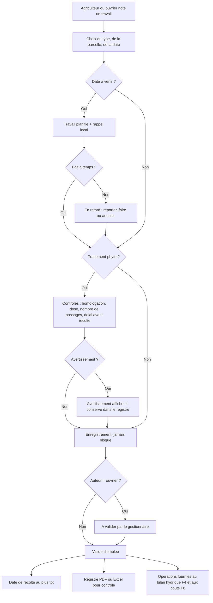
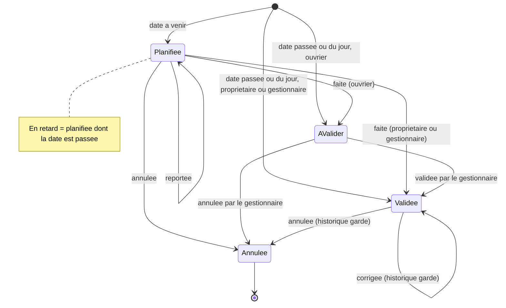

# F6 — Journal des opérations et registre phyto : document métier

Public : responsable produit, agronome, partenaire (coopérative, financeur). Sources : CPS section 11, spec, décisions et statut de la fonctionnalité, code livré.

## 1. Objectif et valeur pour l'agriculteur

Tout ce qui se fait sur la ferme est noté en quelques secondes, avec ou sans réseau.
L'agriculteur est prévenu quand un traitement sort de l'homologation, sans jamais être bloqué.
Il peut produire un registre de traitements à montrer à une coopérative, un exportateur ou un contrôleur.

## 2. Acteurs et rôles

| Acteur | Ce qu'il peut faire | Ce qu'il ne voit pas |
| --- | --- | --- |
| Propriétaire | Noter, planifier, valider, corriger, annuler, exporter le registre ; ses saisies sont validées d'emblée | Les données d'autres fermes |
| Gestionnaire | Mêmes droits que le propriétaire sur la ferme : valider les travaux des ouvriers, corriger, exporter | Les données d'autres fermes |
| Ouvrier | Noter un travail (il reste « à valider ») ; reporter ses propres travaux planifiés | Ce que son rôle n'autorise pas ; il ne valide ni ne corrige |
| Coopérative, exportateur, contrôleur | Reçoit le registre exporté (fichier) | Tout le reste ; l'accès direct par partage relève de F9 |

## 3. Glossaire métier

| Terme | Sens dans l'application |
| --- | --- |
| Opération | Un travail noté : traitement phyto, fertilisation, irrigation, travail du sol, semis ou plantation, taille, désherbage, récolte, autre |
| Planifiée | Opération à date future ; elle déclenche un rappel le jour venu |
| En retard | Planifiée dont la date est passée ; état déduit, pas un statut |
| À valider | Opération d'un ouvrier, en attente du gestionnaire |
| Validée | Opération confirmée ; elle reste corrigeable avec historique |
| Registre phyto | Liste des traitements avec date, parcelle, culture, produit, matière active, dose, surface, opérateur et avertissements |
| Avertissement | Alerte (produit non autorisé sur la culture, dose trop forte, trop de passages, délai avant récolte) ; jamais un blocage |
| DAR (délai avant récolte) | Nombre de jours à attendre entre un traitement et la récolte |
| Date de récolte au plus tôt | Date la plus lointaine parmi les DAR restants de la parcelle |
| Produit « non contrôlé » | Produit saisi à la main, absent du catalogue : aucun contrôle d'homologation |
| Dictée | Saisie à la voix, confirmée par l'agriculteur avant enregistrement |

## 4. Processus métier

Cycle de vie d'une opération :

## 5. Règles métier

| N° | Règle | Source |
| --- | --- | --- |
| RM-1 | Seuls le type, la parcelle et la date sont obligatoires | CPS §11 ; FR-002 |
| RM-2 | Pour un traitement, produit et dose sont demandés mais jamais exigés | CPS §11 ; FR-003 |
| RM-3 | Une opération peut couvrir plusieurs parcelles ; les quantités sont réparties selon la surface | CPS §11 ; FR-004 |
| RM-4 | Les contrôles phyto (homologation sur la culture, dose maximale, nombre d'applications, DAR) ne font qu'avertir | CPS §11 ; FR-006, FR-007 |
| RM-5 | Tout avertissement ignoré reste écrit dans le registre | CPS §11 ; FR-007 |
| RM-6 | Produit hors catalogue : saisie libre, signalée « non contrôlé » ; aucun produit non homologué n'est recommandé | FR-017 ; CPS principe 5 |
| RM-7 | La date de récolte au plus tôt suit le DAR le plus long restant et se recalcule à chaque correction ou suppression | CPS §11 ; FR-008 |
| RM-8 | Une date future crée une opération planifiée avec rappel le jour venu, y compris saisie hors réseau | FR-009 |
| RM-9 | Une planifiée non faite reste visible « en retard » : reporter, faire ou annuler | spec récit 4 |
| RM-10 | Un travail d'ouvrier est « à valider » jusqu'au feu vert du gestionnaire ; ce que note un propriétaire ou gestionnaire est validé d'emblée | FR-013 |
| RM-11 | Une opération validée reste corrigeable ; chaque correction garde auteur, date, avant et après | CPS §11 ; FR-014 |
| RM-12 | Le journal fournit les opérations « faites » au bilan hydrique (F4) et aux coûts (F8) | CPS §11 ; FR-015 |
| RM-13 | Saisie et consultation fonctionnent sans réseau (30 jours) ; ce qui n'est pas envoyé est signalé ; aucune donnée perdue | FR-016 ; CPS §15 |
| RM-14 | Une dictée n'est jamais enregistrée sans confirmation ; les champs incertains sont proposés, pas devinés | FR-010 ; spec récit 5 |
| RM-15 | Le registre exporté (PDF, Excel) porte les mêmes lignes et colonnes ; un registre n'est pas une certification | FR-011, FR-012 ; CPS hors périmètre |
| RM-16 | Accès limité à la ferme et au rôle, contrôlé côté serveur | FR-018 |
| RM-17 | Conservation du registre : 5 ans par défaut, à confirmer par un juriste ; à la suppression d'un compte, les données personnelles sont anonymisées et les lignes du registre conservées | decisions.md (« À confirmer ») |

## 6. Critères d'acceptation

« Couvert » = tests automatisés sur le serveur et le domaine (voir section 7). Aucun critère n'est vérifié sur un écran mobile : les écrans ne sont pas livrés.

| Critère | Priorité | État |
| --- | --- | --- |
| Enregistrer une opération par icône, sans autre champ obligatoire | P1 | Serveur et règles couverts ; écran non livré |
| Opération hors réseau conservée puis synchronisée sans perte | P1 | Couvert côté serveur et règles ; écran non livré |
| Répartition d'une quantité au prorata des surfaces | P1 | Couvert |
| Enregistrement en moins de 15 secondes (SC-001) | P1 | Non mesurable : pas d'écran |
| Traitement : avertissements dose, produit non autorisé, passages, conservés au registre | P1 | Couvert |
| Recherche de produit par nom | P1 | Service couvert ; catalogue de produits non fourni (voir section 7) |
| Reconnaissance de l'étiquette par photo | P1 | Partiel : service prévu avec repli, fournisseur de reconnaissance non branché |
| Date de récolte au plus tôt (DAR 21 j, plusieurs produits, recalcul) | P1 | Couvert ; affichage sur la fiche parcelle non livré |
| Planification, rappel, passage à « faite », retard | P1 | Partiel : règles et rappels locaux couverts ; écran non livré |
| Dictée : préremplissage, champs incertains, confirmation obligatoire | P1 | Partiel : règles de confirmation couvertes ; analyse de la phrase non branchée (service d'analyse non défini) |
| Export PDF et Excel avec colonnes et avertissements | P2 | Couvert côté serveur ; partage WhatsApp et écran non livrés |
| Travail d'ouvrier à valider, validation, historique des corrections | P2 | Couvert côté serveur ; écrans non livrés |

## 7. Ce qui est livré et ce qui ne l'est pas

**Livré (fusionné le 2026-11-07)**

- Serveur : création, consultation, correction, annulation, report, validation et historique des opérations ; contrôles phyto ; date de récolte au plus tôt ; export du registre en PDF et Excel (français, arabe, darija) ; accès par ferme et rôle ; synchronisation hors ligne.
- Règles métier partagées (domaine) : contrôles phyto, date de récolte, répartition par surface, états d'une opération.
- Mobile, sans écran : logique de préparation du journal, du formulaire, de la date de récolte, des contrôles locaux, du cache du catalogue et des rappels locaux (notifications sur le téléphone, 8 h le jour venu).
- Anonymisation à la suppression de compte, avec conservation du registre.

**Non livré**

- Tous les écrans mobiles de F6 (journal, choix d'icône, formulaire, traitement, étiquette, date de récolte, planifiées, dictée, export, validation, historique). Raison : la maquette n'a pas reçu la validation humaine (porte design) et la refonte du design (004-design-system) n'est pas fusionnée. Aucun test bout en bout mobile n'existe donc.
- Données de référence : aucun chargement du catalogue des produits homologués n'est fourni dans le code livré. Source prévue : PhytoIndex/ONSSA (CPS §17, §19) ; procédure d'import non définie dans la spec.
- Reconnaissance d'étiquette et analyse de la dictée : interfaces prévues avec repli ; fournisseurs à décider (décisions.md).
- Dérogation : taille de l'application portée à 52 Mo (au lieu de 40 Mo) pour cette fonctionnalité, acceptée par le porteur du projet.
- Durée de conservation du registre (5 ans) et articulation avec la suppression de compte : à confirmer.

## 8. Indicateurs de réussite

Spec (SC-001 à SC-007) :

- Enregistrement en moins de 15 secondes pour un utilisateur entraîné.
- 100 % des dépassements (dose, homologation, passages) avertis et conservés au registre.
- Date de récolte exacte dans 100 % des cas de test.
- Aucune perte après 30 jours hors ligne.
- Colonnes exigées présentes à 100 % dans le PDF et l'Excel.
- Au moins 4 agriculteurs sur 5 enregistrent un traitement sans aide au test de prototype.
- Écrans vérifiés dans trois langues et quatre états.

CPS §1 : au moins 4 opérations enregistrées par mois et par exploitation active (cible à 12 mois, hypothèse à valider). SC-001, SC-006 et SC-007 ne sont pas mesurables tant que les écrans n'existent pas.

## 9. Hors périmètre

- Certification officielle.
- Paie des ouvriers.
- Calcul des coûts (F8) et du bilan hydrique (F4) : seule la fourniture des opérations est ici.
- Recommandation de traitement (diagnostic F5).

## 10. Risques et questions ouvertes

- Sans écran, la fonctionnalité n'est pas utilisable par un agriculteur : la validation des maquettes est le point bloquant.
- Sans catalogue chargé, les contrôles d'homologation n'ont pas de données : qui fournit et met à jour PhytoIndex, et à quel rythme (mensuel selon le CPS) ?
- Durée légale de conservation du registre : à valider (loi 09-08, CNDP, ONSSA).
- Fournisseurs de reconnaissance d'étiquette et de dictée en darija : non choisis.
- Valeur du registre auprès des auditeurs : il n'est pas une certification ; acceptation par les coopératives non définie dans la spec.
