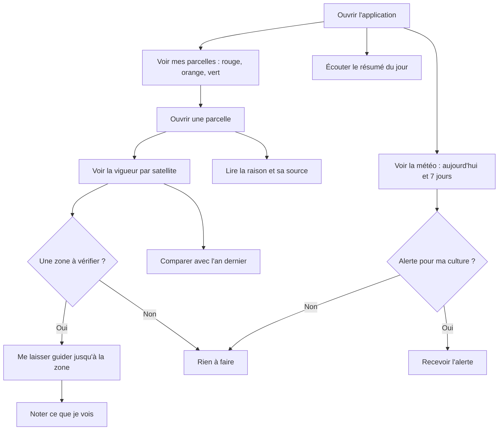

# أيلال: ضيعتي يومًا بيوم

> **أين وصلنا؟ غير قابل للاستعمال بعد داخل التطبيق.**
> **جاهز اليوم (في الخلفية):** حساب التنبيهات ولون القطع والمناطق التي تحتاج تفقدًا، وحماية بياناتك، وتحديد ما يراه العامل.
> **قريبًا:** كل الشاشات (لوحة المتابعة، الطقس، التنبيهات، قوة النبات، المنطقة التي تحتاج تفقدًا، المقارنة، الملخص الصوتي). التصاميم ما زالت تنتظر الموافقة.
> لا تبحث عن هذه الأزرار: لم تظهر بعد. ستضاف أسماؤها الدقيقة لاحقًا.
> **لم تربط بعد:** الطقس والقمر الصناعي والإشعارات.
> **لم تحدد بعد:** حدود التنبيه لكل محصول (الصقيع، الريح، المطر، الشركي). بدونها لا يعرض التطبيق **أي تنبيه ولا أي منطقة للتفقد**.
> هذا الدليل يشرح ما هو **مخطط له**.

## 1. فيمَ يفيد

عند فتح التطبيق ترى في 30 ثانية أي القطع تحتاج انتباهك.
وتعرف السبب: الطقس، قوة النبات من القمر الصناعي، أو أشغال متأخرة.

## 2. ما تحتاجه قبل البدء

- حساب وضيعة جاهزان.
- موقع الضيعة محدد على الخريطة. بدونه لا طقس.
- قطعك الأرضية (الفدادين) مرسومة ومحصولها مختار.
- الشبكة (الإنترنت) ليست إجبارية. بدونها ترى آخر المعطيات مع تاريخها.

## 3. خطوة بخطوة (مخطط)

### رؤية طقس ضيعتي

1. افتح التطبيق. تظهر لوحة المتابعة.
2. انظر إلى طقس اليوم.
3. انظر إلى الأيام السبعة التالية.
4. كل يوم يعرض: الحرارة، المطر، الريح، الرطوبة. وتصاحبها صورة صغيرة.
5. موقع الضيعة غير دقيق؟ يطلب منك التطبيق تحديده.

### رؤية حالة قطعي

1. في لوحة المتابعة، انظر إلى قائمة القطع.
2. أحمر: يُنصح بعمل. هذه القطع في الأعلى.
3. برتقالي: تحتاج مراقبة. تأتي بعدها.
4. أخضر: لا شيء لتفعله.
5. كل قطعة تعطي سببها في جملة واحدة.
6. المس قطعة برتقالية أو حمراء لترى التفاصيل.
7. كل سبب يقول من أين جاء: الطقس، القمر الصناعي، السقي، الأمراض أو أشغال متأخرة.
8. قطعة بلا مشكل خضراء: «لا شيء لتفعله».
9. في حالة الشك يضع التطبيق البرتقالي لا الأخضر.

### تلقي تنبيه الطقس

1. يصلك تنبيه على الهاتف إذا كان الطقس يهدد محصولك.
2. قد يتعلق بالصقيع، أو الشركي (ريح حارة وجافة)، أو مطر غزير، أو ريح قوية.
3. يذكر القطعة ودرجة الخطورة والسبب.
4. التنبيه يراعي محصولك ومرحلة نموه. صقيع لا يضر محصولك لا يطلق شيئًا.
5. صقيع متوقع بعد 48 ساعة: تُنبَّه في اليوم السابق قبل الساعة 6 مساءً.
6. ريح قوية: ينصحك التنبيه بعدم العلاج في ذلك اليوم.
7. نفس التوقع: تنبيه واحد فقط. إذا تغير التوقع يتحدث التنبيه.
8. لا خطر: «لا تنبيه لمحاصيلك».

### رؤية قوة نبات القطعة من القمر الصناعي

1. افتح قطعة.
2. انظر إلى خريطة قوة النبات («الحيوية»).
3. انظر إلى المنحنى منذ بداية الموسم.
4. انظر أيضًا إلى رطوبة النبات.
5. قطعة جديدة: تصل الاثنا عشر شهرًا الماضية في أقل من 10 دقائق.
6. سحب كثيرة: لا تعرض صورة اليوم. تبقى آخر صورة جيدة مع تاريخها.
7. قطعة أقل من 0.3 هكتار أو تحت بيت بلاستيكي: الصورة قليلة الثقة. تعتمد الحالة على الطقس وملاحظاتك.

### الذهاب إلى منطقة للتفقد

1. يحيط التطبيق على الخريطة منطقة تنخفض فيها قوة النبات أكثر من اللازم.
2. يقترح عليك الذهاب لرؤيتها.
3. إذا قبلت، يرشدك إلى المنطقة.
4. الإرشاد يشتغل بلا شبكة على الخرائط التي رأيتها من قبل.
5. في عين المكان سجل ما ترى. الملاحظة تبقى مرتبطة بالمنطقة.
6. لا منطقة: لا يعرض شيء.

### المقارنة مع السنة الماضية

1. افتح القطعة.
2. فعّل المقارنة.
3. يظهر المنحنيان معًا، على نفس التواريخ.
4. لا معطيات للسنة الماضية؟ تشرح رسالة ذلك. لا يظهر منحنى فارغ.

### سماع ملخص اليوم

1. كل صباح يصلك إشعار.
2. المسه لتسمع الملخص.
3. يبدأ بالقطع الحمراء، ثم القطع التي تحتاج مراقبة، ثم الطقس.
4. يكون بلغتك: الدارجة أو العربية أو الفرنسية.
5. القراءة غير ممكنة؟ يظهر النص بدلها.
6. بلا شبكة، ملخص وصل من قبل يبقى مسموعًا.

### ما يراه العامل

- العامل لا يرى إلا القطع الموكولة إليه.
- لا يصله إلا تنبيه وملخص هذه القطع.
- المالك والمسيرون يرون كل القطع.

## 4. المسار بالصورة

## 5. أسئلة متكررة

**هل أستعمل كل هذا الآن؟**
لا. الشاشات لم تجهز. هذا الدليل يشرح ما هو مخطط.

**لماذا لا يصلني أي تنبيه؟**
حدود كل محصول لم تحدد بعد. بدونها لا يقول التطبيق شيئًا.

**هل القطعة الخضراء تعني أن كل شيء بخير؟**
تعني: لا شيء لتفعله حسب ما يعرفه التطبيق. اذهب لرؤيتها مع ذلك.

**هل القطعة المؤرشفة تعطي تنبيهات؟**
لا. تختفي من لوحة المتابعة.

**هل معطياتي ملكي؟**
نعم. يمكنك إخراجها. وتحذف مع حسابك.

## 6. إذا لم يشتغل

- **بلا شبكة**: ترى آخر المعطيات مع تاريخها. شريط يخبرك بذلك.
- **لا طقس**: تأكد أن موقع الضيعة محدد على الخريطة.
- **لا صورة من القمر الصناعي**: سحب كثيرة أو قطعة جديدة جدًا. انتظر. تبقى آخر صورة جيدة ظاهرة.
- **لا تنبيه**: أمر عادي حاليًا، الحدود لم تحدد بعد.
- **الإرشاد غير ممكن**: الموقع أو الطريق غير متاح. انظر إلى المنطقة على الخريطة وامش نحوها.
- **الملخص لم يُقرأ**: اقرأ النص الظاهر.
- **رسالة خطأ**: اضغط «إعادة المحاولة». المعطيات الظاهرة تبقى.
