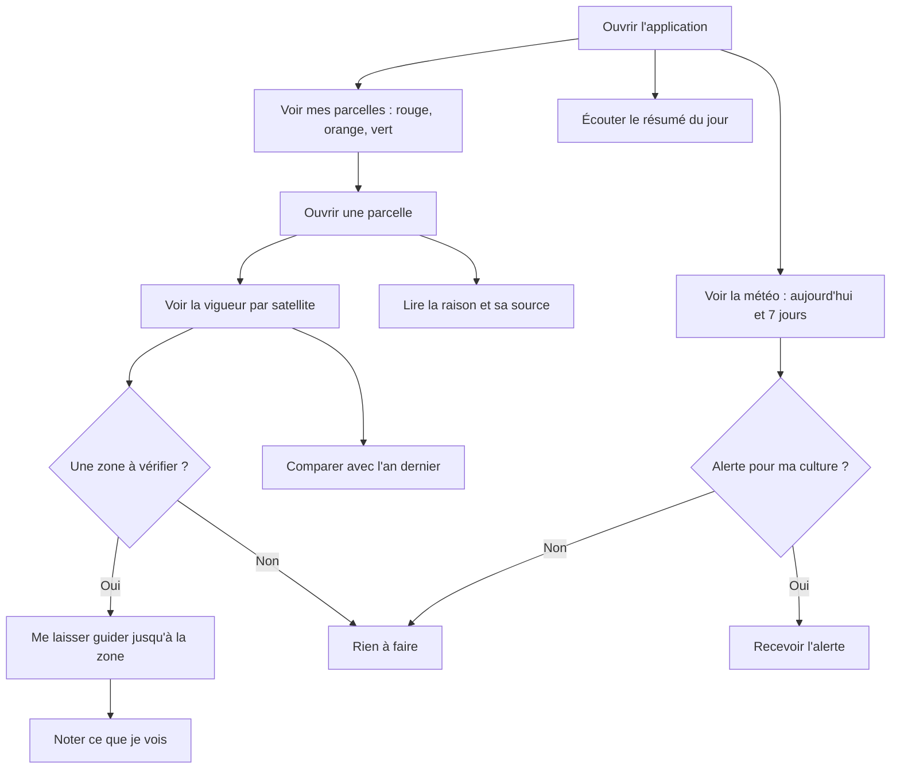

# AYLAL : ma ferme au jour le jour

> **Où en est-on ? Pas encore utilisable dans l'application.**
> **Prêt aujourd'hui (en coulisses) :** le calcul des alertes, de la couleur des parcelles et des zones à vérifier ; la protection de vos données ; l'accès limité des ouvriers.
> **À venir :** tous les écrans (tableau de bord, météo, alertes, vigueur, zone à vérifier, comparaison, résumé vocal). Les maquettes attendent leur validation.
> Ne cherchez pas ces boutons : ils n'existent pas encore. Leurs noms exacts seront ajoutés plus tard.
> **Pas encore branchés :** la météo, le satellite et les notifications.
> **Pas encore fixés :** les seuils d'alerte par culture (gel, vent, pluie, chergui). Sans eux, l'application n'affiche **ni alerte ni zone à vérifier**.
> Ce guide décrit ce qui est **prévu**.

## 1. À quoi ça sert

En ouvrant l'application, vous voyez en 30 secondes quelles parcelles demandent votre attention.
Vous savez aussi pourquoi : météo, vigueur vue du satellite, travaux en retard.

## 2. Ce qu'il faut avant de commencer

- Avoir déjà un compte et une ferme.
- Avoir situé votre ferme sur la carte. Sans cela, pas de météo.
- Avoir déjà dessiné vos parcelles et choisi leur culture.
- Le réseau n'est pas obligatoire. Sans réseau, vous voyez les dernières données, avec leur date.

## 3. Pas à pas (prévu)

### Voir la météo de ma ferme

1. Ouvrez l'application. Le tableau de bord s'affiche.
2. Regardez la météo d'aujourd'hui.
3. Regardez les 7 jours suivants.
4. Chaque jour montre : température, pluie, vent, humidité. Une petite image les accompagne.
5. Ferme sans lieu précis ? L'application vous demande de le préciser.

### Voir l'état de mes parcelles

1. Sur le tableau de bord, regardez la liste des parcelles.
2. Rouge : une action est conseillée. Ces parcelles sont en premier.
3. Orange : à surveiller. Elles viennent ensuite.
4. Vert : rien à faire.
5. Chaque parcelle donne sa raison en une phrase.
6. Touchez une parcelle orange ou rouge pour voir le détail.
7. Chaque raison dit d'où elle vient : météo, satellite, arrosage, maladies ou travaux en retard.
8. Une parcelle sans problème est verte : « rien à faire ».
9. Un doute ? L'application met orange, pas vert.

### Recevoir une alerte météo

1. Une alerte arrive sur le téléphone si la météo menace votre culture.
2. Elle peut parler de gel, de chergui (vent chaud et sec), de forte pluie ou de vent fort.
3. Elle dit la parcelle, la gravité et la raison.
4. L'alerte tient compte de votre culture et de son stade. Un gel qui ne gêne pas votre culture ne déclenche rien.
5. Gel prévu dans 48 heures : vous êtes prévenu la veille, avant 18 h.
6. Vent fort : l'alerte vous déconseille de traiter ce jour-là.
7. Même prévision : une seule alerte. Si la prévision change, elle est mise à jour.
8. Pas de menace : « Aucune alerte pour vos cultures ».

### Voir la vigueur d'une parcelle par satellite

1. Ouvrez une parcelle.
2. Regardez la carte de la vigueur.
3. Regardez la courbe depuis le début de la campagne.
4. Regardez aussi l'humidité des plantes.
5. Parcelle neuve : les 12 derniers mois arrivent en moins de 10 minutes.
6. Trop de nuages : l'image du jour n'est pas montrée. Vous gardez la dernière bonne image, avec sa date.
7. Parcelle de moins de 0,3 ha ou sous serre : l'image est peu fiable. L'état se fie à la météo et à vos observations.

### Aller voir une zone à vérifier

1. L'application entoure sur la carte une zone où la vigueur baisse trop.
2. Elle vous propose d'aller voir.
3. Si vous acceptez, elle vous guide jusqu'à la zone.
4. Le guidage marche sans réseau sur les cartes déjà vues.
5. Sur place, notez ce que vous voyez. La note reste liée à la zone.
6. Aucune zone : rien n'est affiché.

### Comparer avec l'année dernière

1. Ouvrez la parcelle.
2. Activez la comparaison.
3. Les deux courbes s'affichent ensemble, sur les mêmes dates.
4. Pas d'historique de l'an dernier ? Un message l'explique. Il n'y a pas de courbe vide.

### Écouter le résumé du jour

1. Chaque matin, une notification arrive.
2. Touchez-la pour écouter le résumé.
3. Il parle des parcelles rouges d'abord, puis de celles à surveiller, puis de la météo.
4. Il est dans votre langue : darija, arabe ou français.
5. Lecture impossible ? Le texte s'affiche à la place.
6. Sans réseau, un résumé déjà reçu reste écoutable.

### Ce que voit un ouvrier

- L'ouvrier ne voit que les parcelles qui lui sont confiées.
- Il reçoit les alertes et le résumé de ces parcelles seulement.
- Le propriétaire et les gestionnaires voient toutes les parcelles.

## 4. Parcours en image

## 5. Questions fréquentes

**Puis-je déjà utiliser tout cela ?**
Non. Les écrans ne sont pas prêts. Ce guide dit ce qui est prévu.

**Pourquoi je ne reçois aucune alerte ?**
Les seuils par culture ne sont pas encore fixés. Sans eux, l'application ne dit rien.

**Une parcelle verte veut-elle dire que tout va bien ?**
Elle veut dire : rien à faire d'après ce que l'application sait. Allez quand même la voir.

**Une parcelle archivée donne-t-elle des alertes ?**
Non. Elle disparaît du tableau de bord.

**Mes données sont-elles à moi ?**
Oui. Vous pouvez les sortir. Elles sont supprimées avec votre compte.

## 6. Si ça ne marche pas

- **Pas de réseau** : vous voyez les dernières données, avec leur date. Un bandeau le dit.
- **Pas de météo** : vérifiez que la ferme est bien située sur la carte.
- **Pas d'image satellite** : trop de nuages, ou parcelle trop neuve. Attendez. La dernière bonne image reste visible.
- **Aucune alerte** : normal pour le moment, les seuils ne sont pas encore fixés.
- **Guidage impossible** : position ou itinéraire indisponible. Regardez la zone sur la carte et marchez vers elle.
- **Résumé non lu** : lisez le texte affiché.
- **Message d'erreur** : appuyez sur « Réessayer ». Les données déjà affichées restent.
