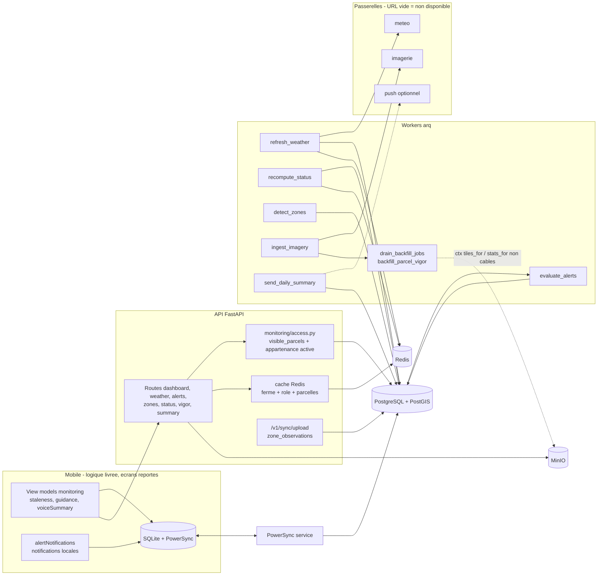
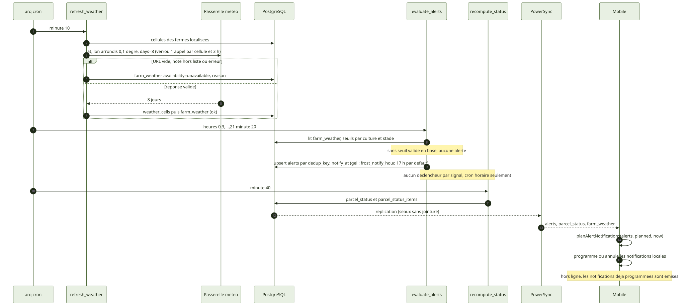
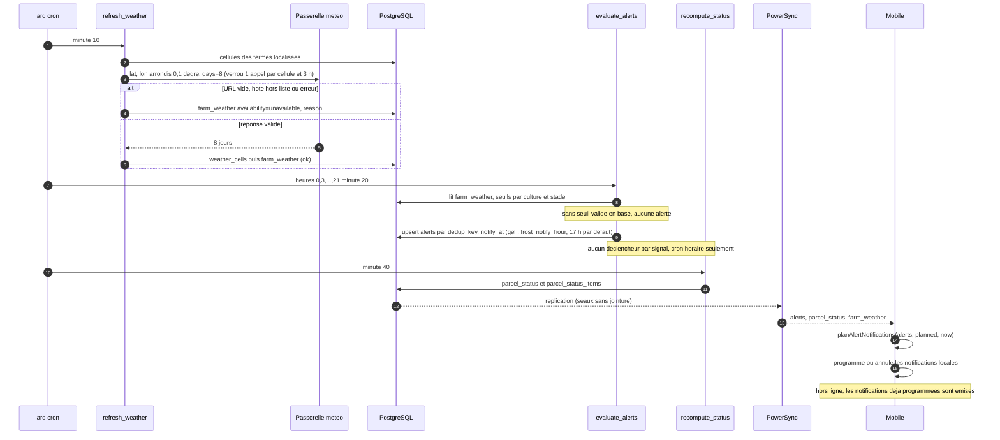
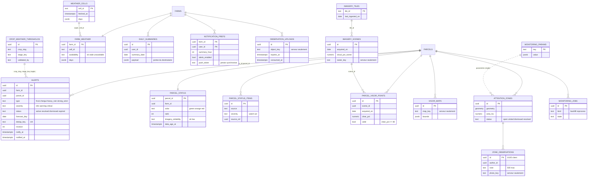
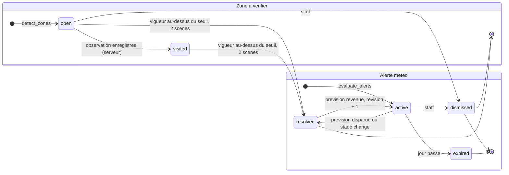

# F3 — Tableau de bord et monitoring : document ingénieur

Branche `006-dashboard-monitoring`. Sources : `specs/006-dashboard-monitoring/{spec,plan,data-model,decisions}.md`, migrations `0010` et `0011`, code `services/api/app/monitoring`, `services/workers`, `packages/domain`, `apps/mobile/src/monitoring`.

## 1. Résumé

**Objectif** : météo J+7, alertes météo par culture et stade, état en couleur par parcelle (vert, orange, rouge), vigueur satellite (courbe, carte, comparaison N-1), zones à vérifier avec observation, résumé quotidien et vocal.

**Livré** : migrations `0010` (17 tables) et `0011` (`parcel_scene_log`), routes REST, écriture des observations par `/v1/sync/upload`, règles PowerSync, tâches worker, règles pures TS/Python à vecteurs partagés, view models mobiles non-écran, clés i18n `ary/ar/fr`.

**Non livré ou non vérifié, à ne pas présumer**

| Sujet | État |
| --- | --- |
| Écrans F3-E1 à E8, Maestro, Storybook | Reportés : porte design T004 (validation humaine) non donnée et fusion de `004-design-system` attendue. Aucun fichier de `packages/ui` ni de `docs/design/` touché. Composants UI manquants listés dans `decisions.md` point 5. |
| Passerelles météo, imagerie, push | `AYLAL_WEATHER_URL`, `AYLAL_IMAGERY_URL`, `AYLAL_PUSH_URL` vides par défaut : réponse « non disponible », aucun appel réseau, aucune valeur inventée. Hébergeur marocain à choisir (constitution XIII). |
| Seuils agronomiques | **Aucun semé** : `crop_weather_thresholds` est vide en production (import `import_crop_thresholds` ultérieur, validé agronome). Sans seuils : aucune alerte. `anomaly_drop`, `anomaly_min_pixels`, `anomaly_resolved_vigor` absents de `monitoring_params` : `detect_zones` ne détecte ni ne résout rien. |
| Lecture des rasters | `backfill_parcel_vigor` lit via `ctx["tiles_for"]` et `ctx["stats_for"]`, **non câblés** : sans eux le job passe `failed`. `ingest_imagery` n'enregistre que des scènes (tuile publique, dates). |
| Recalcul d'état < 5 min après un signal | **Non implémenté ni testé** : seul le cron horaire (minute 40) et le verrou `monitoring:{farm}` existent. |
| `expo-speech`, `expo-location` | Déclarés mais l'impact APK est à re-mesurer avec les écrans (T085). |
| Budget APK | Dérogation 52 Mo pour cette branche (`specs/006-dashboard-monitoring/apk-budget.env`) ; mesure 50 480 024 o, défaut 40 Mo, plafond absolu 60 Mo. |
| E2E Maestro | Non exécutés ; seuls les e2e API existent. |
| Consommateur `reprocess` | Les lignes `monitoring_jobs kind=reprocess` ne sont pas vidées (récit imagerie). |

## 2. Architecture

Un seul module d'accès, `app/monitoring/access.py` (`visible_parcels(ctx)`, SQL partagé `access_sql.py` copié dans l'image worker), est appelé par REST, synchro, export, purge, agrégats et workers. Les passerelles (`gateways.py`, copie dans l'image worker) ne sont appelées que par les workers, jamais par une requête utilisateur.

## 3. Flux principaux

Planification (`services/workers/worker.py`) : `refresh_weather` minute 10 ; `evaluate_alerts` toutes les 3 h minute 20 ; `recompute_status` minute 40 ; `detect_zones` 6 h ; `send_daily_summary` minute 5 ; `drain_backfill_jobs` minutes 3, 13, 23, 33, 43, 53. Un événement invalide le cache par `bump_data_version` (clé Redis `dashver:{farm}`).

Garantie « avant 18 h » : tenue par notification locale à partir d'alertes déjà synchronisées. Une prévision de gel apparue sans synchronisation de l'appareil ne passe que par le push (passerelle facultative, vide). Une alerte de gel est ré-émise (`notified_at` remis à NULL, `revision` + 1) seulement si sa sévérité augmente.

## 4. Modèle de données

- **Globales (5, sans `farm_id`, sans donnée personnelle)** : `crop_weather_thresholds`, `monitoring_params`, `imagery_tiles`, `imagery_scenes`, `weather_cells`.
- **Par ferme (12)** : `farm_weather`, `alerts`, `parcel_status`, `parcel_status_items`, `parcel_vigor_points`, `vigor_maps`, `attention_zones`, `zone_observations`, `observation_uploads`, `daily_summaries`, `notification_prefs`, `monitoring_jobs`. S'y ajoute `parcel_scene_log` (migration `0011`, non synchronisée, cascade avec la parcelle).
- Clés étrangères composites `(farm_id, parcel_id)` ; `parcel_archived_at` recopié par triggers pour des règles PowerSync sans jointure ; `valid` = colonne générée `clear_pct >= 80` ; ≤ 20 alertes actives et ≤ 5 zones ouvertes par parcelle.
- Clés d'objets (`raster_key`, `map_key`, `photo_key`, `object_key`) et `push_token` : serveur seulement, jamais synchronisés ni exposés (cartes servies par URL signée 15 min, `/` encodés en `%2F`).
- Colonnes `ndvi_mean`/`ndmi_mean` côté code ; l'interface n'affiche que « vigueur » et « humidité des plantes ».
- Aucune suppression physique par l'utilisateur ; purge de compte et cascade d'archivage de parcelle (90 jours, F2) seulement.

## 5. États

- Zone : seul le serveur fait `open -> visited` (observation REST ou synchro) ; une zone `dismissed` ou `resolved` n'est jamais rouverte ; une observation refusée laisse la zone `open`. Une zone qui recoupe une zone `open`, `visited` ou `dismissed` n'est pas recréée.
- Alerte : une prévision absente ne résout l'alerte que si le jour est couvert par la météo stockée ; les jours passés sont expirés avant la résolution. Même `dedup_key` au retour de la prévision.
- Météo : `farm_weather.availability` `ok|stale|unavailable` (obsolète au-delà de `weather_stale_hours` = 24).

## 6. API

Préfixe `/v1/farms/{farm_id}`. Les trois rôles lisent ; l'ouvrier est limité à ses parcelles attribuées et non archivées.

| Méthode et chemin | Rôles | Remarques |
| --- | --- | --- |
| `GET /dashboard?limit=` | tous | ETag dérivé du contenu (304), agrégats sur la portée ; `limit` hors bornes : 422 `limit_out_of_range` |
| `GET /weather?days=8` | tous | `days` autre que 8 : 422 `horizon_must_be_8_days` ; ferme sans position : `farm_not_located` ; passerelle absente : `unavailable` + `reason` |
| `GET /alerts`, `POST /alerts/{id}/dismiss` | lecture tous ; dismiss owner/manager | ouvrier : 403 |
| `GET /zones`, `POST /zones/{id}/dismiss` | idem | |
| `POST /zones/{id}/observations/photo` | tous (parcelle attribuée) | 413 `payload_too_large`, 415 `unsupported_image` ; renvoie un `photo_id` opaque (usage unique, 24 h) |
| `POST /zones/{id}/observations` | tous (parcelle attribuée) | 201 ; 422 `invalid_object_ref` ; 429 quota (20/zone, 2 000/ferme/an) + `Retry-After` |
| `GET /parcels/{p}/status` | tous | 404 si archivée ou état non calculé |
| `GET /parcels/{p}/vigor`, `/vigor/compare`, `/vigor/scenes/{s}/map` | tous | fenêtre par défaut 24 mois, plafond 200 points ; 422 `window_too_long` ; carte par URL signée |
| `POST /parcels/{p}/vigor/reprocess` | owner/manager | 202 ; ouvrier 403 ; 429 `quota_exceeded` (3/parcelle/jour, 5 tâches actives/ferme) |
| `GET /summary/today`, `PUT /summary/settings` | tous (les siens) | `summary_hour` 0-23 sinon 422 ; `weather_code` `null` si inconnu |

Erreurs communes : 404 de corps identique `{"detail":"not_found"}` pour non-membre, membre retiré, ferme inconnue ou supprimée, parcelle non attribuée ou archivée. Limites horaires Redis par utilisateur, ferme et IP : photo 30, reprocess 10, series 120, compare 60, summary 120 (429 + `Retry-After`). Écriture mobile : `ps_crud` vers `POST /v1/sync/upload` (`zone_observations`, rejet `quota_exceeded`).

## 7. Règles métier et où elles sont codées

| Règle | Code |
| --- | --- |
| Seuils par culture et stade, sévérité (gel `critical` à 1 °C sous le seuil, pluie forte `critical` à 1,5 x) | `packages/domain/src/alert-rules.ts`, `weather-thresholds.ts` ; `services/api/app/domain/alert_rules.py`, `weather_thresholds.py` ; vecteurs `packages/domain/vectors/f3_alert_rules.json` |
| Scène retenue si ciel dégagé ≥ 80 %, fiabilité faible < 0,3 ha | `imagery-reliability.ts` / `imagery_reliability.py` ; `monitoring/imagery.py` |
| État de parcelle, tri rouge puis orange, source indisponible ignorée, imagerie peu fiable écartée de `vigor_anomaly` | `monitoring/status_sources.py`, `workers/tasks/recompute_status.py` |
| Détection de zones (surface mini 0,3 ha, contour simplifié Douglas-Peucker, 5 ouvertes/parcelle, 200/ferme) | `monitoring/zones.py`, `workers/tasks/detect_zones.py` |
| Plafonds et quotas | `monitoring-limits.ts` / `monitoring_limits.py`, `monitoring/limits.py`, comptage sous `pg_advisory_xact_lock` |
| Fraîcheur des données (24 h) | `apps/mobile/src/monitoring/staleness.ts`, `packages/domain/src/staleness.ts` |
| Planning de notifications locales | `alertNotifications.ts`, `services/api/app/domain/notification_schedule.py` (copie worker) |
| Campagne et comparaison N-1 (début : `seasons.started_at`, sinon 1er septembre ; jamais d'extrapolation, `null` jamais zéro) | `packages/domain/src/vigor.ts`, `yearCompareViewModel.ts` |
| Résumé vocal (voix `ar-MA`, puis `ar*`, `fr*`, sinon texte) | `voice-summary.ts`, `voiceSummary.ts` |
| Matrice des rôles | `roles.py` / `roles.ts`, vecteur `f3_roles.json` |

### Modèle de sécurité

- **Appartenance active** : toute route passe par `farm_context`/`require` ; la synchro n'est ouverte que pour `farm_members.removed_at IS NULL`.
- **Agrégats sur la portée de l'appelant** : le tableau de bord, le résumé quotidien (`payload` limité au destinataire) et l'ETag n'intègrent que les parcelles visibles ; pas de `generated_at` ni de `data_version` dans l'ETag.
- **Clé de cache** : `dash:{farm}:{role}:{user si ouvrier}:{sha256 des parcelles visibles}:{data_version}` ; deux portées ne partagent jamais une entrée, une panne Redis ne casse pas la requête.
- **Seaux PowerSync sans jointure** : `farm_worker_monitoring` a un seul paramètre (`parcel_id`, depuis `worker_parcels`) et filtre `parcel_archived_at IS NULL`. Patron F6 pour les observations : seau distinct `farm_worker_observations` (paramètres `parcel_id` et `user_id`, filtre `author_id = bucket.user_id`), car le service refuse une requête qui ne couvre pas tous les paramètres de son seau. `user_summaries` est filtré par `(farm_id, user_id)` et soumis à l'appartenance active. `scripts/validate-sync-rules.sh` (`make sync-rules`) l'exécute.
- **Purge** : `lifecycle.purge_member_monitoring` (sortie de membre, changement de rôle) supprime résumés et préférences (jeton push compris) dans la même transaction ; `purge_farm_monitoring` à la suppression de ferme ; `worker_parcels` purgé de même.
- **Passerelles** : hôte HTTPS listé dans `AYLAL_EXTERNAL_ALLOWED_HOSTS` hors dev/test (démarrage refusé sinon) ; charge sortante à clés exactes (`assert_outbound`) : météo `lat, lon, days` (position arrondie à 0,1°, soit ~11 km), imagerie `mgrs, from, to` (identifiant de tuile public), push `device_token, alert_id, locale`. Aucune géométrie exacte ni donnée personnelle ne sort.
- **Limiteur** : clé avec `client_ip()` ; `X-Forwarded-For` compte seulement d'un proxy de `AYLAL_TRUSTED_PROXIES`. Le refus de quota précède tout appel de passerelle.
- **Objets opaques** : `photo_id` et `map_id` sans clé de stockage ; usage unique, 24 h ; motif de clé contraint par CHECK.
- **Jobs `backfill`** : `create_field` insère une ligne `monitoring_jobs` ; `drain_backfill_jobs` ne prend en cron que les jobs âgés d'au moins 120 s (cadence espacée), isole les échecs par job, traite `backfill` seulement, passe `failed` sans lecteurs raster, `skipped`/`failed` si la parcelle est archivée ou la ferme supprimée (lecture via `VISIBLE_PARCELS_SQL`).

## 8. Hors ligne et synchronisation

- Lecture : SQLite local alimenté par PowerSync (`farm_weather`, `alerts`, `parcel_status`, items, points, cartes, zones, résumés), toutes données datées (`describeFreshness`, seuil 24 h).
- Écriture : seules les observations de zone (UUID client, idempotent) passent par `ps_crud` vers `/v1/sync/upload`. Le serveur seul fixe le statut de la zone.
- Notifications locales : programmées/annulées par `planAlertNotifications` à partir des alertes synchronisées ; émises hors ligne.
- Guidage vers une zone : cap et distance calculés sur l'appareil (`createGuidance`), sans réseau ; voix : synthèse native, aucun TTS étranger.
- Pas de raster sur l'appareil : cartes PNG pré-rendues côté serveur, courbes plafonnées à 200 points.
- Volume attendu ≤ 1 Mo par ferme de 50 parcelles (objectif du plan, non mesuré ici).

## 9. Tests

Stratégie : RED puis GREEN (commits `test(...)` puis `feat(...)`).
- Domaine (Vitest) : vecteurs partagés `f3_*.json` rejoués en Python.
- API : unitaire, intégration (PostgreSQL, Redis, requêtes de seaux exécutées telles quelles), contrat (OpenAPI et règles de synchro), e2e (`test_f3_*_e2e.py`, tâches worker déclenchées par file arq avec `farm_id`), parité des chemins (`test_f3_path_parity.py`, `COVERED_TASKS`).
- Workers : `services/workers/tests` (`test_refresh_weather`, `test_detect_zones`, `test_ingest_imagery`, `test_send_daily_summary`, drain) avec passerelles et grilles espionnes injectées.
- Mobile : Jest sur les view models, `staleness`, notifications, guidage, résumé vocal.
- Exécution : `make test` (api, domain, mobile), `make test-worker`, `make sync-rules`, `make check-fast`, `make e2e-api`. Reconstruire l'image worker avant un test worker (`bash scripts/dc.sh --profile test build worker`, puis `scripts/tx.sh --no-deps worker pytest tests/<fichier>`).
- Couverture : seuil 80 % du code métier (`make coverage`) ; chiffre de ce lot non relevé dans ce document.
- Corrections de tests consignées (1 à 10 dans `decisions.md`) : motif à chaque fois contradiction avec la spec ou fixtures globales ; flaky `test_refresh_weather` (tranche de 3 h) et Redis partagé sous xdist (une base par worker, 1 à 8).
- Non couverts : écrans, Maestro, recalcul < 5 min après signal, 429 du résumé hors `test_f3_rate_limit.py`, push réel.

## 10. Exploitation Docker

- Aucun service permanent nouveau : API, worker arq (GDAL/rasterio, `libexpat` dans `services/workers/Dockerfile`), PostgreSQL/PostGIS, Redis, MinIO, PowerSync.
- Variables : `AYLAL_WEATHER_URL`/`_KEY`, `AYLAL_IMAGERY_URL`/`_KEY`, `AYLAL_PUSH_URL`/`_KEY` (vides par défaut), `AYLAL_EXTERNAL_ALLOWED_HOSTS`, `AYLAL_TRUSTED_PROXIES`.
- Commandes : `make up`, `make test`, `make test-worker`, `make sync-rules`, `make apk-size` (limite lue dans `apk-budget.env`, 52 Mo), `make diagrams`. E2E : `make up` avec `AYLAL_ENV=test AYLAL_ENABLE_TEST_OTP=1 AYLAL_ENABLE_DEV_TOKEN=1`, puis `scripts/tx.sh api-test pytest tests/e2e/test_f3_*_e2e.py` (limiteur d'OTP par IP).
- Migrations : `0010` provisoire, à recaler à la fusion.

## 11. Décisions et dettes techniques

| Point | Statut |
| --- | --- |
| Valeurs de seuils agronomiques, source de la liste initiale | Ouvert (agronome + équipe) |
| Hébergeur marocain des passerelles | Ouvert |
| Câblage `tiles_for`/`stats_for` (rasters) | Dette : sans lui, aucun historique de vigueur |
| Déclencheur de recalcul par signal (< 5 min) | Dette |
| Sévérité info/warning/critical : marges à confirmer (research 11) | Ouvert |
| Compte des tâches actives de `request_reprocess` sans filtre `kind` | Corrigé au défaut 2 (retraitements terminés exclus ; 5 parcelles créées puis 5 retraitements : 202) |
| Observation fait passer la zone à `visited` | Tranché (modèle de données, T062/T064) |
| Seau ouvrier à un paramètre + seau d'observations distinct | Tranché (moindre privilège, patron F6) |
| Écrans, porte T004, fusion 004, composants UI manquants | Reporté |
| Budget APK 52 Mo, re-mesure `expo-speech`/`expo-location` | Dérogation ; à justifier à nouveau |
| Au-delà de 200 points par courbe, bout conservé | Non figé par la spec |
| Cultures de test `fx_...` jamais supprimées (tables protégées) | Contournées dans 3 tests F2 |
