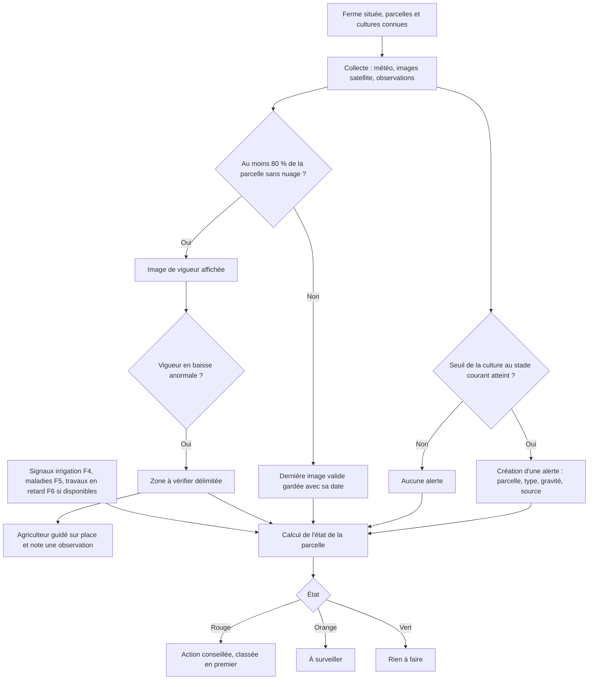
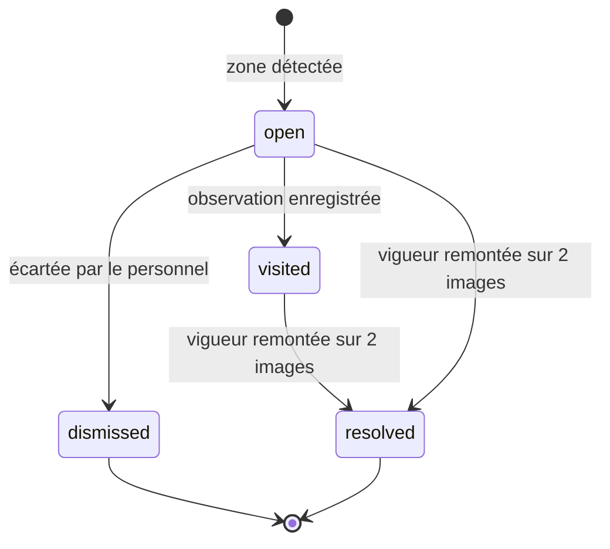

# F3 — Tableau de bord et monitoring : document métier

> État au 2026-11-08 : fonctionnalité **fusionnée côté serveur et logique**, **écrans mobiles reportés**, **passerelles externes non branchées**, **aucun seuil agronomique fourni**. Voir section 7.

## 1. Objectif et valeur pour l'agriculteur

En ouvrant l'application, l'agriculteur voit en 30 secondes quelles parcelles demandent son attention et pourquoi.
Il reçoit des alertes météo adaptées à ses cultures, suit la vigueur de ses parcelles par satellite et est guidé vers les zones qui décrochent.
Chaque parcelle porte une couleur (vert, orange, rouge) et une raison en une phrase.

## 2. Acteurs et rôles

| Acteur | Ce qu'il peut faire | Ce qu'il ne voit pas |
|---|---|---|
| Propriétaire | Voir météo, alertes, états, vigueur, zones de toutes les parcelles ; écarter une alerte ou une zone ; exporter ses données | Rien de sa ferme n'est caché |
| Gestionnaire | Comme le propriétaire pour toutes les parcelles (source : spec, clarifications) | Les autres fermes |
| Ouvrier | Voir alertes, état et résumé des parcelles qui lui sont attribuées ; noter une observation sur une zone d'une parcelle attribuée | Les parcelles non attribuées ; les observations des autres ouvriers |
| Équipe AYLAL / agronome | Maintenir les seuils d'alerte par culture et par stade | Les données des fermes |
| Systèmes externes (météo, satellite, notifications) | Fournir prévisions, images, envois | Aucune donnée personnelle (seules des clés opaques sont transmises) |

## 3. Glossaire métier

| Terme | Sens dans l'application |
|---|---|
| Vigueur | Santé de la végétation vue du satellite (le nom technique reste caché) |
| Humidité des plantes | Eau contenue dans la végétation vue du satellite |
| Alerte | Menace météo pour une parcelle : gel, chergui, forte pluie, vent fort |
| Chergui | Vent chaud et sec |
| Seuil | Valeur au-delà de laquelle une culture, à un stade donné, est menacée |
| Zone à vérifier | Partie de parcelle où la vigueur baisse anormalement |
| État de la parcelle | Vert (rien à faire), orange (à surveiller), rouge (action conseillée) |
| Campagne | Saison de culture d'une parcelle (F2) |
| Image fiable | Image avec au moins 80 % de la parcelle sans nuage |

## 4. Processus métier

Cycle de vie d'une zone à vérifier :

## 5. Règles métier

| N° | Règle | Source |
|---|---|---|
| RM-1 | La météo affichée couvre aujourd'hui et les 7 jours suivants : température, pluie, vent, humidité | CPS §8, FR-001 |
| RM-2 | Une alerte n'est émise que si le seuil de la culture au stade courant est atteint | FR-002, FR-003 |
| RM-3 | Types d'alerte : gel, chergui, forte pluie, vent fort (qui déconseille de traiter) | CPS §8, FR-002 |
| RM-4 | Gel prévu à 48 h sur une culture sensible : notification la veille avant 18 h | FR-004, SC-003 |
| RM-5 | Une alerte indique parcelle, type, gravité, source, statut ; pas de doublon pour une même prévision, mise à jour si elle change | FR-005, cas limites |
| RM-6 | Gravité : gel « critique » si le minimum est au moins 1 °C sous le seuil, sinon « avertissement » ; forte pluie « critique » à 1,5 fois le seuil ; chergui et vent fort « avertissement ». Marges à confirmer | decisions.md (GREEN) |
| RM-7 | Source satellite par défaut : Sentinel-2 (gratuit, 10 m, environ tous les 5 jours) | CPS §8, FR-007 |
| RM-8 | Une image n'est affichée que si au moins 80 % de la parcelle est sans nuage ; sinon la dernière image valide reste, avec sa date | FR-007, SC-004 |
| RM-9 | Les indices s'appellent « vigueur » et « humidité des plantes » | FR-008 |
| RM-10 | Parcelle de moins de 0,3 ha ou sous serre : imagerie peu fiable, l'état repose sur la météo et les observations | FR-009 |
| RM-11 | À la création d'une parcelle, 12 mois d'historique de vigueur en moins de 10 minutes | FR-010, SC-002 |
| RM-12 | Une zone à vérifier est délimitée, l'app propose d'y aller et guide par GPS, y compris hors réseau sur les cartes déjà vues | FR-011 |
| RM-13 | Une observation sur une zone la fait passer de « ouverte » à « visitée » ; une zone écartée ou résolue n'est jamais rouverte par une observation | decisions.md (arbitrage récit 4) |
| RM-14 | État de parcelle : vert / orange / rouge avec raison en une phrase ; combine alertes, vigueur, irrigation (F4), santé (F5), travaux en retard (F6) ; chaque élément cite sa source | FR-012, FR-013, SC-007 |
| RM-15 | Source indisponible : l'état repose sur les autres, sans erreur ; parcelle sans signal = verte « rien à faire » | FR-013, récit 5 |
| RM-16 | Plusieurs cultures sur une parcelle : l'état retient la plus grave | cas limites |
| RM-17 | Tri du tableau de bord : rouges, puis orange, puis vertes | FR-014 |
| RM-18 | Hors réseau : dernières données avec leur date ; l'âge des données est toujours visible (obsolète après 24 h par défaut) | FR-017, SC-005, decisions.md |
| RM-19 | Un ouvrier ne voit que ses parcelles attribuées ; parcelle archivée ou supprimée : plus d'état, d'alerte ni de notification | FR-019 |
| RM-20 | Membre retiré, rôle changé ou ferme supprimée : perte immédiate d'accès à ses résumés et préférences | FR-021 |
| RM-21 | Les données de monitoring appartiennent à l'agriculteur, sont exportables et supprimées avec le compte (loi 09-08) | FR-020 |
| RM-22 | Comparaison avec l'an dernier (P2) ; message explicatif s'il n'y a pas d'historique | FR-015, récit 6 |
| RM-23 | Résumé vocal quotidien (P2) dans la langue de l'utilisateur, rouges d'abord ; repli arabe puis texte si aucune voix | FR-016, decisions.md n°4 |
| RM-24 | Limites : 20 observations par zone, 2 000 par ferme et par an ; 5 zones ouvertes par parcelle, 200 par ferme ; 3 retraitements par parcelle et par jour | decisions.md (quotas) |

## 6. Critères d'acceptation

« Couvert » = tests automatisés côté serveur, domaine et logique mobile. Aucun test d'écran (Maestro) n'existe encore.

| Critère | Priorité | État |
|---|---|---|
| Météo du jour + 7 jours avec icônes simples | P1 | Partiel : données et logique couvertes ; écran non livré |
| Météo hors réseau avec date | P1 | Partiel : logique de fraîcheur couverte ; écran non livré |
| Notification de gel la veille avant 18 h | P1 | Partiel : calcul et planification couverts ; envoi réel non branché ; limite hors réseau (decisions.md n°3) |
| Pas d'alerte si le seuil de la culture n'est pas atteint | P1 | Partiel : règle couverte avec des valeurs de test ; aucun seuil réel |
| Alertes chergui, forte pluie, vent fort avec conseil de ne pas traiter | P1 | Partiel : idem |
| Historique 12 mois en moins de 10 minutes | P1 | Partiel : tâche de reprise couverte avec des sources simulées ; imagerie réelle non branchée |
| Image masquée sous 80 % sans nuage, dernière image gardée | P1 | Couvert côté serveur ; écran non livré |
| Parcelle < 0,3 ha ou serre : imagerie peu fiable | P1 | Couvert côté serveur ; écran non livré |
| Noms « vigueur » et « humidité des plantes » | P1 | Partiel : libellés prévus ; écrans non livrés |
| Zone qui décroche délimitée et proposée | P1 | Partiel : détection couverte avec grilles simulées ; aucun seuil fourni, donc aucune détection réelle |
| Guidage GPS vers la zone, y compris hors réseau | P1 | Partiel : logique couverte ; écran non livré |
| Observation rattachée à la zone | P1 | Couvert côté serveur et synchronisation ; écran non livré |
| État en couleur et raison, rouges puis orange d'abord | P1 | Couvert côté serveur et logique ; écran non livré |
| État combinant les sources, détail avec source, source absente sans erreur | P1 | Couvert côté serveur et logique ; écran non livré |
| Comparaison avec l'an dernier | P2 | Logique couverte ; écran non livré |
| Résumé vocal | P2 | Logique couverte ; écran et envoi non livrés |

## 7. Ce qui est livré et ce qui ne l'est pas

| Domaine | Livré | Non livré ou reporté |
|---|---|---|
| Serveur et domaine | Météo, alertes, états de parcelle, zones, observations, quotas, accès par rôle, export et suppression des données, synchronisation hors ligne | Déclencheur de recalcul « moins de 5 min après un signal » sans test dédié (decisions.md) |
| Écrans mobiles | Logique des écrans (modèles de vue, fraîcheur, guidage, résumé vocal, notifications locales) | **Tous les écrans** : tableau de bord, météo 7 jours, alertes, vigueur, guidage de zone, détail d'état, comparaison, résumé vocal. Reportés : la validation humaine des maquettes (T004) et la fusion du design système (004) manquent |
| Composants d'interface | — | Sept composants à demander au design système : badge d'état, carte météo, ligne d'alerte, courbe de vigueur, calque de carte, carte de guidage, bandeau de données anciennes |
| Données de référence | Table des seuils par culture et par stade, vide | **Aucun seuil agronomique semé** : sans eux, ni alerte ni zone détectée. Fournisseur de la liste non désigné |
| Passerelles externes | Branchement prévu, liste blanche d'hôtes | Météo, imagerie et envoi de notifications **non branchés** ; hébergeur au Maroc non choisi |
| Tests | Unitaires, intégration, contrat, e2e API | Maestro et Playwright : sans objet tant que les écrans manquent ; e2e imagerie impossible sans passerelle |
| Technique | — | Mesure de taille de l'application : dérogation documentée (52 Mo) ; numéro de migration provisoire |

Conséquence métier : aujourd'hui, un agriculteur ne peut pas utiliser F3 dans l'application.

## 8. Indicateurs de réussite

| Indicateur | Cible | Source |
|---|---|---|
| SC-001 | Parcelles à surveiller et raison identifiées en moins de 30 s | spec |
| SC-002 | Historique 12 mois en moins de 10 min dans 95 % des cas | spec |
| SC-003 | 100 % des gels prévus à 48 h notifiés avant 18 h la veille | spec |
| SC-004 | Aucune image affichée sous 80 % de parcelle sans nuage | spec |
| SC-005 | Hors réseau, 100 % des écrans avec dernières données datées | spec |
| SC-006 | Écrans vérifiés en trois langues, quatre états, RTL | spec |
| SC-007 | Chaque état orange ou rouge montre sa raison et la source de chaque élément | spec |

Aucun de ces indicateurs n'est mesurable sur le terrain tant que les écrans et les passerelles manquent.

## 9. Hors périmètre

- Imagerie drone, thermique ou haute résolution (premium, phase 2).
- Prévision de rendement.
- Calcul du besoin d'irrigation (F4), du risque sanitaire (F5) et des opérations en retard (F6) : F3 les consomme seulement.

## 10. Risques et questions ouvertes pour le métier

1. **Seuils par culture et par stade** : qui fournit la liste initiale (équipe AYLAL et agronome) ? Sans elle, le cœur de la valeur (alertes, zones) reste inactif.
2. **Marges de gravité** (info, avertissement, critique) : à confirmer par l'agronomie.
3. **Hébergeur au Maroc** pour météo, imagerie et notifications : à désigner.
4. **Garantie « avant 18 h » hors réseau** : un gel prévu pendant que l'appareil n'a pas synchronisé ne peut être notifié que par envoi à distance, facultatif. Acceptable pour le terrain ?
5. **Écrans** : date de validation des maquettes et de fusion du design système non définie dans la spec.
6. **Heure du résumé vocal** : valeur par défaut le matin, heure exacte non définie dans la spec.
7. **Voix darija** : dépend des voix de l'appareil ; repli arabe puis texte.
8. **Valeurs d'anomalie de vigueur** (baisse, surface minimale, seuil de résolution) : à fournir par l'agronomie.
