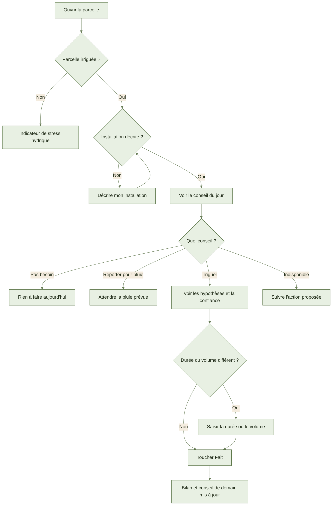
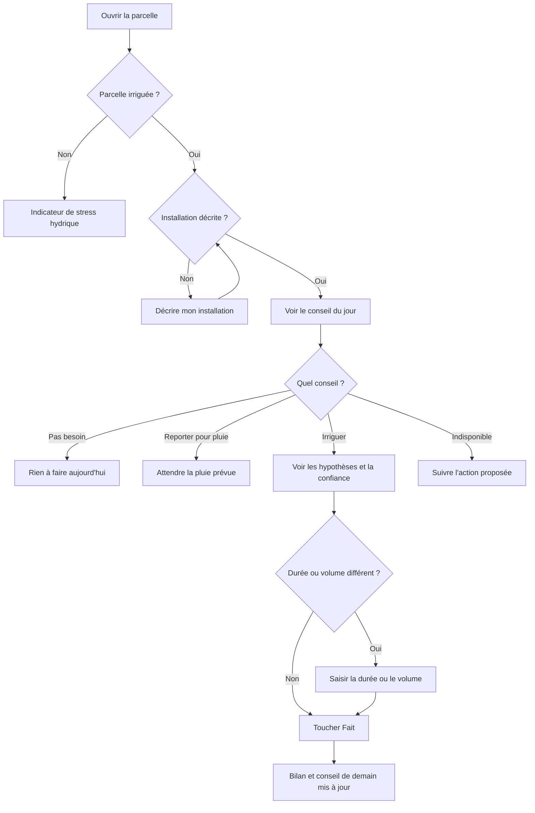

# AYLAL : الري ونصيحة الماء

> **قريبًا : لا يُستعمل بعد.**
> شاشات الري ليست جاهزة بعد.
> هذا الدليل يصف ما هو **مُخطَّط له**. لا تبحث عن هذه الأزرار: ليست موجودة بعد.
> تبقى نصيحة الري **« غير متوفرة »** ما دامت البيانات الفنية للمحصول غير محمّلة.
> ستُضاف الأسماء الدقيقة للأزرار عند اعتماد الشاشات.

## 1. ما فائدته

يخبرك كل يوم هل تحتاج القطعة المسقية إلى ماء (واش خاصها الماء؟).
ويخبرك كم ماءً تعطي، ولمدة كم دقيقة تشغّل المضخة.

## 2. ما يلزم قبل البدء

- أن يكون عندك حساب و**ضيعة** (la ferme).
- أن تكون قطعك مرسومة، مع المحصول الذي فيها.
- أن تحدد لكل قطعة: مسقية، أو **بعل** (pluvial)، أي بدون سقي.
- أن تعرف نوع التركيب: التنقيط (goutte-à-goutte)، الرش (aspersion)، المحور المتحرك (pivot)، أو السقي بالجاذبية (gravitaire).
- أن تعرف تدفق المنقّطات (débit des goutteurs)، أو تدفق المضخة.
- لا تحتاج إلى الشبكة لوصف التركيب.
- لا تحتاج إلى الشبكة لتسجيل سقي.
- للنصيحة: يجب أن تصل أحوال الطقس لليوم. تكون النصيحة جاهزة قبل السابعة صباحًا.
- للنصيحة: يجب تحميل البيانات الفنية للمحصول. وإلا تبقى « غير متوفرة ».

## 3. خطوة بخطوة (مُخطَّط)

### وصف تركيب السقي

1. افتح بطاقة قطعة مسقية.
2. اضغط على الزر الخاص بوصف التركيب.
3. اختر النوع: التنقيط، الرش، المحور المتحرك، أو السقي بالجاذبية.
4. اكتب تدفق المنقّطات.
5. لا توجد منقّطات؟ اكتب تدفق المضخة بدلًا منها.
6. اكتب المسافات: بين الخطوط، وبين المنقّطات.
7. اكتب عدد القطاعات: المناطق التي تُسقى واحدة بعد أخرى.
8. لا تغيّر الفعالية؟ النوع يعطي القيمة الافتراضية، وتبقى ظاهرة.
   - الفعالية: النسبة من الماء التي تصل فعلًا إلى الجذور.
   - التنقيط: 90 %. الرش: 75 %. السقي بالجاذبية: 60 %.
   - المحور المتحرك: مثل الرش، 75 %.
9. اضغط على زر التسجيل.
10. حقل خاطئ؟ رسالة تقول أي حقل تصحّحه. مثلًا تدفق صفر.
11. بدون شبكة؟ يُحفظ التركيب في الهاتف، ويظهر عليه « بانتظار الإرسال » (à envoyer).

### اطّلع على نصيحة اليوم

النصيحة تكون جاهزة قبل السابعة صباحًا، بتوقيت الضيعة.

1. افتح شاشة نصيحة اليوم.
2. لكل قطعة مسقية بطاقتها.
3. اقرأ النصيحة، مثلًا: « اسقِ ساعتين و30 دقيقة اليوم ».
4. أو: « لا حاجة للسقي ». أو: « أجّل السقي، المطر متوقع ».
5. اضغط على البطاقة لترى الافتراضات.
6. انظر إلى درجة الثقة: عالية، أو متوسطة، أو منخفضة.
7. استمع إلى النصيحة: يمكن قراءتها بصوت عالٍ (مُخطَّط).
8. القطعة بعل؟ لا توجد نصيحة سقي. سترى مؤشر الإجهاد المائي.
9. النصيحة « غير متوفرة »؟ الرسالة تذكر السبب. اتبع الإجراء المقترح.

### سجّل سقيًا تمّ

1. على بطاقة النصيحة، اضغط على زر « تم ».
2. المدة المقترحة مكتوبة بالفعل. تحقق منها.
3. سقيت بشكل مختلف؟ غيّر المدة. الحجم يُحسب وحده.
4. تعرف الحجم بالمتر المكعب؟ اكتبه. المدة تُحسب وحدها.
5. اضغط على زر التسجيل.
6. تم التسجيل. ميزان الماء ونصيحة الغد تأخذانه بعين الاعتبار.
7. السقي تمّ يومًا آخر؟ اختر التاريخ. يُعاد حساب الميزان من ذلك التاريخ.
8. تسجّله مرة واحدة فقط. يظهر السقي أيضًا في سجل الأشغال.
9. بدون شبكة؟ يظهر « بانتظار الإرسال ». ميزان الماء في الهاتف يتغير فورًا.

### اطّلع على استهلاك الماء

1. افتح متابعة الماء.
2. اقرأ المجموع للموسم الفلاحي، بالمتر المكعب (m³).
3. اقرأ الحجم لكل هكتار (m³/ha).
4. قارن قطعك: لكل قطعة مجموعها وحجمها لكل هكتار.
5. لم تسجّل شيئًا بعد؟ رسالة تقترح عليك تسجيل سقي.

### سجّل تحليل ماء البئر

1. افتح القطعة، أو مصدر الماء.
2. اضغط على زر إضافة تحليل.
3. اكتب الملوحة (salinité)، أي نسبة الملح، كما هي في ورقة التحليل.
4. اكتب تاريخ التحليل.
5. اضغط على زر التسجيل.
6. الماء مالح أكثر من اللازم للمحصول؟ النصيحة تضيف ماءً لغسل التربة، وتكتب ذلك في الافتراضات.
7. التحليل قديم؟ النصيحة تنبّه إلى ذلك. أجرِ تحليلًا جديدًا.

## 4. الرسم خطوة بخطوة

يتبع الرسم مسار يومك في الري. (أسماء الرسم بالفرنسية.)

## 5. أسئلة شائعة

**هل النصيحة مضمونة 100 %؟**
لا. إنها نصيحة. انظر إلى درجة الثقة. المطر الحقيقي يصحّح الحساب في اليوم التالي.

**لماذا تقول النصيحة « غير متوفرة »؟**
البيانات الفنية لمحصولك لم تُحمّل بعد. التطبيق لا يخترع أي قيمة.

**هل يرى عاملي النصيحة؟**
نعم. لكنه لا يرى تحليل الماء، ولا التربة، ولا ماء الغسل.

**هل يُحسب المطر تحت البيت المحمي؟**
لا. تحت البيت المحمي يُتجاهل المطر.

**هل جهاز استشعار رطوبة التربة مربوط؟**
ليس بعد. ليس في هذه النسخة. سيكون لاحقًا.

## 6. إذا لم يعمل

- **لا توجد شبكة**: سجّل على كل حال. يظهر « بانتظار الإرسال ». لا يضيع شيء.
- **النصيحة « غير متوفرة »**: اقرأ السبب. صف التركيب، أو انتظر البيانات الفنية للمحصول.
- **أحوال الطقس لليوم غائبة**: تبقى آخر نصيحة مع تاريخها. الثقة منخفضة.
- **حقل مرفوض**: صحّح الحقل المذكور. مثلًا تدفق صفر.
- **سقي سُجّل مرتين**: يُحفظ سقي واحد فقط.
- **رسالة خطأ**: اضغط على زر إعادة المحاولة.
