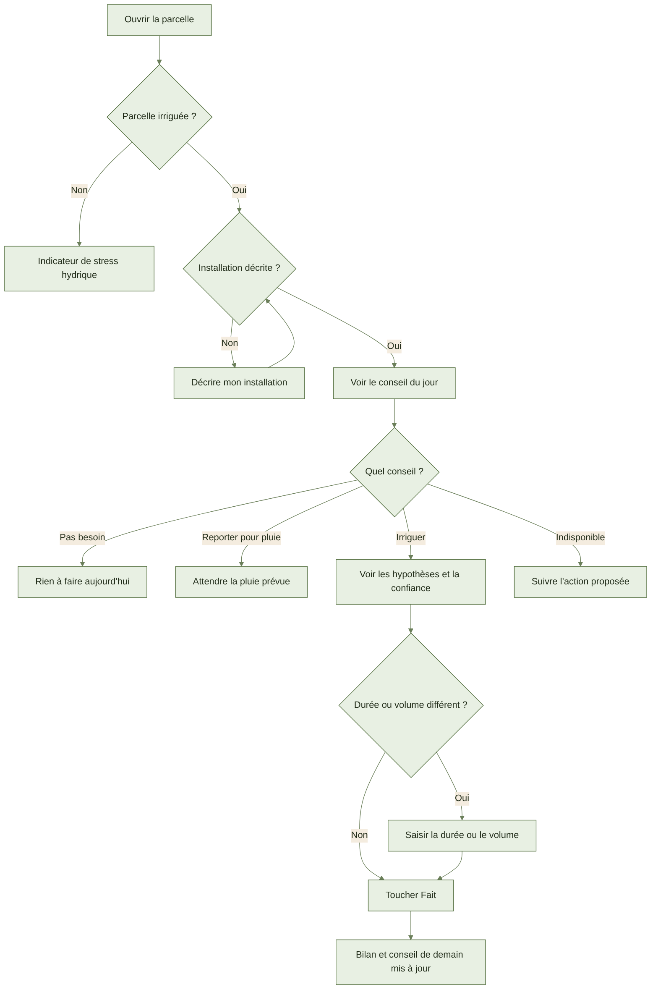
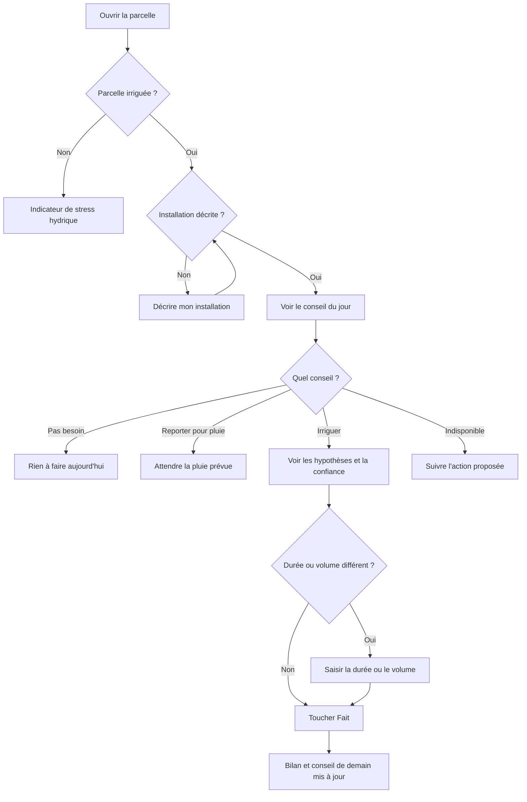

# AYLAL : mon irrigation et mon conseil d'eau

> **À venir : pas encore utilisable.**
> Les écrans de l'irrigation ne sont pas encore prêts.
> Ce guide dit ce qui est **prévu**. Ne cherchez pas ces boutons : ils n'existent pas encore.
> Le conseil d'irrigation reste **« indisponible »** tant que les données agronomiques ne sont pas chargées.
> Les noms exacts des boutons seront ajoutés quand les écrans seront validés.

## 1. À quoi ça sert

Vous saurez chaque jour si une parcelle irriguée a besoin d'eau.
Vous saurez aussi combien d'eau donner, et pendant combien de temps.

## 2. Ce qu'il faut avant de commencer

- Avoir déjà un compte et une ferme.
- Avoir déjà dessiné vos parcelles, avec leur culture.
- Dire pour chaque parcelle : irriguée, ou en pluvial (sans irrigation).
- Connaître votre installation : goutte-à-goutte, aspersion, pivot ou gravitaire.
- Avoir le débit de vos goutteurs, ou le débit de la pompe.
- Le réseau n'est pas nécessaire pour décrire une installation.
- Le réseau n'est pas nécessaire pour noter une irrigation.
- Pour le conseil : la météo du jour doit être reçue. Le conseil arrive avant 7 h.
- Pour le conseil : les données de la culture doivent être chargées. Sinon, il reste « indisponible ».

## 3. Pas à pas (prévu)

### Décrire mon installation

1. Ouvrez la fiche d'une parcelle irriguée.
2. Touchez le bouton pour décrire l'installation.
3. Choisissez le type : goutte-à-goutte, aspersion, pivot ou gravitaire.
4. Écrivez le débit des goutteurs.
5. Pas de goutteurs ? Écrivez le débit de la pompe à la place.
6. Écrivez les écartements : entre les lignes, et entre les goutteurs.
7. Écrivez le nombre de secteurs : les zones arrosées l'une après l'autre.
8. Ne touchez pas à l'efficience ? Le type donne la valeur par défaut. Elle reste visible.
   - L'efficience : la part de l'eau qui arrive vraiment aux racines.
   - Goutte-à-goutte : 90 %. Aspersion : 75 %. Gravitaire : 60 %.
   - Pivot : compté comme l'aspersion, 75 %.
9. Touchez le bouton d'enregistrement.
10. Un champ est faux ? Un message indique lequel corriger. Par exemple, un débit à zéro.
11. Sans réseau ? L'installation est gardée sur le téléphone. Elle porte « à envoyer ».

### Voir le conseil du jour

Le conseil est prêt avant 7 h, à l'heure de la ferme.

1. Ouvrez l'écran du conseil du jour.
2. Chaque parcelle irriguée a sa carte.
3. Lisez le conseil. Par exemple : « irriguer 2 h 30 aujourd'hui ».
4. Ou bien : « pas besoin ». Ou : « reporter, pluie prévue ».
5. Touchez la carte pour voir les hypothèses.
6. Regardez le niveau de confiance : élevé, moyen ou bas.
7. Écoutez le conseil : il peut être lu à voix haute (prévu).
8. Parcelle en pluvial ? Pas de conseil. Vous voyez un indicateur de stress hydrique.
9. Conseil « indisponible » ? Le message donne la raison. Suivez l'action proposée.

### Noter une irrigation faite

1. Sur la carte du conseil, touchez le bouton « fait ».
2. La durée conseillée est déjà écrite. Vérifiez-la.
3. Vous avez arrosé autrement ? Changez la durée. Le volume se calcule seul.
4. Vous connaissez le volume en m³ ? Écrivez-le. La durée se calcule seule.
5. Touchez le bouton d'enregistrement.
6. C'est noté. Le bilan et le conseil de demain en tiennent compte.
7. Arrosage fait un autre jour ? Choisissez la date. Le bilan se refait depuis cette date.
8. Vous ne notez qu'une seule fois. L'irrigation apparaît aussi dans votre journal des travaux.
9. Sans réseau ? C'est marqué « à envoyer ». Le bilan du téléphone change tout de suite.

### Voir la consommation d'eau

1. Ouvrez le suivi de l'eau.
2. Lisez le total de la campagne, en m³.
3. Lisez le volume par hectare, en m³/ha.
4. Comparez vos parcelles : chacune a son total et son m³/ha.
5. Rien n'est encore noté ? Un message vous propose d'enregistrer une irrigation.

### Noter l'analyse d'eau du puits

1. Ouvrez la parcelle, ou la source d'eau.
2. Touchez le bouton pour ajouter une analyse.
3. Écrivez la salinité, c'est-à-dire le taux de sel, indiqué sur le papier d'analyse.
4. Écrivez la date de l'analyse.
5. Touchez le bouton d'enregistrement.
6. L'eau est trop salée pour la culture ? Le conseil ajoute de l'eau pour rincer le sol. Il l'écrit dans les hypothèses.
7. Analyse ancienne ? Le conseil le signale. Faites une nouvelle analyse.

## 4. Parcours en image

Le schéma suit le chemin de votre journée d'irrigation.

## 5. Questions fréquentes

**Le conseil est-il certain à 100 % ?**
Non. C'est un conseil. Regardez le niveau de confiance. La pluie réelle corrige le calcul le lendemain.

**Pourquoi le conseil dit « indisponible » ?**
Les données de votre culture ne sont pas encore chargées. L'application n'invente aucune valeur.

**Mon ouvrier voit-il le conseil ?**
Oui. Il ne voit pas l'analyse d'eau, ni la terre, ni l'eau de rinçage du sol.

**La pluie compte-t-elle sous serre ?**
Non. Sous serre, la pluie est ignorée.

**Le capteur d'humidité du sol est-il branché ?**
Pas encore. Ce n'est pas dans cette version. Ce sera prévu plus tard.

## 6. Si ça ne marche pas

- **Pas de réseau** : notez quand même. C'est marqué « à envoyer ». Rien n'est perdu.
- **Conseil « indisponible »** : lisez la raison. Décrivez l'installation, ou attendez les données de la culture.
- **Météo du jour absente** : le dernier conseil reste, avec sa date. La confiance est basse.
- **Champ refusé** : corrigez le champ indiqué. Par exemple, un débit à zéro.
- **Irrigation notée deux fois** : une seule est gardée.
- **Message d'erreur** : touchez le bouton pour réessayer.
