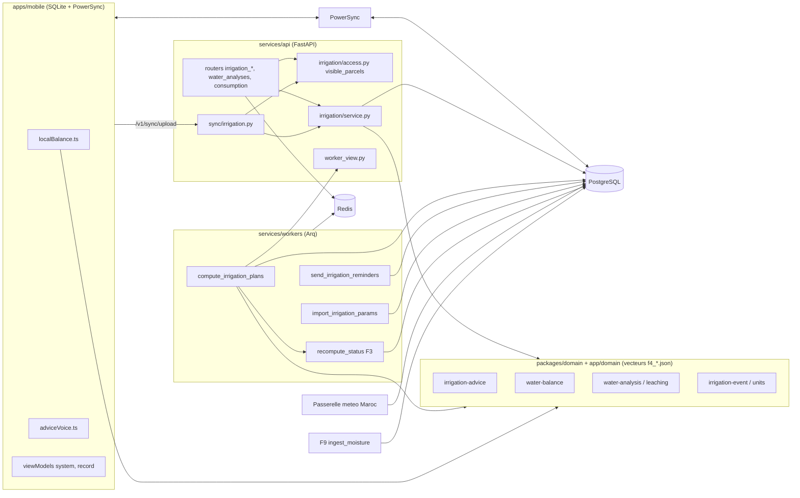
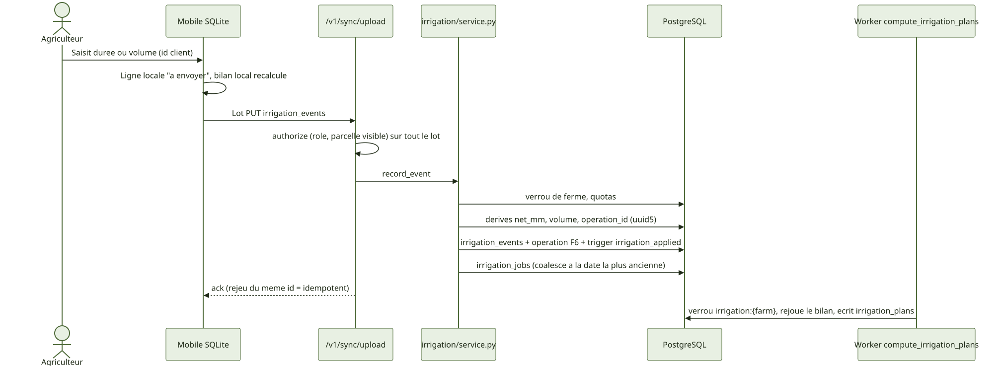
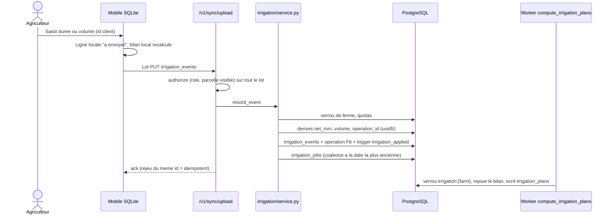
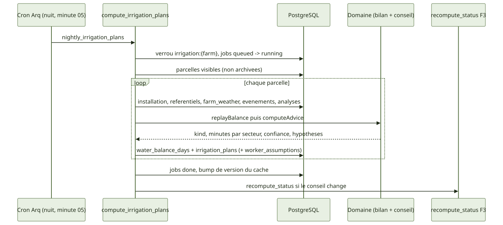
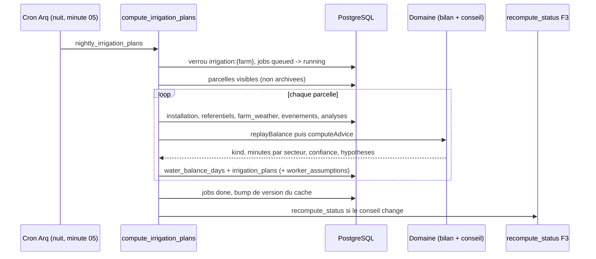
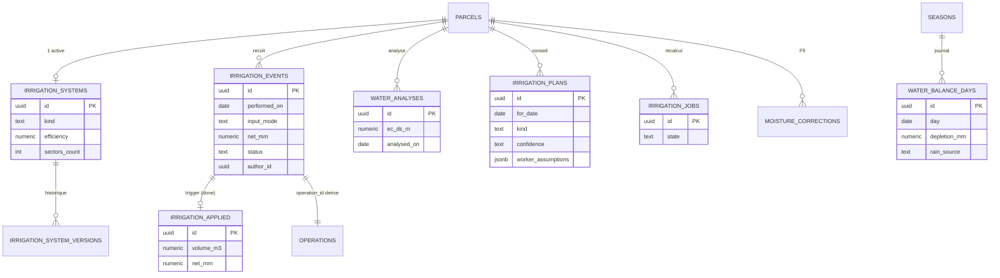
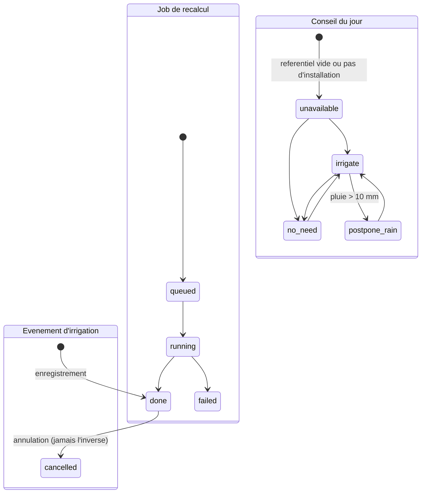

# F4 — Irrigation et bilan hydrique : document ingénieur

Branche `007-irrigation-water-balance`. Sources : `specs/007-irrigation-water-balance/{spec,plan,data-model,decisions}.md` et `contracts/`, migration `0012`, code `services/api/app/irrigation`, `services/workers/tasks`, `packages/domain`, `apps/mobile/src/irrigation`.

## 1. Résumé

**Objectif** : décrire l'installation d'irrigation, tenir un bilan hydrique journalier (FAO-56), produire le conseil du jour (durée par secteur, report si pluie > 10 mm, confiance et hypothèses), enregistrer une irrigation en un geste (opération F6), suivre la consommation (m³, m³/ha), enregistrer une analyse d'eau (fraction de lessivage) et accueillir une mesure d'humidité externe (F9).

**Livré** : migration `0012_irrigation_water_balance`, 4 routeurs REST (+ consommation), écritures par `/v1/sync/upload` (`app/sync/irrigation.py`), seaux PowerSync, 3 tâches worker (`compute_irrigation_plans`, `send_irrigation_reminders`, `import_irrigation_params`), règles pures TS/Python à vecteurs partagés (`packages/domain/vectors/f4_*.json`), lecteur `irrigation_need` pour l'état de parcelle F3, clés i18n `ary/ar/fr` (`irrigation`, `waterbalance`, `wateranalysis`), logique mobile non-écran (`localBalance.ts`, `adviceVoice.ts`, `pendingBadge.ts`, view models `system`, `record`).

**Non livré ou à ne pas présumer**

| Sujet | État |
| --- | --- |
| Écrans F4-E1 à E5 | **Bloqués** : porte design T004 (validation humaine des maquettes) non donnée et fusion de `004-design-system` attendue (T063-T068, T073, T078 non démarrés). Maestro et captures non écrits. `packages/ui` et `docs/design/` non modifiés. |
| View models `advice`, `consumption`, `waterAnalysis` | Non créés (viennent avec les écrans) ; T057, T062, T072, T077 laissées décochées (PARTIEL) dans `tasks.md`. |
| Référentiels agronomiques | **Vides à la livraison** : `crop_irrigation_params`, `soil_textures`, `irrigation_params`. Aucun Kc, réserve utile, profondeur racinaire, seuil de salinité ou méthode de pluie efficace n'est codé ni semé. Tant qu'un import validé (`import_irrigation_params`) n'a pas eu lieu, le conseil est `unavailable` (raisons `no_crop_coefficient`, `no_root_depth`, `no_depletion_fraction`, `no_soil_reference`, `no_soil_reserve`). Le fournisseur de la liste initiale reste à désigner. |
| Passerelles météo | `AYLAL_WEATHER_URL` et `AYLAL_WEATHER_OBSERVED_URL` vides par défaut : pas d'appel réseau, « non disponible ». Hébergeur marocain non choisi (hérité de F3). |
| Choix « À confirmer » | Voir §11 : pivot traité comme aspersion à 75 %, pluie ignorée sous serre, « prêt avant 7 h » = heure locale de la ferme. |
| Numéro de migration | `0012` provisoire, à recaler à la fusion. |
| Budget APK | **Dérogation** : 50 480 024 o mesurés (défaut 40 Mo), plafond 52 Mo (`specs/007-irrigation-water-balance/apk-budget.env`). Cause : MapLibre hérité de F2/F3 ; F4 n'ajoute aucune dépendance native. |
| Maestro, e2e mobile | Aucun fichier Maestro F4 (écrans bloqués). Seuls les e2e API existent. |

## 2. Architecture

Points structurants :
- Toute règle vit dans `packages/domain` (TS) avec miroir `services/api/app/domain/` ; les deux lisent les mêmes vecteurs JSON.
- Un seul module d'accès, `app/irrigation/access.py`, délègue à `visible_parcels` de F3 (ferme + `archived_at IS NULL` + attribution pour l'ouvrier). REST, synchro, export, purge, agrégats, calcul et rappels l'utilisent.
- Le serveur fait foi ; le mobile recalcule le bilan depuis SQLite (`localBalance.ts`). Aucune requête REST ne déclenche un calcul : le conseil est une lecture de `irrigation_plans`.

## 3. Flux principaux

**Enregistrer une irrigation (hors ligne puis synchro)**

**Calcul nocturne du conseil**

Le cron `nightly_irrigation_plans` tourne à `hour={2,3}, minute=5` (UTC, pour couvrir 03:00 locale selon la zone) ; `morning_irrigation_reminders` à `{5,6}:30`. Le conseil est aussi recalculé à chaque météo reçue.

## 4. Modèle de données

Colonnes complètes : `specs/007-irrigation-water-balance/data-model.md`. Compléments : `irrigation_notification_log` (par utilisateur), `weather_observed` (globale, PK `(cell_id, day)`), référentiels `crop_irrigation_params`, `soil_textures`, `irrigation_params`. Toutes les tables de ferme portent `farm_id` avec clés étrangères composites `(farm_id, parcel_id)` et `parcel_archived_at` posé par trigger.

## 5. États

- `irrigation_events.status` : `done` vers `cancelled` uniquement ; pas de DELETE ; l'annulation déclenche le recalcul à la date de l'événement.
- `irrigation_plans.kind` : `rainfed_stress` n'apparaît que pour une parcelle pluviale. `unavailable` n'est écrit que s'il n'existe aucun conseil antérieur valide ; sinon l'ancien est servi avec sa date et `confidence=low` (FR-017). Le diagramme montre les transitions principales, pas toutes les combinaisons.

## 6. API

Préfixe `/v1/farms/{farm_id}`. Contrat : `specs/007-irrigation-water-balance/contracts/openapi.yaml` (test `tests/contract/test_f4_openapi_contract.py`).

| Méthode et chemin | Droit | Remarque |
| --- | --- | --- |
| `GET /irrigation/advice` | `advice.read` | liste des conseils (vue ouvrier pour `worker`) |
| `GET /parcels/{id}/irrigation/advice` | `advice.read` | conseil du jour |
| `GET /parcels/{id}/irrigation/balance` | `advice.read` | journal du bilan |
| `GET`/`PUT /parcels/{id}/irrigation-system` | lecture / `irrigation_system.write` | écriture refusée à l'ouvrier (403), 422 si parcelle pluviale |
| `GET /parcels/{id}/irrigation-system/versions` | lecture | historique |
| `POST`/`GET /parcels/{id}/irrigation/events` | `irrigation.record` / `advice.read` | 201 créé, 200 rejeu du même `id` |
| `POST /parcels/{id}/irrigation/events/{event_id}/cancel` | `irrigation.correct` | l'ouvrier : les siennes |
| `GET /irrigation/consumption` | `consumption.read` | m³ et m³/ha sur la portée de l'appelant, ETag, fenêtre <= 24 mois |
| `GET`/`POST /parcels/{id}/water-analyses` | owner, manager | ouvrier : 403 |

Erreurs : `404 {"detail":"not_found"}` identique pour non-membre, ferme supprimée, parcelle non attribuée, archivée ou inconnue ; `403 forbidden` (rôle) ; `422 {"detail":"validation","field","code"}` ; `422 limit_out_of_range`, `422 window_too_long` ; `409 {"detail":"quota_exceeded","code"}` ; `413 batch_too_large` (lot de synchro > 100) ; `429` avec `Retry-After` (limiteur Redis, par heure : `record` 60, `history` 120, `consumption` 120, `analysis` 60). Pagination `limit` <= 100 (défaut 50) et curseur.

Aucune route pour `moisture_corrections` (service interne `ingest_moisture`, F9) ni pour plans et bilans (non inscriptibles par la synchro).

## 7. Règles métier et où elles sont codées

| Règle | Domaine TS (`packages/domain/src`) | Miroir Python (`app/domain`) |
| --- | --- | --- |
| Efficience 90 % goutte, 75 % aspersion, 60 % gravitaire ; pivot = aspersion 75 % | `irrigation-efficiency.ts` | `irrigation_efficiency.py` |
| Conseil : `no_need` si épuisement < réserve facilement utilisable ; report si pluie du jour > 10 mm (strict, `POSTPONE_RAIN_MM`) ; pluie ignorée sous serre ; durée = besoin brut / (débit × efficience) par secteur | `irrigation-advice.ts` | `irrigation_advice.py` |
| Bilan journalier rejouable (ET0, Kc, pluie efficace, apports, épuisement) | `water-balance.ts` | `water_balance.py` |
| Lessivage FAO-29 plafonné par `leaching_max` ; âge de l'analyse | `water-analysis.ts` | `water_analysis.py` |
| Dernier conseil connu servi s'il n'y a pas de nouveau (FR-017) | `irrigation-last-known.ts` | `irrigation_last_known.py` |
| Conversions durée/volume/mm, débit par m² | `irrigation-units.ts`, `irrigation-event.ts` | `irrigation_units.py`, `irrigation_event.py` |
| Validation d'installation | `irrigation-system-validation.ts` | `irrigation_system_validation.py` |
| Plafonds (secteurs <= 50, 24 irrigations/jour/secteur, 1440 min, antidatage 400 j, 50 analyses, EC <= 100) | `irrigation-limits.ts` | `irrigation_limits.py` |
| Matrice des droits | `roles.ts` (vecteur `f4_roles.json`) | `app/domain/roles.py` |
| Vue ouvrier : liste blanche `et0, kc, effective_rain, efficiency, application_rate, rain_source`, sans `leaching_fraction`, `taw_mm`, `raw_mm`, `moisture_source` | `advice-worker-view.ts` | `app/irrigation/worker_view.py` |

Côté serveur seulement : `operation_id` dérivé (`ids.py`, uuid5), dérivés d'événement recalculés par `service.py`, quotas sous verrou de ferme, jobs coalescés, cache scopé `irr:{farm}:{role}:{sha256 des parcelles visibles}:{date}:{version}` (`cache.py`), horloge injectée (`Africa/Casablanca`). Les référentiels sont lus dans `engine.py` (pas de `reference.py`).

## 8. Hors ligne et synchronisation

- Seaux PowerSync (`infra/powersync/sync-rules.yaml`, sans jointure ni sous-requête, colonnes dénormalisées) : `farm_irrigation` (staff), `farm_worker_irrigation` (ouvrier, conseils via `worker_assumptions` uniquement), `farm_worker_irrigation_own` (événements avec auteur et note, filtrés sur `author_id = bucket.user_id`), `irrigation_reference` (global).
- Les analyses d'eau ne sont servies à aucun ouvrier. Le journal de bilan de l'ouvrier est sans `taw_mm`/`raw_mm` : il ne recalcule pas la réserve utile et lit le dernier conseil synchronisé.
- Écriture : `/v1/sync/upload` (<= 100 opérations) ; autorisation du lot entier avant toute écriture (403 rôle, 404 non-membre ou parcelle invisible) ; champs serveur rejetés ; idempotence par `id` client et `applied_ops`. Doublon proche : signalé `possible_duplicate`, conservé.
- Mobile : irrigation locale marquée « à envoyer » (`pendingBadge.ts`), bilan recalculé sur SQLite (`localBalance.ts`), lecture vocale (`adviceVoice.ts`, `expo-speech`).

## 9. Tests

Stratégie : TDD, trois niveaux (CLAUDE.md).
- **Unitaires** : `packages/domain/tests/*irrigation*|water*` (Vitest + vecteurs `f4_*.json`), `services/api/tests/unit/test_f4_*.py`, `apps/mobile/src/irrigation/__tests__/`.
- **Intégration** : `services/api/tests/integration/test_f4_*.py` (isolation de ferme, parité des chemins, rôles, archivage, sortie de membre, export/purge, quotas concurrents, limiteur, rédaction ouvrier, passerelles dégradées), `services/workers/tests/test_f4_*.py` (calcul, rappels, lecteur d'état, portée), contrat `tests/contract/test_f4_openapi_contract.py`.
- **Bout en bout** : `services/api/tests/e2e/test_f4_*_e2e.py` et `test_irrigation_greenhouse_e2e.py` (parcours HTTP sur la pile). Aucun Maestro (écrans bloqués).
- Couverture : seuil de 80 % du code métier ; le chiffre mesuré n'est pas reporté ici (voir `make coverage`).

Lancer (Docker uniquement) : `make test-domain`, `make test-api ARGS=<fichiers>`, `make test-mobile`, `make test-unit`, `make test-integration`, `make e2e`, `make check-fast-cached`, `make check-cached` avant release. `make test-pyramid` est inclus dans `make check`.

## 10. Exploitation Docker

- Services : `api`, `worker` (Arq), `db` (PostgreSQL + PostGIS), `redis`, `powersync`. Aucun service permanent ajouté par F4 ; API et worker sont des images (`docker compose up -d --build --no-deps api worker` avant l'e2e).
- Variables : `AYLAL_WEATHER_URL`, `AYLAL_WEATHER_KEY`, `AYLAL_WEATHER_OBSERVED_URL` (vide par défaut ; requête `lat, lon, from, to`, coordonnées arrondies à 0,1°, aucun identifiant), `AYLAL_EXTERNAL_ALLOWED_HOSTS` (liste blanche), `AYLAL_DATABASE_URL`, `AYLAL_REDIS_URL`.
- Migration : `0012_irrigation_water_balance` (Alembic, sans valeur agronomique). Référentiels : tâche worker `import_irrigation_params` (fichier validé, `validated_by` et `source` obligatoires).
- Commandes : `make up`, `make down`, `make sync-rules`, `make apk-size`, `make diagrams`.

## 11. Décisions et dettes techniques

**À confirmer** (`decisions.md`, section « À confirmer »)
- Pivot = aspersion à 75 %, modifiable, hypothèse visible (CPS §9 ne donne que 90/75/60 pour trois types).
- Pluie ignorée sous serre : ni bilan ni report (`rain_source = ignored_greenhouse`).
- « Prêt avant 7 h » = heure locale de la ferme, calcul à 03:00 puis à chaque météo.
- Fenêtre du report = jour local J entier (> 10 mm strict).
- ET0 : passerelle si `et0_mm`, sinon Hargreaves-Samani (confiance abaissée) ; lessivage FAO-29 ; surfaces de secteur égales ; sol à la capacité au champ au départ ; règle de confiance ; plafonds de robustesse : à valider par l'agronomie ou le produit.
- Rôles de l'ouvrier déduits de CPS §6/§16 (CPS §9 muet).

**Dettes**
- Écrans F4-E1 à E5 et composants UI manquants (`AdviceCard`, `DurationStepper`, `HypothesisSheet`, `WaterStressGauge`, `SectorList`) à demander à `004-design-system` ; porte T004 humaine.
- Référentiels vides : conseil `unavailable` en production tant que l'import n'est pas fait.
- Dérogation APK 52 Mo : réduction future par fractionnement par ABI ou chargement différé de la carte (hors F4).
- Extensions de F3 tracées : `gateways.py` (`weather_observed`, `et0_mm`), `refresh_weather`, `recompute_status` (lecteur `irrigation_need`), anonymisation F6. Mapping `kind` vers `severity/reason_key` à confirmer avec la revue design.
- Hébergeur Maroc des passerelles non choisi ; numéro de migration provisoire.
- Alternative écartée : expurgation de la vue ouvrier par liste de blocage (fragile aux clés futures), remplacée par une liste blanche.
