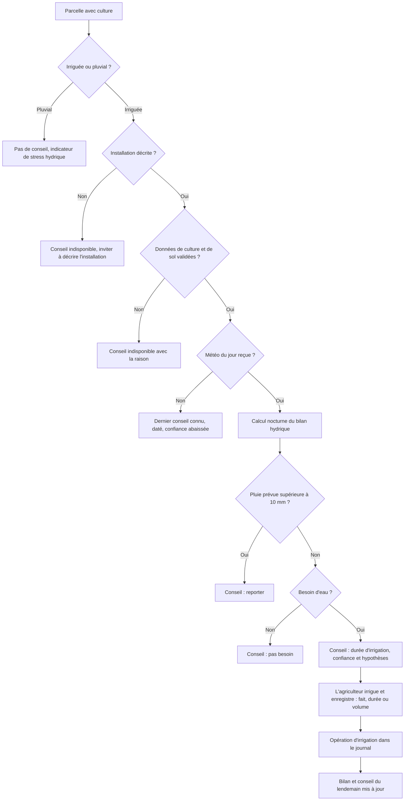
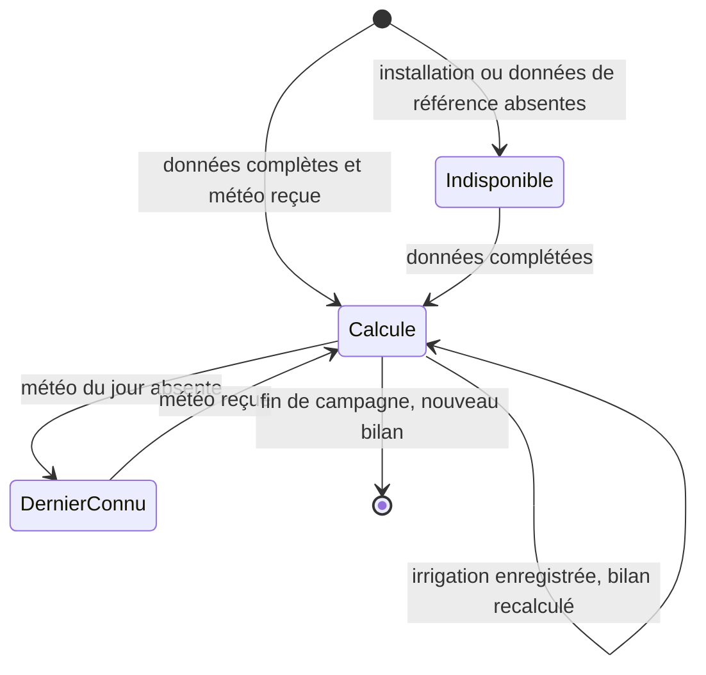

# Irrigation et bilan hydrique : document métier (F4)

Fonctionnalité `007-irrigation-water-balance`, section 9 du CPS. Public : responsable produit, agronome, partenaire (coopérative, financeur). Aucun détail de code.

**État honnête en une phrase** : le calcul du conseil et l'enregistrement des données sont livrés côté serveur et domaine ; **aucun écran mobile n'est livré** et **les référentiels agronomiques sont vides**, donc aucun agriculteur ne peut encore recevoir de conseil.

## 1. Objectif et valeur pour l'agriculteur

L'agriculteur sait chaque jour si une parcelle irriguée a besoin d'eau, combien, et pendant combien de temps faire tourner son installation. Il économise l'eau et protège sa culture sans faire de calcul. Il garde la trace de ses apports réels et de sa consommation d'eau.

## 2. Acteurs et rôles

| Qui | Ce qu'il peut faire | Ce qu'il ne voit pas |
| --- | --- | --- |
| Propriétaire, gestionnaire | Décrire l'installation, voir le conseil complet, enregistrer une irrigation, suivre la consommation, enregistrer une analyse d'eau | Rien de sa ferme n'est masqué |
| Ouvrier | Lire l'installation et le conseil, enregistrer une irrigation sur ses parcelles, voir la consommation de sa portée | L'analyse d'eau (salinité, source, âge), le sol, la part d'eau de rinçage, et tout ce qui en découle (décision 13 et 19, FR-022) |
| Autres fermes | Rien | Les données restent propres à la ferme (FR-021) |
| Capteur ou compteur connecté | Prévu plus tard (F9) : corriger le bilan | Non branché dans cette version |

Le rôle de l'ouvrier est déduit des sections 6 et 16 du CPS, la section 9 étant muette : à confirmer (décision 13).

## 3. Glossaire métier

| Terme | Sens dans l'app |
| --- | --- |
| Parcelle irriguée / pluvial | Irriguée : reçoit un conseil. Pluvial : pas de conseil, un indicateur de stress hydrique à la place |
| Installation | Description du matériel : type, débit des goutteurs et écartements (ou débit de la pompe), secteurs |
| Type d'installation | Goutte-à-goutte, aspersion, pivot, gravitaire |
| Secteur | Zone arrosée l'une après l'autre |
| Efficience | Part de l'eau qui arrive aux racines. Défauts : goutte-à-goutte 90 %, aspersion 75 %, gravitaire 60 %, pivot traité comme l'aspersion (75 %) |
| Évapotranspiration (ET0) | Eau perdue par le sol et la plante selon la météo |
| Coefficient cultural (Kc) | Ajuste ce besoin à la culture et à son stade |
| Pluie efficace | Part de la pluie réellement utile à la culture |
| Réserve utile | Eau que le sol peut garder, selon sa texture. Valeur prudente si la texture est inconnue |
| Bilan hydrique | Compte journalier de l'eau du sol par parcelle |
| Conseil | Durée à irriguer, « pas besoin » ou « reporter », avec confiance et hypothèses |
| Niveau de confiance | Élevé, moyen ou bas |
| Lessivage | Eau en plus pour rincer le sol quand l'eau est trop salée |
| Analyse d'eau | Salinité de l'eau du puits, avec sa date |
| Campagne | Période de culture ; le bilan repart à chaque nouvelle campagne |

## 4. Processus métier

Cycle de vie du conseil d'une parcelle :

## 5. Règles métier

| N° | Règle | Source |
| --- | --- | --- |
| RM-1 | Le besoin de la culture suit la méthode FAO-56 : évapotranspiration × coefficient cultural, moins la pluie efficace | CPS 9, FR-003 |
| RM-2 | Un bilan d'eau du sol est tenu chaque jour par parcelle ; réserve prudente si la texture est inconnue, signalée dans les hypothèses | CPS 9, FR-004 |
| RM-3 | Durée = besoin net / (efficience × débit par m²) | CPS 9, FR-005 |
| RM-4 | Efficience par défaut selon le type, modifiable et visible | CPS 9, FR-002 |
| RM-5 | Pivot traité comme l'aspersion (75 %) | Spec, clarification ; décision 1 |
| RM-6 | Conseil disponible avant 7 h, heure locale de la ferme, dès que la météo du jour est reçue ; calcul de nuit | CPS 9, FR-006 ; décision 3 |
| RM-7 | Pluie supérieure à 10 mm sur le jour : reporter l'irrigation (c'est un conseil, la pluie réelle corrige le lendemain) | CPS 9, FR-007 ; décision 4 |
| RM-8 | Sous serre, la pluie est ignorée | Spec, clarification ; décision 2 |
| RM-9 | Chaque conseil montre confiance et hypothèses en un clic ; aucune valeur inventée si une donnée essentielle manque, le conseil est « indisponible » avec la raison | FR-008, FR-017 |
| RM-10 | Parcelle en pluvial : aucun conseil, un indicateur de stress hydrique | CPS 9, FR-009 |
| RM-11 | Météo du jour absente : dernier conseil connu, daté, confiance abaissée | Spec, récit 2 |
| RM-12 | Une irrigation se saisit par durée ou par volume, l'autre se calcule ; une seule saisie, elle devient aussi une opération du journal | FR-010, FR-012 |
| RM-13 | Une irrigation à date passée recalcule le bilan depuis cette date | FR-011 |
| RM-14 | Même envoi répété : une seule irrigation. Deux saisies proches : conservées et signalées « doublon possible » ; aucun apport réel n'est perdu | Spec ; décision 12 |
| RM-15 | Eau salée au-dessus de la tolérance de la culture : fraction de lessivage ajoutée ; analyse ancienne signalée | CPS 9, FR-014 |
| RM-16 | Consommation affichée par parcelle et pour la campagne, en m³ et m³/ha | FR-013 |
| RM-17 | Tout fonctionne hors réseau, sans perte à la synchronisation | FR-016 |
| RM-18 | L'ouvrier ne reçoit jamais l'analyse d'eau, le sol ni le lessivage | FR-022 ; décision 19 |
| RM-19 | Les valeurs agronomiques viennent uniquement d'un import validé par l'agronomie ; sinon « indisponible » | Décision 5 |
| RM-20 | Sol supposé à pleine capacité au début de campagne, confiance abaissée | Décision 9 |
| RM-21 | Une mesure de capteur est un point d'accueil prévu, non obligatoire | FR-015 |

## 6. Critères d'acceptation

Les tests couvrent les règles côté domaine, serveur et bout en bout serveur. Aucun test d'écran (Maestro, Playwright) n'existe pour F4.

| Critère | Priorité | État |
| --- | --- | --- |
| R1 : décrire l'installation (type, débits, secteurs), pompe sans goutteurs, efficience par défaut, saisie incohérente refusée avec champ nommé | P1 | Règles et serveur couverts par des tests ; écran non livré |
| R1 : saisie hors réseau conservée puis synchronisée | P1 | Synchronisation testée ; écran non livré |
| R2 : conseil avant 7 h, report si pluie, confiance et hypothèses, sol inconnu, météo absente, pluvial | P1 | Calcul et serveur couverts ; affichage non livré ; conseil réel impossible tant que les référentiels sont vides |
| R3 : irrigation « fait » en un geste, durée/volume, bilan mis à jour, hors réseau, journal sans double saisie | P1 | Serveur et règles couverts ; geste à l'écran non livré |
| R4 : consommation en m³ et m³/ha par parcelle et campagne, état vide | P2 | Calcul serveur couvert ; écran non livré |
| R5 : analyse d'eau et lessivage, analyse ancienne signalée | P2 | Serveur couvert ; écran non livré |
| R6 : correction par capteur | P3 | Hors cette version (F9) |
| Lecture vocale du conseil (FR-020) | non classé | Préparation côté mobile faite ; écran non livré |
| Quatre états et rendu arabe miroir de chaque écran (SC-007) | exigence | Non livré, faute d'écrans |

## 7. Ce qui est livré et ce qui ne l'est pas

**Livré**
- Règles de calcul partagées entre fronts (besoin, bilan, durée, lessivage, report, confiance, consommation) et vérifiées par des jeux de cas communs.
- Serveur : installation, conseil, enregistrement d'irrigation, consommation, analyse d'eau ; calcul de nuit et rappels ; vue réduite pour l'ouvrier ; export et suppression de la ferme.
- Synchronisation hors réseau prévue pour ces données, testée sur 30 jours simulés.
- Côté mobile : logique de préparation des données (sans écran).
- Intégration au journal des opérations (F6) et à l'état de parcelle (F3).

**Non livré**
- **Écrans mobiles** : les cinq écrans (installation, conseil du jour, enregistrement, suivi de consommation, analyse d'eau) sont bloqués. La validation humaine des maquettes (porte design, tâche T004) n'a pas eu lieu, et dépend de la fusion du design system. Un agriculteur ne peut donc rien faire dans l'application. Le guide agriculteur le dit en tête.
- **Référentiels agronomiques vides** : coefficients culturaux par stade, profondeur racinaire, fraction d'épuisement, réserve utile par sol, seuils de salinité, méthode de pluie efficace. Ils ne viennent que d'un import validé ; le fournisseur de la liste initiale n'est pas désigné (décision 5). Tant qu'ils manquent, **tout conseil est « indisponible »**. Les valeurs des jeux de test sont des données d'essai, pas des références.
- **Validation agronomique à faire** : méthode ET0 de secours, formule de lessivage, règle de confiance, surfaces de secteur égales (décisions 6, 7, 8, 10).
- **Dérogation de poids de l'application** : 50,5 Mo mesurés contre 40 Mo de limite, plafond accordé à 52 Mo pour cette version. La cause est la carte, héritée de versions précédentes ; F4 n'ajoute rien de natif.
- **Capteurs et compteurs connectés** : non branchés (F9).
- **Écrans web et bureau** : non définis dans la spec.
- **Tâches ouvertes** : quelques éléments mobiles liés aux écrans et la revue transverse restent décochés dans le plan de tâches.
- Le fournisseur d'hébergement au Maroc des passerelles météo n'est pas choisi (décision 14).

## 8. Indicateurs de réussite

Issus de la spec (SC) ; la mesure réelle ne peut pas commencer sans écrans.

| Indicateur | Cible |
| --- | --- |
| SC-001 | 100 % des parcelles irriguées décrites avec météo reçue ont leur conseil avant 7 h |
| SC-002 | Installation décrite en moins de 2 minutes ; irrigation enregistrée en moins de 15 secondes |
| SC-003 | 100 % des pluies prévues de plus de 10 mm donnent un report |
| SC-004 | Durées à moins de 5 % des valeurs de référence du jeu agronomique validé |
| SC-005 | Aucune donnée perdue après 30 jours hors réseau simulés |
| SC-006 | Confiance et hypothèses en un clic sur 100 % des conseils |
| SC-007 | Quatre états et rendu arabe conforme sur chaque écran |

Les objectifs globaux du CPS à 12 mois (inscrits, surface suivie, etc.) ne sont pas propres à F4 : non définis dans la spec pour cette fonctionnalité.

## 9. Hors périmètre

- Commande à distance des vannes et pompes.
- Conception et dimensionnement du réseau.
- Fertigation détaillée.
- Branchement effectif des capteurs et compteurs connectés (F9, phase 2).

## 10. Risques et questions ouvertes pour le métier

1. **Qui fournit les données agronomiques initiales, et quand ?** Sans elles, F4 ne produit aucun conseil. Question bloquante.
2. **Validation de la porte design** : sans elle, aucun écran. Quand et par qui ?
3. **Validation agronomique** des règles de calcul de secours et de la règle de confiance (décisions 6, 7, 10).
4. **Rôle de l'ouvrier** : confirmer ce qu'il peut faire (décision 13).
5. **Pluie sous serre ignorée** et **fenêtre de report limitée au jour local** : choix prudents à confirmer (décisions 2 et 4).
6. **Poids de l'application** au-dessus de la limite : accepter la dérogation ou financer une réduction (chargement différé de la carte).
7. **Risque de confiance** : un conseil trop prudent ou trop incertain peut être ignoré ; la confiance affichée doit rester honnête.
8. **Hébergeur Maroc** des passerelles météo à choisir.
