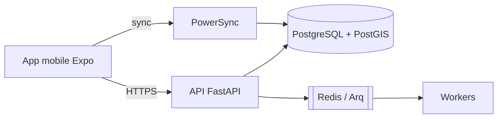

# <NNN-feature> — Document ingénieur

> Fonctionnalité : <Fx — titre> · Version : <tag git> · Date : <AAAA-MM-JJ>

## 1. Résumé
## 2. Architecture

## 3. Flux principaux
## 4. Modèle de données
## 5. États
## 6. API
## 7. Règles métier et emplacement dans le code
## 8. Hors ligne et synchronisation
## 9. Tests (stratégie, couverture, commandes)
## 10. Exploitation Docker
## 11. Décisions et dettes techniques
