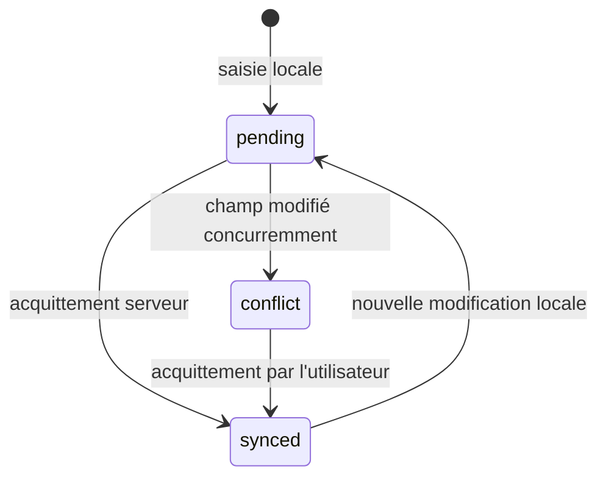
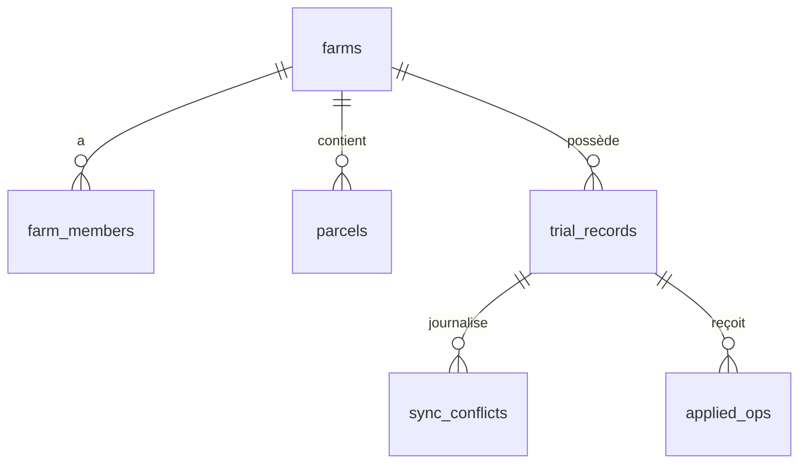

# Modèle de données : F0

Les noms de tables/colonnes sont en anglais. Le schéma Zod de `packages/domain` est la source ; PostgreSQL (Alembic) et SQLite local (schéma PowerSync) en dérivent. Les identifiants sont des UUID générés sur l'appareil.

## Entités synchronisées (PostgreSQL ⇄ SQLite)

### farms
| Champ | Type | Règle |
| --- | --- | --- |
| id | uuid PK | |
| name | text | 1..120 caractères |
| created_at | timestamptz | serveur |

### farm_members (contrôle d'accès)
| Champ | Type | Règle |
| --- | --- | --- |
| farm_id | uuid FK farms | |
| user_id | uuid | compte d'essai en F0 |
| role | enum `owner` / `editor` / `viewer` | |
PK (farm_id, user_id). Lecture seule côté mobile.

### parcels (prototype, Récit 6)
| Champ | Type | Règle |
| --- | --- | --- |
| id | uuid PK | |
| farm_id | uuid FK | |
| name | text | 1..80 |
| geometry | PostGIS `Polygon` SRID 4326 (GeoJSON texte côté SQLite) | valide, non vide |
| vigor | real | 0..1, valeur synthétique de F0 |
Index GiST sur `geometry`. 50 lignes générées par graine déterministe.

### trial_records (enregistrement d'essai)
| Champ | Type | Règle |
| --- | --- | --- |
| id | uuid PK | stable, client |
| farm_id | uuid FK | l'utilisateur doit être membre avec rôle ≥ `editor` |
| author_id | uuid | non modifiable |
| title | text | 1..120, requis (règle d'essai partagée Zod/Pydantic) |
| note | text null | ≤ 2000 |
| quantity | numeric null | ≥ 0, ≤ 1 000 000 (règle d'essai) |
| created_at | timestamptz | appareil, informatif |
| updated_at | timestamptz | serveur à l'application ; **jamais** utilisé pour trancher un conflit |
| server_version | bigint | séquence serveur, croît à chaque application |
| field_versions | jsonb | `{champ: server_version}` du dernier changement par champ |
| deleted_at | timestamptz null | suppression logique |
| has_conflict | boolean | vrai tant qu'un conflit n'est pas acquitté |

## Entités serveur uniquement

### applied_ops (idempotence)
`op_id uuid PK`, `record_id uuid`, `applied_at timestamptz`, `result jsonb`. Un `op_id` déjà vu renvoie le résultat enregistré sans réappliquer.

### sync_conflicts (journal, aucune perte silencieuse)
`id uuid PK`, `record_id uuid`, `field text`, `discarded_value jsonb`, `kept_value jsonb`, `discarded_by uuid`, `base_version bigint`, `server_version bigint`, `detected_at timestamptz`, `acknowledged_at timestamptz null`. Synchronisée en lecture vers les membres de la ferme pour afficher l'état « en conflit ».

## Local au téléphone (non synchronisé)

### app_settings
`key text PK`, `value text`. Clés : `locale` (`ary`, `ary-Latn`, `ar`, `fr`), `theme` (`light`, `dark`, `sun`, `system`), `telemetry_enabled` (`true`/`false`), `install_id` (UUID aléatoire anonyme).

### File d'envoi (fournie par PowerSync : table `ps_crud`)
Chaque opération locale est ajoutée atomiquement avec la modification. Retirée uniquement après acquittement du serveur.

## État de synchronisation (entité « État de synchronisation »)
Calculé, non stocké comme colonne :
| État | Condition |
| --- | --- |
| `pending` (en attente) | une opération du record est dans `ps_crud` |
| `synced` (envoyé) | aucune opération en file et `server_version` connu |
| `conflict` (en conflit) | `has_conflict = true` |

## Entités non relationnelles
- **Jeton de design** : schéma `contracts/design-tokens.schema.json` (`color`, `space`, `radius`, `shadow`, `typography`, `motion`, par thème).
- **Clé de traduction** : `contracts/i18n-contract.md`.
- **Rapport de mesure** : JSON `{metric, value, unit, threshold, device, date, verdict: "met"|"not_met", build}` agrégé en `docs/modules/001-foundations/mesures.md`.

## Relations

## Règles de validation (partagées)
- `title` obligatoire après trim, 1..120 ; `quantity` ≥ 0 si présent ; `geometry` polygone fermé valide ; `vigor` ∈ [0,1].
- Le même jeu de vecteurs (`packages/domain/vectors/`) est joué côté TypeScript et Python.
